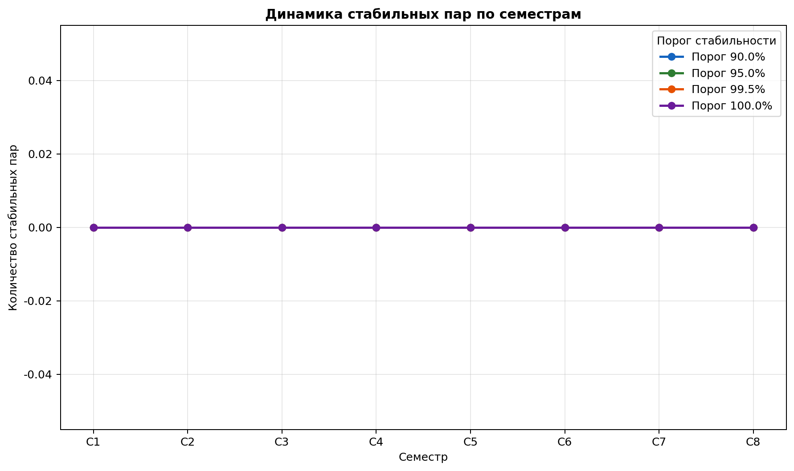
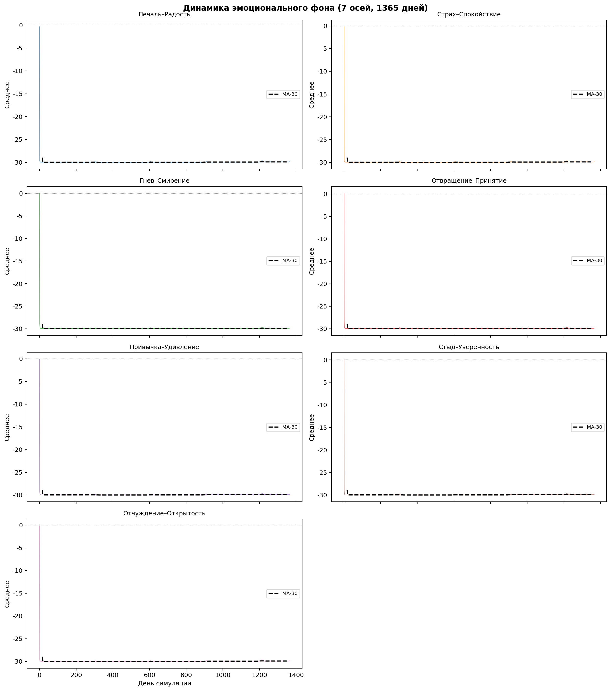
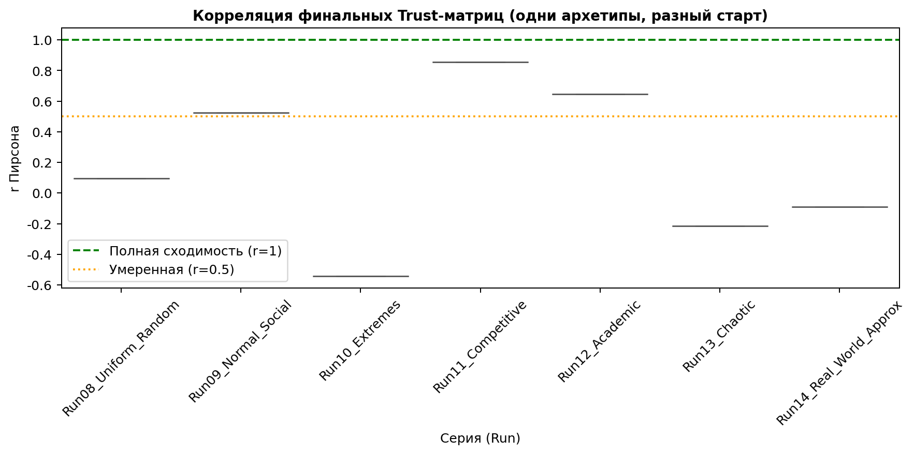
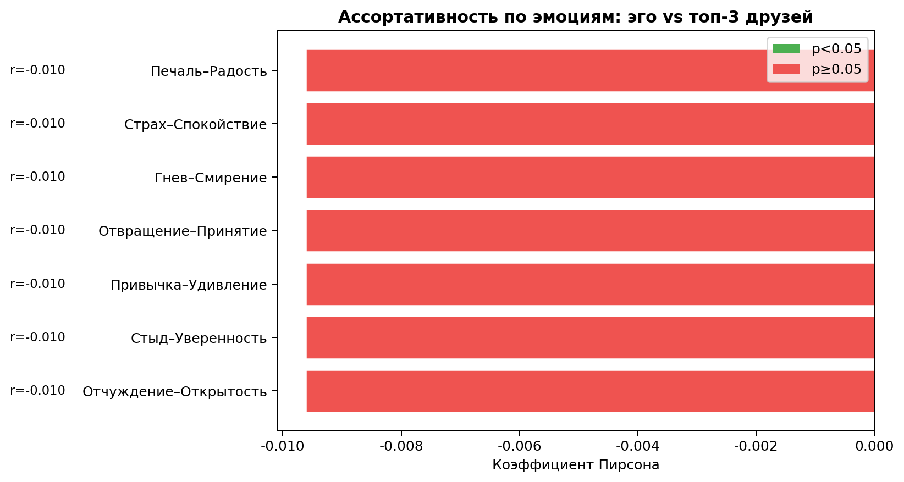
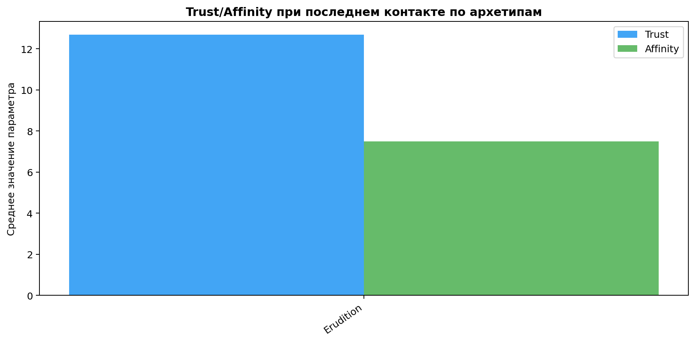
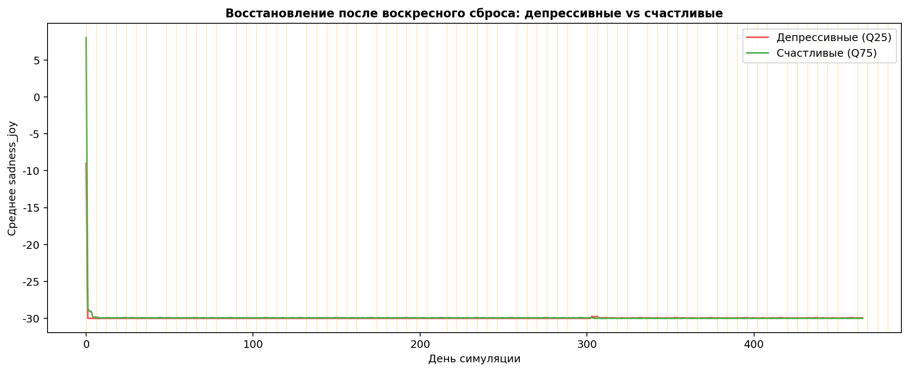
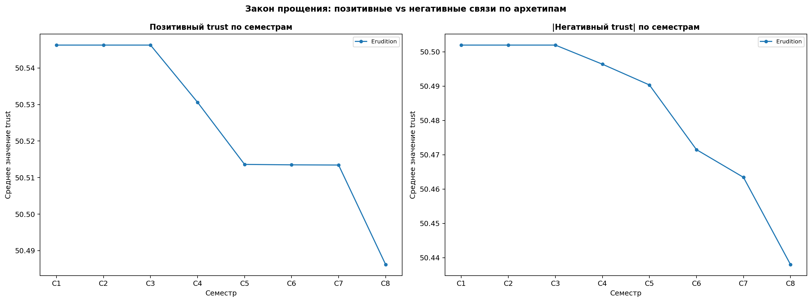
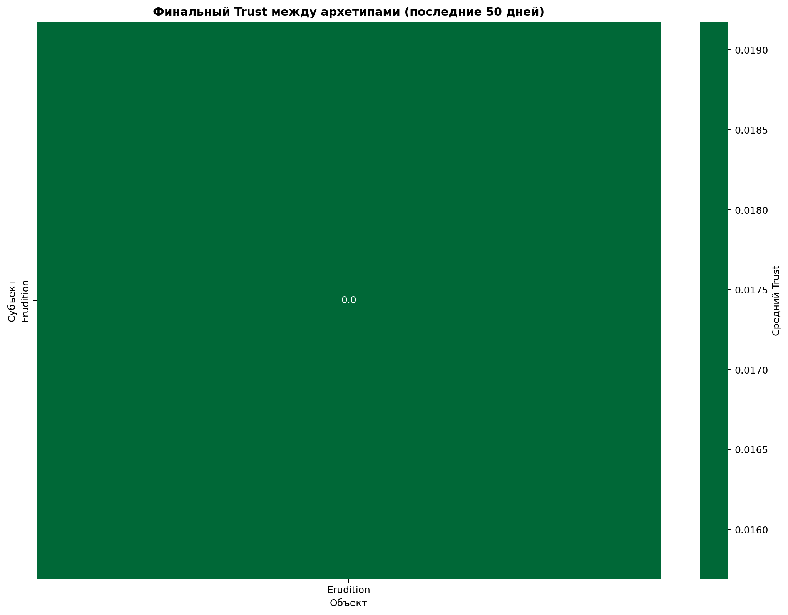
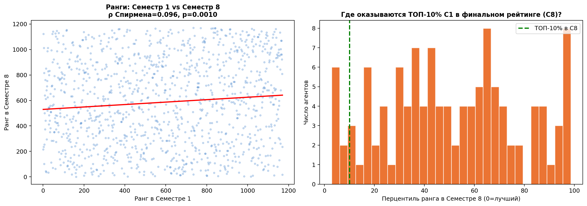

# Мега-отчёт: Многоагентная симуляция социально-эмоциональных отношений

**Дата генерации:** 2026-05-19 16:13:09
**База данных:** ClickHouse (localhost:8123)
**Объём данных:** 42 серии × 1365 дней — ~56 млрд строк отношений,
90 млн состояний агентов, 147 млн взаимодействий.
**Блоков анализа:** 18 (9 базовых + 9 новых гипотез)

---

## 1. Базовые метрики взаимодействий

*Суммарные контакты по сценариям*

*Мин/Среднее/Макс по группам и типу инициализации*

| group        | init_type   |        mean |     min |     max |
|:-------------|:------------|------------:|--------:|--------:|
| Гетерогенные | EMPTY       | 4.18783e+06 | 3635678 | 4738324 |
| Гетерогенные | MIXED       | 3.21126e+06 | 3008302 | 3392602 |
| Гетерогенные | RANDOM      | 3.083e+06   | 2848343 | 3284906 |
| Гомогенные   | EMPTY       | 4.26896e+06 | 3514578 | 4988631 |
| Гомогенные   | MIXED       | 3.25319e+06 | 2830748 | 3663899 |
| Гомогенные   | RANDOM      | 3.12717e+06 | 2719554 | 3475253 |

## 2. Глубокий анализ отказов

**Общий % отказов:** 28.03%

|   refusals |   successes |    failures |      total |
|-----------:|------------:|------------:|-----------:|
| 4.1464e+07 | 8.10415e+07 | 2.54143e+07 | 1.4792e+08 |

### 2a. По локациям

*Отказы по локациям*

### 2b. Кривая Лоренца

*Концентрация отказов*

- ТОП-10% «мизантропов» = **13.7%** всех отказов
- ТОП-50% = **63.6%**
- Агентов без единого отказа: **0** (0.0%)
- Джини: **0.189**

### 2c. По архетипам

*% отказов по архетипам*

| archetype    |   refusals |    total |   pct |
|:-------------|-----------:|---------:|------:|
| Nihility     |    8464127 | 12245228 | 69.12 |
| Elation      |    8598272 | 18139457 | 47.4  |
| Enigmata     |    6134838 | 16240527 | 37.77 |
| Remembrance  |     630245 |  2889997 | 21.81 |
| Hunt         |    4249067 | 19790858 | 21.47 |
| Erudition    |    4287428 | 22113819 | 19.39 |
| Trailblaze   |     527517 |  3029906 | 17.41 |
| Preservation |    2903584 | 19690650 | 14.75 |
| Harmony      |    1481583 | 18757165 |  7.9  |

## 3. Анализ реляционных порогов

*Реляционные пороги по сценариям*

| scenario_name                  | init_type   |   soft_pct |   hard_pct |
|:-------------------------------|:------------|-----------:|-----------:|
| Run01_Erudition_EMPTY          | EMPTY       |     0      |   0        |
| Run01_Erudition_MIXED          | MIXED       |    56.3832 |   0.235584 |
| Run01_Erudition_RANDOM         | RANDOM      |    76.5572 |   0.558978 |
| Run02_Enigmata_EMPTY           | EMPTY       |     0      |   0        |
| Run02_Enigmata_MIXED           | MIXED       |    55.359  |   0.293024 |
| Run02_Enigmata_RANDOM          | RANDOM      |    74.8771 |   0.287804 |
| Run03_Harmony_EMPTY            | EMPTY       |     0      |   0        |
| Run03_Harmony_MIXED            | MIXED       |    56.0464 |   0.651591 |
| Run03_Harmony_RANDOM           | RANDOM      |    73.8244 |   0.870812 |
| Run04_Hunt_EMPTY               | EMPTY       |     0      |   0        |
| Run04_Hunt_MIXED               | MIXED       |    55.7998 |   0.510304 |
| Run04_Hunt_RANDOM              | RANDOM      |    73.3874 |   0.653457 |
| Run05_Elation_EMPTY            | EMPTY       |     0      |   0        |
| Run05_Elation_MIXED            | MIXED       |    55.8524 |   0.407332 |
| Run05_Elation_RANDOM           | RANDOM      |    75.059  |   0.558937 |
| Run06_Preservation_EMPTY       | EMPTY       |     0      |   0        |
| Run06_Preservation_MIXED       | MIXED       |    55.6024 |   0.479922 |
| Run06_Preservation_RANDOM      | RANDOM      |    73.1673 |   0.642699 |
| Run07_Nihility_EMPTY           | EMPTY       |     0      |   0        |
| Run07_Nihility_MIXED           | MIXED       |    52.8907 |   0.285963 |
| Run07_Nihility_RANDOM          | RANDOM      |    70.2671 |   0.299674 |
| Run08_Uniform_Random_EMPTY     | EMPTY       |     0      |   0        |
| Run08_Uniform_Random_MIXED     | MIXED       |    54.7972 |   0.384658 |
| Run08_Uniform_Random_RANDOM    | RANDOM      |    75.0894 |   0.681717 |
| Run09_Normal_Social_EMPTY      | EMPTY       |     0      |   0        |
| Run09_Normal_Social_MIXED      | MIXED       |    56.4399 |   0.620219 |
| Run09_Normal_Social_RANDOM     | RANDOM      |    74.9761 |   0.627459 |
| Run10_Extremes_EMPTY           | EMPTY       |     0      |   0        |
| Run10_Extremes_MIXED           | MIXED       |    54.3101 |   0.285063 |
| Run10_Extremes_RANDOM          | RANDOM      |    74.1319 |   0.290381 |
| Run11_Competitive_EMPTY        | EMPTY       |     0      |   0        |
| Run11_Competitive_MIXED        | MIXED       |    55.6458 |   0.401013 |
| Run11_Competitive_RANDOM       | RANDOM      |    75.795  |   0.480439 |
| Run12_Academic_EMPTY           | EMPTY       |     0      |   0        |
| Run12_Academic_MIXED           | MIXED       |    56.8883 |   0.657546 |
| Run12_Academic_RANDOM          | RANDOM      |    74.7627 |   0.587703 |
| Run13_Chaotic_EMPTY            | EMPTY       |     0      |   0        |
| Run13_Chaotic_MIXED            | MIXED       |    56.6375 |   0.307619 |
| Run13_Chaotic_RANDOM           | RANDOM      |    74.477  |   0.344573 |
| Run14_Real_World_Approx_EMPTY  | EMPTY       |     0      |   0        |
| Run14_Real_World_Approx_MIXED  | MIXED       |    55.92   |   0.499844 |
| Run14_Real_World_Approx_RANDOM | RANDOM      |    72.2738 |   0.534876 |

## 4. Стабильные пары

*Динамика стабильных пар по семестрам*

**Порог 90.0%:**
|   Семестр |   Стаб.пар |
|----------:|-----------:|
|         1 |          0 |
|         2 |          0 |
|         3 |          0 |
|         4 |          0 |
|         5 |          0 |
|         6 |          0 |
|         7 |          0 |
|         8 |          0 |

**Порог 95.0%:**
|   Семестр |   Стаб.пар |
|----------:|-----------:|
|         1 |          0 |
|         2 |          0 |
|         3 |          0 |
|         4 |          0 |
|         5 |          0 |
|         6 |          0 |
|         7 |          0 |
|         8 |          0 |

**Порог 99.5%:**
|   Семестр |   Стаб.пар |
|----------:|-----------:|
|         1 |          0 |
|         2 |          0 |
|         3 |          0 |
|         4 |          0 |
|         5 |          0 |
|         6 |          0 |
|         7 |          0 |
|         8 |          0 |

**Порог 100.0%:**
|   Семестр |   Стаб.пар |
|----------:|-----------:|
|         1 |          0 |
|         2 |          0 |
|         3 |          0 |
|         4 |          0 |
|         5 |          0 |
|         6 |          0 |
|         7 |          0 |
|         8 |          0 |

## 5. Эмоциональный фон коллектива

*Временные ряды эмоционального фона (7 осей)*

*Тепловая карта эмоций во времени*

### Дрейф начало→конец

|                       |   Δ дрейф |
|:----------------------|----------:|
| Печаль–Радость        |  0.119295 |
| Страх–Спокойствие     |  0.120095 |
| Гнев–Смирение         |  0.12795  |
| Отвращение–Принятие   |  0.133405 |
| Привычка–Удивление    |  0.124364 |
| Стыд–Уверенность      |  0.127947 |
| Отчуждение–Открытость |  0.120518 |

## 6. Эффект «Выгорания лидера»

*Корреляция популярности с эмоциями лидеров*

- **Гнев–Смирение**: r=-0.017, p=0.4145 (❌ незначимо)

- **Страх–Спокойствие**: r=-0.017, p=0.4221 (❌ незначимо)

- **Печаль–Радость**: r=-0.017, p=0.4096 (❌ незначимо)

## 7. «Аттракторная сходимость» сетей

*Аттракторная сходимость: корреляция финальных матриц*

|       |    pearson |     cosine |
|:------|-----------:|-----------:|
| count |  7         |  7         |
| mean  |  0.181864  |  0.177955  |
| std   |  0.508255  |  0.386249  |
| min   | -0.542392  | -0.231115  |
| 25%   | -0.152485  | -0.0998233 |
| 50%   |  0.0943245 |  0.0983881 |
| 75%   |  0.585459  |  0.370166  |
| max   |  0.855167  |  0.837728  |

## 8. Эмоциональные пузыри (Emotional Contagion)

*Эмоциональная ассортативность пар*

|                       |           r |        p |   sig |
|:----------------------|------------:|---------:|------:|
| Печаль–Радость        | -0.00961517 | 0.700834 |     0 |
| Страх–Спокойствие     | -0.00961517 | 0.700834 |     0 |
| Гнев–Смирение         | -0.00961517 | 0.700834 |     0 |
| Отвращение–Принятие   | -0.00961517 | 0.700834 |     0 |
| Привычка–Удивление    | -0.00961517 | 0.700834 |     0 |
| Стыд–Уверенность      | -0.00961517 | 0.700834 |     0 |
| Отчуждение–Открытость | -0.00961517 | 0.700834 |     0 |

## 9. Скорость полураспада отношений

*Уровень отношений при «распаде» пары*

| archetype   |   trust_at_end |   affinity_at_end |   n_pairs |
|:------------|---------------:|------------------:|----------:|
| Erudition   |        12.6942 |           7.48867 |    229795 |

## 10. «Эффект воскресного сброса»

**Гипотеза:** Хронически депрессивные агенты восстанавливаются после воскресного δ-сдвига медленнее нейтральных.

*Воскресные сбросы и базовый уровень радости*

*Восстановление: депрессивные vs счастливые агенты*

## 11. «Закон прощения» — асимметрия скорости затухания

**Гипотеза:** Положительные связи затухают с 0.5·d, отрицательные с d. Деструктор (d=1.0) забывает обиды быстрее, чем Протектор (d=0.2) забывает дружбу.

*Асимметрия затухания: позитивные vs негативные связи*

| Архетип   |   Скорость угасания позитива |   Скорость угасания негатива |
|:----------|-----------------------------:|-----------------------------:|
| Erudition |                      -0.0083 |                      -0.0088 |

## 12. «Семестровая амнезия» — что переживает переинициализацию эмоций?

**Гипотеза:** Реляционные функции восстанавливают эмоциональный паттерн предыдущего семестра в первые 20–30 дней нового. Т.е. отношения являются «памятью» системы.

*Семестровая амнезия: накопленные отношения как эмоциональная память*

|   День от начала |   count |        mean |        std |   min |   25% |   50% |   75% |   max |
|-----------------:|--------:|------------:|-----------:|------:|------:|------:|------:|------:|
|                1 |      18 |  0          | 0          |  0    |     0 |     0 |    -0 |     0 |
|                7 |      21 |  0          | 0          |  0    |     0 |     0 |     0 |     0 |
|               14 |      21 |  0          | 0          |  0    |     0 |     0 |     0 |     0 |
|               30 |      18 | -0.00166667 | 0.00383482 | -0.01 |     0 |     0 |     0 |     0 |

## 13. «Ловушка логарифма» — бимодальность у Аналитика и Инноватора

**Гипотеза:** Архетипы с log(U) в формуле приоритета (Аналитик, Инноватор) избегают агентов с U≈0, создавая бимодальную структуру связей.

*Бимодальность utility у log-архетипов*

- Коэф. бимодальности (log-архетипы): **nan**
- Коэф. бимодальности (остальные):     **0.332**
- *Порог бимодальности: >0.555 (Sarle)*

## 14. «Нонконформист × Медиатор» — взрывная асимметрия

**Гипотеза:** Нонконформист часто отказывает Медиатору, но Медиатор накапливает высокий trust через редкие успешные контакты.

*Матрица отказов между архетипами*

*Матрица финального Trust между архетипами*

## 15. «Оппортунист в спортзале» — кластеризация сети GYM

**Гипотеза:** Оппортунист (τ=3.0) создаёт случайную сеть в GYM, а Конкурент (ε=3.0 в GYM) — плотные кластеры.

*networkx не установлен. Запустите: pip install networkx*

## 16. «Тёплые острова» — закрытые кластеры Рефлектора и Протектора

**Гипотеза:** Рефлектор (d=0.1) и Протектор (d=0.2) создают устойчивые закрытые кластеры с trust≥70, исключающие другие архетипы.

*networkx не установлен.*

## 17. Деструктор как «катализатор» распада пар

**Гипотеза:** Пары (A, B) распадаются значимо чаще, если агент A получил много отказов от Деструкторов.

*scikit-learn не установлен. Запустите: pip install scikit-learn*

## 18. «Эффект первого семестра» — path dependency

**Гипотеза:** Ранговая позиция агента по числу контактов в 1-м семестре является сильным предиктором его позиции в 8-м семестре (особенно в EMPTY-сценариях).

*Эффект первого семестра: ранговая корреляция С1 → С8*

- **ρ Спирмена:** 0.096
- **p-значение:** 0.001039
- ❌ Первый семестр не предсказывает финал
