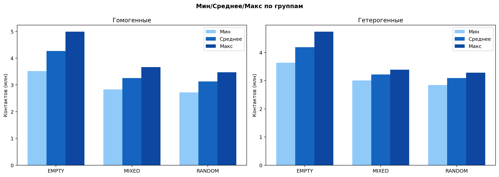
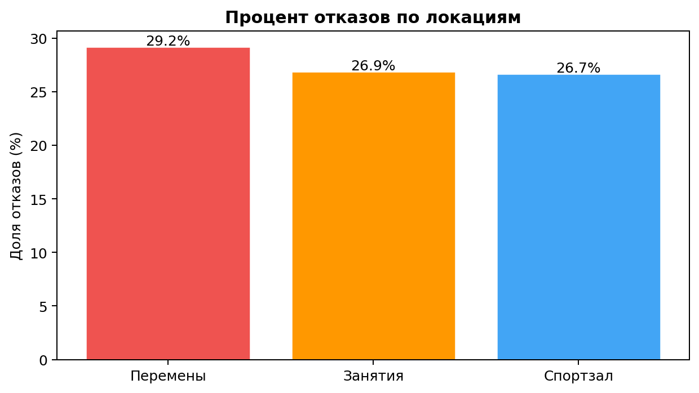
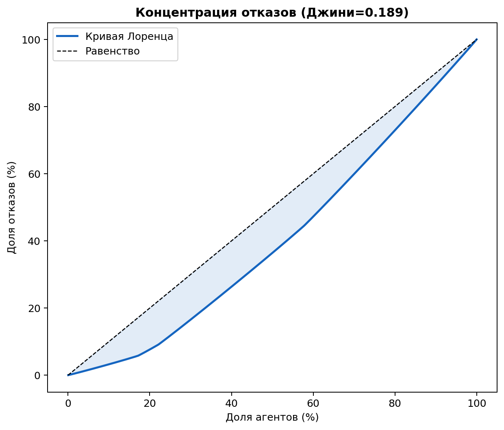
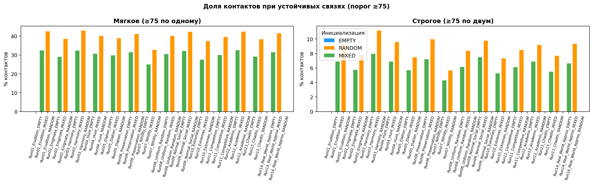
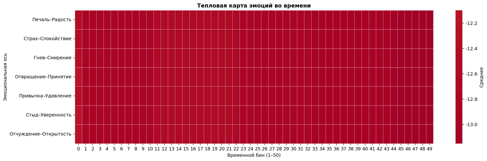
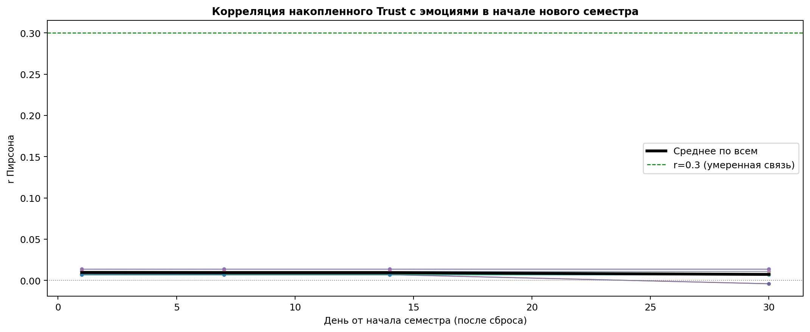
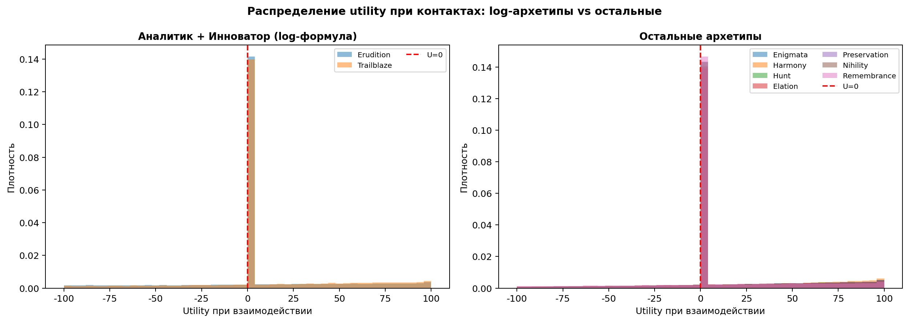
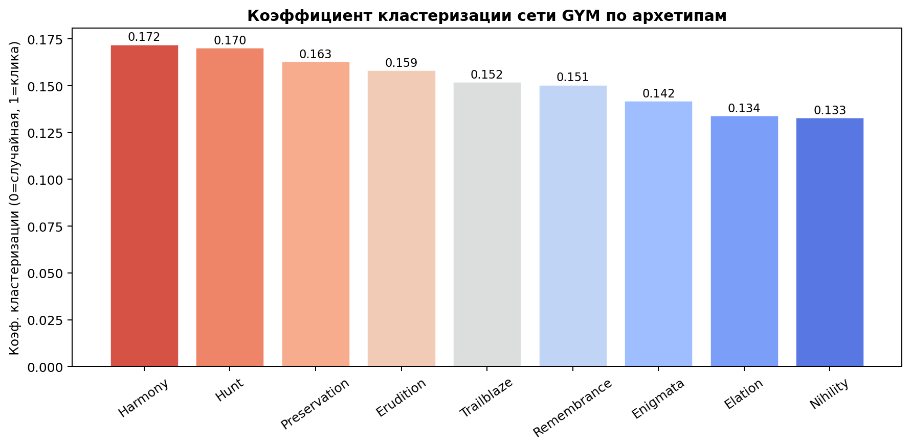
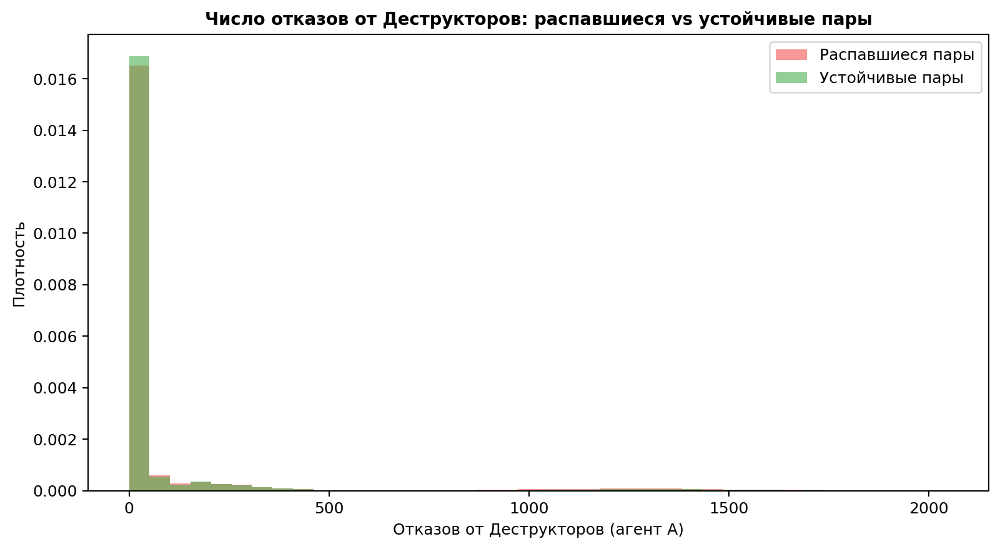

# Мега-отчёт: Многоагентная симуляция социально-эмоциональных отношений

**Дата генерации:** 2026-05-20 00:09:18
**База данных:** ClickHouse (localhost:8123)
**Объём данных:** 42 серии × 1365 дней — ~56 млрд строк отношений,
90 млн состояний агентов, 147 млн взаимодействий.
**Блоков анализа:** 18 (9 базовых + 9 новых гипотез)

---

## 1. Базовые метрики взаимодействий

*Суммарные контакты по сценариям*

*Мин/Среднее/Макс по группам и типу инициализации*

| group        | init_type   |        mean |     min |     max |
|:-------------|:------------|------------:|--------:|--------:|
| Гетерогенные | EMPTY       | 4.18783e+06 | 3635678 | 4738324 |
| Гетерогенные | MIXED       | 3.21126e+06 | 3008302 | 3392602 |
| Гетерогенные | RANDOM      | 3.083e+06   | 2848343 | 3284906 |
| Гомогенные   | EMPTY       | 4.26896e+06 | 3514578 | 4988631 |
| Гомогенные   | MIXED       | 3.25319e+06 | 2830748 | 3663899 |
| Гомогенные   | RANDOM      | 3.12717e+06 | 2719554 | 3475253 |

## 2. Глубокий анализ отказов

**Общий % отказов:** 28.03%

|   refusals |   successes |    failures |      total |
|-----------:|------------:|------------:|-----------:|
| 4.1464e+07 | 8.10415e+07 | 2.54143e+07 | 1.4792e+08 |

### 2a. По локациям

*Отказы по локациям*

### 2b. Кривая Лоренца

*Концентрация отказов*

- ТОП-10% «мизантропов» = **13.7%** всех отказов
- ТОП-50% = **63.6%**
- Агентов без единого отказа: **0** (0.0%)
- Джини: **0.189**

### 2c. По архетипам

*% отказов по архетипам*

| archetype    |   refusals |    total |   pct |
|:-------------|-----------:|---------:|------:|
| Nihility     |    8464127 | 12245228 | 69.12 |
| Elation      |    8598272 | 18139457 | 47.4  |
| Enigmata     |    6134838 | 16240527 | 37.77 |
| Remembrance  |     630245 |  2889997 | 21.81 |
| Hunt         |    4249067 | 19790858 | 21.47 |
| Erudition    |    4287428 | 22113819 | 19.39 |
| Trailblaze   |     527517 |  3029906 | 17.41 |
| Preservation |    2903584 | 19690650 | 14.75 |
| Harmony      |    1481583 | 18757165 |  7.9  |

## 3. Анализ реляционных порогов

*Реляционные пороги по сценариям*

| scenario_name                  | init_type   |   soft_pct |   hard_pct |
|:-------------------------------|:------------|-----------:|-----------:|
| Run01_Erudition_EMPTY          | EMPTY       |     0      |    0       |
| Run01_Erudition_MIXED          | MIXED       |    32.6792 |    6.94901 |
| Run01_Erudition_RANDOM         | RANDOM      |    42.7668 |    9.22794 |
| Run02_Enigmata_EMPTY           | EMPTY       |     0      |    0       |
| Run02_Enigmata_MIXED           | MIXED       |    29.1948 |    5.80619 |
| Run02_Enigmata_RANDOM          | RANDOM      |    38.7551 |    7.82058 |
| Run03_Harmony_EMPTY            | EMPTY       |     0      |    0       |
| Run03_Harmony_MIXED            | MIXED       |    32.5802 |    7.9952  |
| Run03_Harmony_RANDOM           | RANDOM      |    43.2156 |   11.2207  |
| Run04_Hunt_EMPTY               | EMPTY       |     0      |    0       |
| Run04_Hunt_MIXED               | MIXED       |    30.8902 |    6.93572 |
| Run04_Hunt_RANDOM              | RANDOM      |    40.2957 |    9.60454 |
| Run05_Elation_EMPTY            | EMPTY       |     0      |    0       |
| Run05_Elation_MIXED            | MIXED       |    29.9656 |    5.73069 |
| Run05_Elation_RANDOM           | RANDOM      |    39.1403 |    7.52416 |
| Run06_Preservation_EMPTY       | EMPTY       |     0      |    0       |
| Run06_Preservation_MIXED       | MIXED       |    31.6287 |    7.25034 |
| Run06_Preservation_RANDOM      | RANDOM      |    41.347  |   10.0055  |
| Run07_Nihility_EMPTY           | EMPTY       |     0      |    0       |
| Run07_Nihility_MIXED           | MIXED       |    25.1386 |    4.3471  |
| Run07_Nihility_RANDOM          | RANDOM      |    32.8867 |    5.70263 |
| Run08_Uniform_Random_EMPTY     | EMPTY       |     0      |    0       |
| Run08_Uniform_Random_MIXED     | MIXED       |    30.6477 |    6.19663 |
| Run08_Uniform_Random_RANDOM    | RANDOM      |    40.3426 |    8.4155  |
| Run09_Normal_Social_EMPTY      | EMPTY       |     0      |    0       |
| Run09_Normal_Social_MIXED      | MIXED       |    32.3071 |    7.52954 |
| Run09_Normal_Social_RANDOM     | RANDOM      |    42.5441 |    9.81992 |
| Run10_Extremes_EMPTY           | EMPTY       |     0      |    0       |
| Run10_Extremes_MIXED           | MIXED       |    27.6934 |    5.32384 |
| Run10_Extremes_RANDOM          | RANDOM      |    37.5604 |    7.39337 |
| Run11_Competitive_EMPTY        | EMPTY       |     0      |    0       |
| Run11_Competitive_MIXED        | MIXED       |    30.1875 |    6.1564  |
| Run11_Competitive_RANDOM       | RANDOM      |    39.7888 |    8.53207 |
| Run12_Academic_EMPTY           | EMPTY       |     0      |    0       |
| Run12_Academic_MIXED           | MIXED       |    32.7805 |    6.92794 |
| Run12_Academic_RANDOM          | RANDOM      |    42.623  |    9.20546 |
| Run13_Chaotic_EMPTY            | EMPTY       |     0      |    0       |
| Run13_Chaotic_MIXED            | MIXED       |    29.3587 |    5.53968 |
| Run13_Chaotic_RANDOM           | RANDOM      |    38.5899 |    7.7404  |
| Run14_Real_World_Approx_EMPTY  | EMPTY       |     0      |    0       |
| Run14_Real_World_Approx_MIXED  | MIXED       |    31.5979 |    6.68526 |
| Run14_Real_World_Approx_RANDOM | RANDOM      |    41.7517 |    9.37813 |

## 4. Стабильные пары

**Описание:** Оценка распределения стабильности связей (по индексу Жаккара) по всем 42 университетам в динамике по семестрам.

*Динамика распределения стабильных пар по семестрам*

### Распределение стабильных пар (среднее на один университет):
| Семестр   |    0-10% |   10-20% |   20-30% |   30-40% |   40-50% |   50-60% |   60-70% |   70-80% |   80-90% |   90-100% |
|:----------|---------:|---------:|---------:|---------:|---------:|---------:|---------:|---------:|---------:|----------:|
| С1        | 553658   |    63.88 |     0.02 |        0 |        0 |        0 |        0 |        0 |        0 |         0 |
| С2        | 586755   |    10.1  |     0    |        0 |        0 |        0 |        0 |        0 |        0 |         0 |
| С3        | 598271   |    35.76 |     0    |        0 |        0 |        0 |        0 |        0 |        0 |         0 |
| С4        | 583885   |    22.26 |     0    |        0 |        0 |        0 |        0 |        0 |        0 |         0 |
| С5        | 500034   |    53.71 |     0.02 |        0 |        0 |        0 |        0 |        0 |        0 |         0 |
| С6        | 588704   |    43.71 |     0.14 |        0 |        0 |        0 |        0 |        0 |        0 |         0 |
| С7        | 564864   |    37.86 |     0.05 |        0 |        0 |        0 |        0 |        0 |        0 |         0 |
| С8        |  75707.1 |   198.95 |     2.86 |        0 |        0 |        0 |        0 |        0 |        0 |         0 |

## 5. Эмоциональный фон коллектива

*Временные ряды эмоционального фона (7 осей)*

*Тепловая карта эмоций во времени*

### Дрейф начало→конец

|                       |   Δ дрейф |
|:----------------------|----------:|
| Печаль–Радость        |  0.340827 |
| Страх–Спокойствие     |  0.338056 |
| Гнев–Смирение         |  0.349991 |
| Отвращение–Принятие   |  0.377161 |
| Привычка–Удивление    |  0.357553 |
| Стыд–Уверенность      |  0.378833 |
| Отчуждение–Открытость |  0.366805 |

## 6. Эффект «Выгорания лидера»

*Корреляция популярности с эмоциями лидеров*

- **Гнев–Смирение**: r=0.037, p=0.0000 (✅ значимо)

- **Страх–Спокойствие**: r=0.037, p=0.0000 (✅ значимо)

- **Печаль–Радость**: r=0.037, p=0.0000 (✅ значимо)

## 7. «Аттракторная сходимость» сетей

*Аттракторная сходимость: корреляция финальных матриц*

|       |    pearson |     cosine |
|:------|-----------:|-----------:|
| count |  7         |  7         |
| mean  |  0.181864  |  0.177955  |
| std   |  0.508255  |  0.386249  |
| min   | -0.542392  | -0.231115  |
| 25%   | -0.152485  | -0.0998233 |
| 50%   |  0.0943245 |  0.0983881 |
| 75%   |  0.585459  |  0.370166  |
| max   |  0.855167  |  0.837728  |

## 8. Эмоциональные пузыри (Emotional Contagion)

*Эмоциональная ассортативность пар*

|                       |        r |   p |   sig |
|:----------------------|---------:|----:|------:|
| Печаль–Радость        | 0.784414 |   0 |     1 |
| Страх–Спокойствие     | 0.784414 |   0 |     1 |
| Гнев–Смирение         | 0.784414 |   0 |     1 |
| Отвращение–Принятие   | 0.784414 |   0 |     1 |
| Привычка–Удивление    | 0.784414 |   0 |     1 |
| Стыд–Уверенность      | 0.784414 |   0 |     1 |
| Отчуждение–Открытость | 0.784414 |   0 |     1 |

## 9. Скорость полураспада отношений

*Уровень отношений при «распаде» пары*

| archetype    |   sum_trust |   sum_affinity |   n_pairs |   trust_at_end |   affinity_at_end |
|:-------------|------------:|---------------:|----------:|---------------:|------------------:|
| Nihility     |     2090193 |        1846813 |   1090318 |        1.91705 |           1.69383 |
| Enigmata     |     3359825 |        6754569 |   1339289 |        2.50866 |           5.0434  |
| Harmony      |     6076740 |        7369714 |   1353551 |        4.48948 |           5.44473 |
| Hunt         |     8254369 |        8222452 |   1456880 |        5.66579 |           5.64388 |
| Preservation |     8774728 |        7518419 |   1471938 |        5.96134 |           5.10784 |
| Elation      |     9578673 |        2089988 |   1555191 |        6.15916 |           1.34388 |
| Trailblaze   |     1581485 |        1254540 |    232004 |        6.81663 |           5.40741 |
| Remembrance  |     1839219 |         918218 |    231258 |        7.9531  |           3.97054 |
| Erudition    |    15442116 |        9442424 |   1756732 |        8.79025 |           5.37499 |

## 10. «Эффект воскресного сброса»

**Гипотеза:** Хронически депрессивные агенты восстанавливаются после воскресного δ-сдвига медленнее нейтральных.

*Воскресные сбросы и базовый уровень радости*

*Восстановление: депрессивные vs счастливые агенты*

## 11. «Закон прощения» — асимметрия скорости затухания

**Гипотеза:** Положительные связи затухают с 0.5·d, отрицательные с d. Деструктор (d=1.0) забывает обиды быстрее, чем Протектор (d=0.2) забывает дружбу.

*Асимметрия затухания: позитивные vs негативные связи*

| Архетип      |   Скорость угасания позитива |   Скорость угасания негатива |
|:-------------|-----------------------------:|-----------------------------:|
| Elation      |                       0.0027 |                      -0.0013 |
| Enigmata     |                       0.0017 |                      -0.0026 |
| Erudition    |                      -0.0055 |                      -0.0024 |
| Harmony      |                       0.003  |                       0.0021 |
| Hunt         |                       0.0123 |                      -0.0057 |
| Nihility     |                       0.0008 |                      -0.0059 |
| Preservation |                       0.003  |                       0.012  |
| Remembrance  |                       0.0021 |                      -0.0297 |
| Trailblaze   |                       0.0007 |                       0.0044 |

## 12. «Семестровая амнезия» — что переживает переинициализацию эмоций?

**Гипотеза:** Реляционные функции восстанавливают эмоциональный паттерн предыдущего семестра в первые 20–30 дней нового. Т.е. отношения являются «памятью» системы.

*Семестровая амнезия: накопленные отношения как эмоциональная память*

|   День от начала |   count |       mean |        std |    min |   25% |    50% |   75% |   max |
|-----------------:|--------:|-----------:|-----------:|-------:|------:|-------:|------:|------:|
|                1 |      18 | 0.00966667 | 0.00263461 |  0.007 | 0.007 | 0.0095 | 0.011 | 0.014 |
|                7 |      21 | 0.00942857 | 0.00250143 |  0.007 | 0.007 | 0.008  | 0.011 | 0.014 |
|               14 |      21 | 0.00942857 | 0.00250143 |  0.007 | 0.007 | 0.008  | 0.011 | 0.014 |
|               30 |      18 | 0.00733333 | 0.00574968 | -0.004 | 0.007 | 0.008  | 0.011 | 0.014 |

## 13. «Ловушка логарифма» — бимодальность у Аналитика и Инноватора

**Гипотеза:** Архетипы с log(U) в формуле приоритета (Аналитик, Инноватор) избегают агентов с U≈0, создавая бимодальную структуру связей.

*Бимодальность utility у log-архетипов*

- Коэф. бимодальности (log-архетипы): **0.253**
- Коэф. бимодальности (остальные):     **0.299**
- *Порог бимодальности: >0.555 (Sarle)*

## 14. «Нонконформист × Медиатор» — взрывная асимметрия

**Гипотеза:** Нонконформист часто отказывает Медиатору, но Медиатор накапливает высокий trust через редкие успешные контакты.

*Матрица отказов между архетипами*

*Матрица финального Trust между архетипами*

## 15. «Оппортунист в спортзале» — кластеризация сети GYM

**Гипотеза:** Оппортунист (τ=3.0) создаёт случайную сеть в GYM, а Конкурент (ε=3.0 в GYM) — плотные кластеры.

*Кластеризация сети в спортзале по архетипам*

| Архетип      |   Кластеризация |   Средняя степень |   Вершин |
|:-------------|----------------:|------------------:|---------:|
| Harmony      |          0.1722 |            112.27 |     1619 |
| Hunt         |          0.1704 |            110.04 |     1618 |
| Preservation |          0.1631 |             96.91 |     1619 |
| Erudition    |          0.1585 |            102.9  |     1619 |
| Trailblaze   |          0.1522 |             51.35 |     1618 |
| Remembrance  |          0.1506 |             48.87 |     1617 |
| Enigmata     |          0.142  |             78.56 |     1610 |
| Elation      |          0.1341 |            102.04 |     1619 |
| Nihility     |          0.1331 |             65.86 |     1605 |

## 16. «Тёплые острова» — закрытые кластеры Рефлектора и Протектора

**Гипотеза:** Рефлектор (d=0.1) и Протектор (d=0.2) создают устойчивые закрытые кластеры с trust≥70, исключающие другие архетипы.

*Тёплые острова: распределение и доминирующие архетипы*

**Всего кластеров (≥3 агентов): 28**

| run_id                               |   Размер кластера | Доминирующий архетип   |   Доля доминанта (%) | Все архетипы                                                                                                                                         |
|:-------------------------------------|------------------:|:-----------------------|---------------------:|:-----------------------------------------------------------------------------------------------------------------------------------------------------|
| 46a8c629-384a-4ea5-a5ca-9e6832f9e24d |               476 | Enigmata               |                100   | {'Enigmata': 476}                                                                                                                                    |
| 98359cab-fc1f-4c7a-8d39-151987fe62b4 |               465 | Erudition              |                100   | {'Erudition': 465}                                                                                                                                   |
| 13ba0fa9-36b9-499b-beef-b9d87b2f0cf2 |               458 | Hunt                   |                 66.2 | {'Enigmata': 155, 'Hunt': 303}                                                                                                                       |
| 2c4e64db-89ed-4afe-b69e-e7047dd42ad1 |               456 | Elation                |                100   | {'Elation': 456}                                                                                                                                     |
| 7763597b-0f8c-4329-9c28-5261578dad12 |               453 | Erudition              |                 77.9 | {'Erudition': 353, 'Remembrance': 100}                                                                                                               |
| db273b6f-a0d0-41c8-8a3b-502f86c6d3ac |               453 | Erudition              |                 35.1 | {'Erudition': 159, 'Harmony': 110, 'Preservation': 83, 'Enigmata': 18, 'Hunt': 71, 'Nihility': 12}                                                   |
| 4c8c3f82-ac1a-44df-b113-84d8978919ac |               452 | Preservation           |                100   | {'Preservation': 452}                                                                                                                                |
| 0456647a-65ba-42b9-a275-1739ca33927b |               444 | Harmony                |                100   | {'Harmony': 444}                                                                                                                                     |
| e611eaab-7112-4c47-8d39-9bb653cf5b31 |               441 | Nihility               |                 34.2 | {'Elation': 140, 'Preservation': 150, 'Nihility': 151}                                                                                               |
| 2c36dbf0-050f-4ce9-b8c7-ea15023b6133 |               431 | Harmony                |                 40.8 | {'Harmony': 176, 'Preservation': 122, 'Trailblaze': 76, 'Erudition': 57}                                                                             |
| a764184e-96d5-4540-a21b-9ea5c68936e0 |               427 | Trailblaze             |                 12.6 | {'Erudition': 44, 'Remembrance': 47, 'Hunt': 48, 'Elation': 43, 'Trailblaze': 54, 'Enigmata': 45, 'Harmony': 43, 'Nihility': 50, 'Preservation': 53} |
| 14bb405b-53e0-4201-a6e4-068226500bc3 |               422 | Elation                |                 65.6 | {'Elation': 277, 'Enigmata': 145}                                                                                                                    |
| 6a5bc084-bf09-49ff-82d4-46039731854e |               415 | Nihility               |                100   | {'Nihility': 415}                                                                                                                                    |
| b582b691-afc3-4bcd-9bdf-31ab78acbb16 |               410 | Hunt                   |                100   | {'Hunt': 410}                                                                                                                                        |
| 363b5037-ea96-43c0-98e2-623470228612 |               357 | Enigmata               |                 13.4 | {'Preservation': 43, 'Nihility': 38, 'Remembrance': 42, 'Elation': 43, 'Hunt': 34, 'Enigmata': 48, 'Harmony': 25, 'Trailblaze': 40, 'Erudition': 44} |

## 17. Деструктор как «катализатор» распада пар

**Гипотеза:** Пары (A, B) распадаются значимо чаще, если агент A получил много отказов от Деструкторов.

*Деструктор как катализатор распада пар*

- Коэф. логит-регрессии (стандартизованный): **0.058**
- Odds Ratio: **1.060**
- ✅ Деструкторы действительно ускоряют распад

## 18. «Эффект первого семестра» — path dependency

**Гипотеза:** Ранговая позиция агента по числу контактов в 1-м семестре является сильным предиктором его позиции в 8-м семестре (особенно в EMPTY-сценариях).

*Эффект первого семестра: ранговая корреляция С1 → С8*

- **ρ Спирмена:** -0.000
- **p-значение:** 0.983163
- ❌ Первый семестр не предсказывает финал
