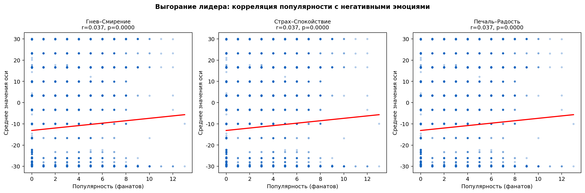
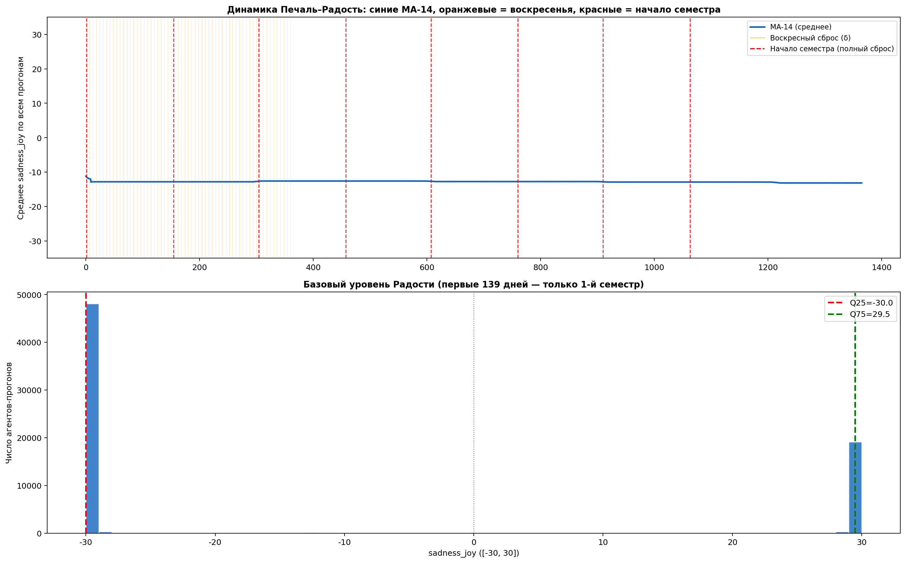
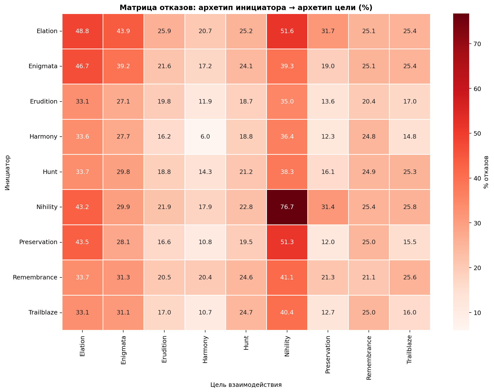
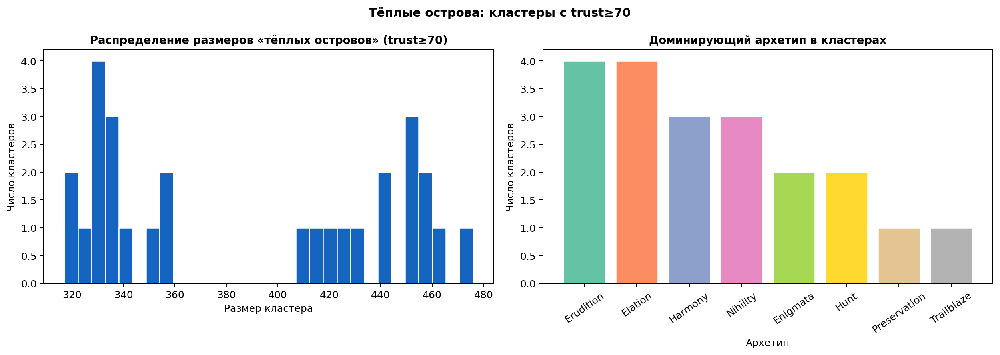

# Мега-отчёт: Многоагентная симуляция социально-эмоциональных отношений

**Дата генерации:** 2026-05-20 14:37:16
**База данных:** ClickHouse (localhost:8123)
**Объём данных:** 42 серии × 1365 дней — ~56 млрд строк отношений,
90 млн состояний агентов, 147 млн взаимодействий.
**Блоков анализа:** 18 (9 базовых + 9 новых гипотез)

---

## 1. Базовые метрики взаимодействий

*Суммарные контакты по сценариям*

*Мин/Среднее/Макс по группам и типу инициализации*

| group        | init_type   |        mean |     min |     max |
|:-------------|:------------|------------:|--------:|--------:|
| Гетерогенные | EMPTY       | 4.18783e+06 | 3635678 | 4738324 |
| Гетерогенные | MIXED       | 3.2221e+06  | 3008302 | 3392602 |
| Гетерогенные | RANDOM      | 3.0909e+06  | 2848343 | 3284906 |
| Гомогенные   | EMPTY       | 4.26896e+06 | 3514578 | 4988631 |
| Гомогенные   | MIXED       | 3.25319e+06 | 2830748 | 3663899 |
| Гомогенные   | RANDOM      | 3.12717e+06 | 2719554 | 3475253 |

*Нелинейных сценариев не обнаружено (в именах нет NL/NONLINEAR).*

## 2. Глубокий анализ отказов

**Общий % отказов:** 28.03%

|   refusals |   successes |    failures |      total |
|-----------:|------------:|------------:|-----------:|
| 4.1464e+07 | 8.10415e+07 | 2.54143e+07 | 1.4792e+08 |

### 2a. По локациям

*Отказы по локациям*

### 2b. Кривая Лоренца

*Концентрация отказов*

- ТОП-10% «мизантропов» = **13.7%** всех отказов
- ТОП-50% = **63.6%**
- Агентов без единого отказа: **0** (0.0%)
- Джини: **0.189**

### 2c. По архетипам

*% отказов по архетипам*

| archetype    |   refusals |    total |   pct |
|:-------------|-----------:|---------:|------:|
| Nihility     |    8464127 | 12245228 | 69.12 |
| Elation      |    8598272 | 18139457 | 47.4  |
| Enigmata     |    6134838 | 16240527 | 37.77 |
| Remembrance  |     630245 |  2889997 | 21.81 |
| Hunt         |    4249067 | 19790858 | 21.47 |
| Erudition    |    4287428 | 22113819 | 19.39 |
| Trailblaze   |     527517 |  3029906 | 17.41 |
| Preservation |    2903584 | 19690650 | 14.75 |
| Harmony      |    1481583 | 18757165 |  7.9  |

## 3. Анализ реляционных порогов

*Реляционные пороги по сценариям*

| scenario_name                  | init_type   |   soft_pct |   hard_pct |
|:-------------------------------|:------------|-----------:|-----------:|
| Run01_Erudition_EMPTY          | EMPTY       |    0       |   0        |
| Run01_Erudition_MIXED          | MIXED       |    9.11525 |   0.346842 |
| Run01_Erudition_RANDOM         | RANDOM      |   12.5167  |   0.569934 |
| Run02_Enigmata_EMPTY           | EMPTY       |    0       |   0        |
| Run02_Enigmata_MIXED           | MIXED       |    7.25222 |   0.255182 |
| Run02_Enigmata_RANDOM          | RANDOM      |    9.84885 |   0.383553 |
| Run03_Harmony_EMPTY            | EMPTY       |    0       |   0        |
| Run03_Harmony_MIXED            | MIXED       |    9.6422  |   0.557684 |
| Run03_Harmony_RANDOM           | RANDOM      |   13.3632  |   0.755828 |
| Run04_Hunt_EMPTY               | EMPTY       |    0       |   0        |
| Run04_Hunt_MIXED               | MIXED       |    8.665   |   0.391082 |
| Run04_Hunt_RANDOM              | RANDOM      |   11.6502  |   0.629666 |
| Run05_Elation_EMPTY            | EMPTY       |    0       |   0        |
| Run05_Elation_MIXED            | MIXED       |    8.11875 |   0.295227 |
| Run05_Elation_RANDOM           | RANDOM      |   10.4499  |   0.476508 |
| Run06_Preservation_EMPTY       | EMPTY       |    0       |   0        |
| Run06_Preservation_MIXED       | MIXED       |    8.94085 |   0.472387 |
| Run06_Preservation_RANDOM      | RANDOM      |   12.0177  |   0.58239  |
| Run07_Nihility_EMPTY           | EMPTY       |    0       |   0        |
| Run07_Nihility_MIXED           | MIXED       |    6.14439 |   0.258676 |
| Run07_Nihility_RANDOM          | RANDOM      |    7.80815 |   0.288923 |
| Run08_Uniform_Random_EMPTY     | EMPTY       |    0       |   0        |
| Run08_Uniform_Random_MIXED     | RANDOM      |    8.45633 |   0.408636 |
| Run08_Uniform_Random_RANDOM    | RANDOM      |   11.4765  |   0.533575 |
| Run09_Normal_Social_EMPTY      | EMPTY       |    0       |   0        |
| Run09_Normal_Social_MIXED      | MIXED       |    9.3565  |   0.550052 |
| Run09_Normal_Social_RANDOM     | RANDOM      |   12.4398  |   0.617996 |
| Run10_Extremes_EMPTY           | EMPTY       |    0       |   0        |
| Run10_Extremes_MIXED           | MIXED       |    7.10685 |   0.274068 |
| Run10_Extremes_RANDOM          | RANDOM      |    9.63318 |   0.41242  |
| Run11_Competitive_EMPTY        | EMPTY       |    0       |   0        |
| Run11_Competitive_MIXED        | MIXED       |    7.93129 |   0.345833 |
| Run11_Competitive_RANDOM       | RANDOM      |   10.7577  |   0.57554  |
| Run12_Academic_EMPTY           | EMPTY       |    0       |   0        |
| Run12_Academic_MIXED           | MIXED       |    9.45481 |   0.485015 |
| Run12_Academic_RANDOM          | RANDOM      |   11.932   |   0.594596 |
| Run13_Chaotic_EMPTY            | EMPTY       |    0       |   0        |
| Run13_Chaotic_MIXED            | MIXED       |    7.37778 |   0.307937 |
| Run13_Chaotic_RANDOM           | RANDOM      |   10.2345  |   0.356779 |
| Run14_Real_World_Approx_EMPTY  | EMPTY       |    0       |   0        |
| Run14_Real_World_Approx_MIXED  | MIXED       |    8.85734 |   0.507099 |
| Run14_Real_World_Approx_RANDOM | RANDOM      |   11.7323  |   0.581155 |

## 4. Стабильные пары

**Логика:** Для упорядоченной пары (A→B) вычисляется доля контактов агента A с агентом B от всех контактов A за семестр: `n_AB / N_A`. Пара считается стабильной, если эта доля ≥ порогу.

*Динамика стабильных пар по семестрам (n_AB/N_A)*

**Порог 90.0%:**
|   Семестр |   Стаб.пар |
|----------:|-----------:|
|         1 |          0 |
|         2 |          1 |
|         3 |          0 |
|         4 |          6 |
|         5 |          0 |
|         6 |         28 |
|         7 |          0 |
|         8 |          0 |

**Порог 95.0%:**
|   Семестр |   Стаб.пар |
|----------:|-----------:|
|         1 |          0 |
|         2 |          1 |
|         3 |          0 |
|         4 |          6 |
|         5 |          0 |
|         6 |         28 |
|         7 |          0 |
|         8 |          0 |

**Порог 99.5%:**
|   Семестр |   Стаб.пар |
|----------:|-----------:|
|         1 |          0 |
|         2 |          1 |
|         3 |          0 |
|         4 |          6 |
|         5 |          0 |
|         6 |         28 |
|         7 |          0 |
|         8 |          0 |

**Порог 100.0%:**
|   Семестр |   Стаб.пар |
|----------:|-----------:|
|         1 |          0 |
|         2 |          1 |
|         3 |          0 |
|         4 |          6 |
|         5 |          0 |
|         6 |         28 |
|         7 |          0 |
|         8 |          0 |

## 5. Эмоциональный фон коллектива

*Эмоциональный фон: среднее ± std по всем 42 прогонам*

*Тепловая карта эмоций во времени*

### Дрейф начало→конец

*Примечание: из-за семестровых сбросов эмоций средние значения осциллируют. Дрейф = |avg(конец) − avg(начало)| без учёта сбросов.*

|                       |   Δ дрейф |
|:----------------------|----------:|
| Печаль–Радость        |  0.468384 |
| Страх–Спокойствие     |  0.462887 |
| Гнев–Смирение         |  0.48669  |
| Отвращение–Принятие   |  0.540602 |
| Привычка–Удивление    |  0.501729 |
| Стыд–Уверенность      |  0.543963 |
| Отчуждение–Открытость |  0.519664 |

## 6. Эффект «Выгорания лидера»

*Корреляция популярности с эмоциями лидеров*

- **Гнев–Смирение**: r=0.037, p=0.0000 (✅ значимо)

- **Страх–Спокойствие**: r=0.037, p=0.0000 (✅ значимо)

- **Печаль–Радость**: r=0.037, p=0.0000 (✅ значимо)

## 7. «Аттракторная сходимость» сетей

*Аттракторная сходимость: корреляция финальных матриц*

|       |    pearson |     cosine |
|:------|-----------:|-----------:|
| count |  7         |  7         |
| mean  |  0.181864  |  0.177955  |
| std   |  0.508255  |  0.386249  |
| min   | -0.542392  | -0.231115  |
| 25%   | -0.152485  | -0.0998233 |
| 50%   |  0.0943245 |  0.0983881 |
| 75%   |  0.585459  |  0.370166  |
| max   |  0.855167  |  0.837728  |

## 8. Эмоциональные пузыри (Emotional Contagion)

*Эмоциональная ассортативность пар*

|                       |      r |   p |   sig |
|:----------------------|-------:|----:|------:|
| Печаль–Радость        | 0.7875 |   0 |     1 |
| Страх–Спокойствие     | 0.7875 |   0 |     1 |
| Гнев–Смирение         | 0.7875 |   0 |     1 |
| Отвращение–Принятие   | 0.7875 |   0 |     1 |
| Привычка–Удивление    | 0.7875 |   0 |     1 |
| Стыд–Уверенность      | 0.7875 |   0 |     1 |
| Отчуждение–Открытость | 0.7875 |   0 |     1 |

## 9. Скорость полураспада отношений

*Уровень отношений при «распаде» пары*

| archetype    |   sum_trust |   sum_affinity |   n_pairs |   trust_at_end |   affinity_at_end |
|:-------------|------------:|---------------:|----------:|---------------:|------------------:|
| Nihility     |     2090193 |        1846813 |   1090318 |        1.91705 |           1.69383 |
| Enigmata     |     3359825 |        6754569 |   1339289 |        2.50866 |           5.0434  |
| Harmony      |     6076740 |        7369714 |   1353551 |        4.48948 |           5.44473 |
| Hunt         |     8254369 |        8222452 |   1456880 |        5.66579 |           5.64388 |
| Preservation |     8774728 |        7518419 |   1471938 |        5.96134 |           5.10784 |
| Elation      |     9578673 |        2089988 |   1555191 |        6.15916 |           1.34388 |
| Trailblaze   |     1581485 |        1254540 |    232004 |        6.81663 |           5.40741 |
| Remembrance  |     1839219 |         918218 |    231258 |        7.9531  |           3.97054 |
| Erudition    |    15442116 |        9442424 |   1756732 |        8.79025 |           5.37499 |

## 10. «Эффект воскресного сброса»

**Гипотеза:** Хронически депрессивные агенты восстанавливаются после воскресного δ-сдвига медленнее нейтральных.

**Важно:** Базовый уровень эмоций считается ТОЛЬКО из первого семестра (до первого семестрового сброса), чтобы исключить влияние переинициализации на классификацию агентов.

*Динамика с воскресными и семестровыми сбросами*

*Профиль sadness_joy по дням недели: депрессивные vs счастливые*

- Q25 (депрессивные): baseline_joy ≤ -30.0
- Q75 (счастливые): baseline_joy ≥ 29.5

## 11. «Закон прощения» — асимметрия скорости затухания

**Гипотеза:** Положительные связи затухают с 0.5·d, отрицательные с d. Деструктор (d=1.0) забывает обиды быстрее, чем Протектор (d=0.2) забывает дружбу.

*Асимметрия затухания: позитивные vs негативные связи*

| Архетип      |   Скорость угасания позитива |   Скорость угасания негатива |
|:-------------|-----------------------------:|-----------------------------:|
| Elation      |                       0.0033 |                      -0.0011 |
| Enigmata     |                      -0.0011 |                       0.0002 |
| Erudition    |                      -0.0042 |                      -0.0034 |
| Harmony      |                       0.0024 |                       0.0022 |
| Hunt         |                       0.0088 |                      -0.0046 |
| Nihility     |                       0.0001 |                      -0.0049 |
| Preservation |                       0.0016 |                       0.0064 |
| Remembrance  |                       0.0062 |                      -0.0153 |
| Trailblaze   |                      -0.0041 |                       0.0052 |

## 12. «Семестровая амнезия» — что переживает переинициализацию эмоций?

**Гипотеза:** После семестрового сброса эмоций агенты с высоким накопленным Trust быстрее восстанавливают свой эмоциональный ранг внутри коллектива. То есть отношения выступают «памятью», которая подтягивает эмоции назад.

**Метрика:** Ранговая корреляция эмоционального ранга агента в последние дни старого семестра и его ранга в день 1, 7, 14, 30 нового семестра, для двух групп: высокий trust (топ-25%) vs низкий trust (нижние 25%).

*Ранговая корреляция эмоций до/после сброса: высокий vs низкий trust*

|   Семестр |   Дней после сброса | Группа               |   ρ Спирмена |   p |
|----------:|--------------------:|:---------------------|-------------:|----:|
|         2 |                   7 | Высокий trust (Q75+) |        1     |   0 |
|         2 |                   7 | Низкий trust (Q25-)  |        0.999 |   0 |
|         2 |                  14 | Высокий trust (Q75+) |        0.993 |   0 |
|         2 |                  14 | Низкий trust (Q25-)  |        0.993 |   0 |
|         2 |                  30 | Высокий trust (Q75+) |        0.993 |   0 |
|         2 |                  30 | Низкий trust (Q25-)  |        0.993 |   0 |
|         3 |                   1 | Высокий trust (Q75+) |        0.674 |   0 |
|         3 |                   1 | Низкий trust (Q25-)  |        0.638 |   0 |
|         3 |                   7 | Высокий trust (Q75+) |        0.61  |   0 |
|         3 |                   7 | Низкий trust (Q25-)  |        0.575 |   0 |
|         3 |                  14 | Высокий trust (Q75+) |        0.643 |   0 |
|         3 |                  14 | Низкий trust (Q25-)  |        0.612 |   0 |
|         3 |                  30 | Высокий trust (Q75+) |        0.61  |   0 |
|         3 |                  30 | Низкий trust (Q25-)  |        0.575 |   0 |
|         4 |                   1 | Высокий trust (Q75+) |        0.931 |   0 |
|         4 |                   1 | Низкий trust (Q25-)  |        0.932 |   0 |
|         4 |                  30 | Высокий trust (Q75+) |        0.931 |   0 |
|         4 |                  30 | Низкий trust (Q25-)  |        0.932 |   0 |
|         5 |                   1 | Высокий trust (Q75+) |        0.72  |   0 |
|         5 |                   1 | Низкий trust (Q25-)  |        0.724 |   0 |
|         5 |                   7 | Высокий trust (Q75+) |        0.697 |   0 |
|         5 |                   7 | Низкий trust (Q25-)  |        0.702 |   0 |
|         5 |                  14 | Высокий trust (Q75+) |        0.661 |   0 |
|         5 |                  14 | Низкий trust (Q25-)  |        0.666 |   0 |
|         5 |                  30 | Высокий trust (Q75+) |        0.661 |   0 |
|         5 |                  30 | Низкий trust (Q25-)  |        0.666 |   0 |
|         6 |                   1 | Высокий trust (Q75+) |        1     |   0 |
|         6 |                   1 | Низкий trust (Q25-)  |        1     |   0 |
|         6 |                   7 | Высокий trust (Q75+) |        0.938 |   0 |
|         6 |                   7 | Низкий trust (Q25-)  |        0.939 |   0 |
|         6 |                  14 | Высокий trust (Q75+) |        1     |   0 |
|         6 |                  14 | Низкий trust (Q25-)  |        1     |   0 |
|         6 |                  30 | Высокий trust (Q75+) |        0.938 |   0 |
|         6 |                  30 | Низкий trust (Q25-)  |        0.939 |   0 |
|         7 |                   1 | Высокий trust (Q75+) |        0.739 |   0 |
|         7 |                   1 | Низкий trust (Q25-)  |        0.71  |   0 |
|         7 |                   7 | Высокий trust (Q75+) |        0.711 |   0 |
|         7 |                   7 | Низкий trust (Q25-)  |        0.684 |   0 |
|         7 |                  14 | Высокий trust (Q75+) |        0.645 |   0 |
|         7 |                  14 | Низкий trust (Q25-)  |        0.622 |   0 |
|         7 |                  30 | Высокий trust (Q75+) |        0.645 |   0 |
|         7 |                  30 | Низкий trust (Q25-)  |        0.622 |   0 |
|         8 |                   1 | Высокий trust (Q75+) |        1     |   0 |
|         8 |                   1 | Низкий trust (Q25-)  |        1     |   0 |
|         8 |                   7 | Высокий trust (Q75+) |        1     |   0 |
|         8 |                   7 | Низкий trust (Q25-)  |        1     |   0 |
|         8 |                  14 | Высокий trust (Q75+) |        0.944 |   0 |
|         8 |                  14 | Низкий trust (Q25-)  |        0.944 |   0 |
|         8 |                  30 | Высокий trust (Q75+) |        0.944 |   0 |
|         8 |                  30 | Низкий trust (Q25-)  |        0.944 |   0 |

**Интерпретация:** Если ρ у «Высокий trust» > ρ у «Низкий trust» — накопленные отношения действительно служат эмоциональной памятью.

## 13. «Ловушка логарифма» — бимодальность у Аналитика и Инноватора

**Гипотеза:** Архетипы с log(U) в формуле приоритета (Аналитик, Инноватор) избегают агентов с U≈0, создавая бимодальную структуру utility при контактах.

*Обнаруженные log-архетипы: ['Erudition', 'Trailblaze']*

*Всего строк для анализа: 2,000,000*

*Бимодальность utility у log-архетипов*

- Коэф. бимодальности (log-архетипы): **0.248**
- Коэф. бимодальности (остальные):     **0.299**
- *Порог бимодальности: >0.555 (Sarle)*

## 14. «Нонконформист × Медиатор» — взрывная асимметрия

**Гипотеза:** Нонконформист часто отказывает Медиатору, но Медиатор накапливает высокий trust через редкие успешные контакты.

*Матрица отказов между архетипами*

*Матрица финального Trust между архетипами*

## 15. «Оппортунист в спортзале» — кластеризация сети GYM

**Гипотеза:** Оппортунист (τ=3.0) создаёт случайную сеть в GYM, а Конкурент (ε=3.0 в GYM) — плотные кластеры.

*Кластеризация сети в спортзале по архетипам*

| Архетип      |   Кластеризация |   Средняя степень |   Вершин |
|:-------------|----------------:|------------------:|---------:|
| Harmony      |          0.1722 |            112.27 |     1619 |
| Hunt         |          0.1704 |            110.04 |     1618 |
| Preservation |          0.1631 |             96.91 |     1619 |
| Erudition    |          0.1585 |            102.9  |     1619 |
| Trailblaze   |          0.1522 |             51.35 |     1618 |
| Remembrance  |          0.1506 |             48.87 |     1617 |
| Enigmata     |          0.142  |             78.56 |     1610 |
| Elation      |          0.1341 |            102.04 |     1619 |
| Nihility     |          0.1331 |             65.86 |     1605 |

## 16. «Тёплые острова» — закрытые кластеры Рефлектора и Протектора

**Гипотеза:** Рефлектор (d=0.1) и Протектор (d=0.2) создают устойчивые закрытые кластеры с trust≥70, исключающие другие архетипы.

*Тёплые острова: распределение и доминирующие архетипы*

**Всего кластеров (≥3 агентов): 28**

| run_id                               |   Размер кластера | Доминирующий архетип   |   Доля доминанта (%) | Все архетипы                                                                                                                                         |
|:-------------------------------------|------------------:|:-----------------------|---------------------:|:-----------------------------------------------------------------------------------------------------------------------------------------------------|
| 46a8c629-384a-4ea5-a5ca-9e6832f9e24d |               476 | Enigmata               |                100   | {'Enigmata': 476}                                                                                                                                    |
| 98359cab-fc1f-4c7a-8d39-151987fe62b4 |               465 | Erudition              |                100   | {'Erudition': 465}                                                                                                                                   |
| 13ba0fa9-36b9-499b-beef-b9d87b2f0cf2 |               458 | Hunt                   |                 66.2 | {'Enigmata': 155, 'Hunt': 303}                                                                                                                       |
| 2c4e64db-89ed-4afe-b69e-e7047dd42ad1 |               456 | Elation                |                100   | {'Elation': 456}                                                                                                                                     |
| 7763597b-0f8c-4329-9c28-5261578dad12 |               453 | Erudition              |                 77.9 | {'Erudition': 353, 'Remembrance': 100}                                                                                                               |
| db273b6f-a0d0-41c8-8a3b-502f86c6d3ac |               453 | Erudition              |                 35.1 | {'Erudition': 159, 'Harmony': 110, 'Preservation': 83, 'Enigmata': 18, 'Hunt': 71, 'Nihility': 12}                                                   |
| 4c8c3f82-ac1a-44df-b113-84d8978919ac |               452 | Preservation           |                100   | {'Preservation': 452}                                                                                                                                |
| 0456647a-65ba-42b9-a275-1739ca33927b |               444 | Harmony                |                100   | {'Harmony': 444}                                                                                                                                     |
| e611eaab-7112-4c47-8d39-9bb653cf5b31 |               441 | Nihility               |                 34.2 | {'Elation': 140, 'Preservation': 150, 'Nihility': 151}                                                                                               |
| 2c36dbf0-050f-4ce9-b8c7-ea15023b6133 |               431 | Harmony                |                 40.8 | {'Harmony': 176, 'Preservation': 122, 'Trailblaze': 76, 'Erudition': 57}                                                                             |
| a764184e-96d5-4540-a21b-9ea5c68936e0 |               427 | Trailblaze             |                 12.6 | {'Erudition': 44, 'Remembrance': 47, 'Hunt': 48, 'Elation': 43, 'Trailblaze': 54, 'Enigmata': 45, 'Harmony': 43, 'Nihility': 50, 'Preservation': 53} |
| 14bb405b-53e0-4201-a6e4-068226500bc3 |               422 | Elation                |                 65.6 | {'Elation': 277, 'Enigmata': 145}                                                                                                                    |
| 6a5bc084-bf09-49ff-82d4-46039731854e |               415 | Nihility               |                100   | {'Nihility': 415}                                                                                                                                    |
| b582b691-afc3-4bcd-9bdf-31ab78acbb16 |               410 | Hunt                   |                100   | {'Hunt': 410}                                                                                                                                        |
| 363b5037-ea96-43c0-98e2-623470228612 |               357 | Enigmata               |                 13.4 | {'Preservation': 43, 'Nihility': 38, 'Remembrance': 42, 'Elation': 43, 'Hunt': 34, 'Enigmata': 48, 'Harmony': 25, 'Trailblaze': 40, 'Erudition': 44} |

## 17. Деструктор как «катализатор» распада пар

**Гипотеза:** Пары (A, B) распадаются значимо чаще, если агент A получил много отказов от Деструкторов.

*Деструктор как катализатор распада пар*

- Коэф. логит-регрессии (стандартизованный): **0.061**
- Odds Ratio: **1.063**
- ✅ Деструкторы действительно ускоряют распад

## 18. «Эффект первого семестра» — path dependency

**Гипотеза:** Ранговая позиция агента по числу контактов в 1-м семестре является сильным предиктором его позиции в 8-м семестре (особенно в EMPTY-сценариях).

*Эффект первого семестра: ранговая корреляция С1 → С8*

- **ρ Спирмена:** 0.005
- **p-значение:** 0.538629
- ❌ Первый семестр не предсказывает финал
