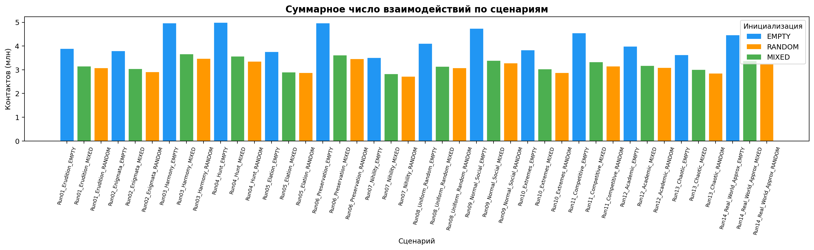
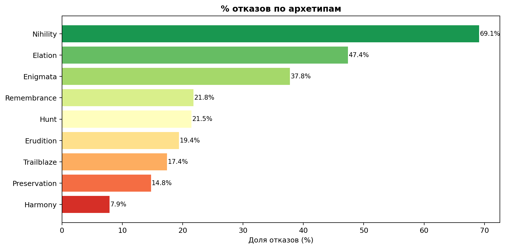

# Мега-отчёт: Многоагентная симуляция социально-эмоциональных отношений

**Дата генерации:** 2026-05-20 12:01:15
**База данных:** ClickHouse (localhost:8123)
**Объём данных:** 42 серии × 1365 дней — ~56 млрд строк отношений,
90 млн состояний агентов, 147 млн взаимодействий.
**Блоков анализа:** 18 (9 базовых + 9 новых гипотез)

---


## 1. Базовые метрики взаимодействий


*Суммарные контакты по сценариям*


*Мин/Среднее/Макс по группам и типу инициализации*

| group        | init_type   |        mean |     min |     max |
|:-------------|:------------|------------:|--------:|--------:|
| Гетерогенные | EMPTY       | 4.18783e+06 | 3635678 | 4738324 |
| Гетерогенные | MIXED       | 3.21126e+06 | 3008302 | 3392602 |
| Гетерогенные | RANDOM      | 3.083e+06   | 2848343 | 3284906 |
| Гомогенные   | EMPTY       | 4.26896e+06 | 3514578 | 4988631 |
| Гомогенные   | MIXED       | 3.25319e+06 | 2830748 | 3663899 |
| Гомогенные   | RANDOM      | 3.12717e+06 | 2719554 | 3475253 |


## 2. Глубокий анализ отказов

**Общий % отказов:** 28.03%

|   refusals |   successes |    failures |      total |
|-----------:|------------:|------------:|-----------:|
| 4.1464e+07 | 8.10415e+07 | 2.54143e+07 | 1.4792e+08 |

### 2a. По локациям


*Отказы по локациям*

### 2b. Кривая Лоренца


*Концентрация отказов*

- ТОП-10% «мизантропов» = **13.7%** всех отказов
- ТОП-50% = **63.6%**
- Агентов без единого отказа: **0** (0.0%)
- Джини: **0.189**

### 2c. По архетипам


*% отказов по архетипам*

| archetype    |   refusals |    total |   pct |
|:-------------|-----------:|---------:|------:|
| Nihility     |    8464127 | 12245228 | 69.12 |
| Elation      |    8598272 | 18139457 | 47.4  |
| Enigmata     |    6134838 | 16240527 | 37.77 |
| Remembrance  |     630245 |  2889997 | 21.81 |
| Hunt         |    4249067 | 19790858 | 21.47 |
| Erudition    |    4287428 | 22113819 | 19.39 |
| Trailblaze   |     527517 |  3029906 | 17.41 |
| Preservation |    2903584 | 19690650 | 14.75 |
| Harmony      |    1481583 | 18757165 |  7.9  |


## 3. Анализ реляционных порогов


*Реляционные пороги по сценариям*

| scenario_name                  | init_type   |   soft_pct |   hard_pct |
|:-------------------------------|:------------|-----------:|-----------:|
| Run01_Erudition_EMPTY          | EMPTY       |    0       |   0        |
| Run01_Erudition_MIXED          | MIXED       |    9.11525 |   0.346842 |
| Run01_Erudition_RANDOM         | RANDOM      |   12.5167  |   0.569934 |
| Run02_Enigmata_EMPTY           | EMPTY       |    0       |   0        |
| Run02_Enigmata_MIXED           | MIXED       |    7.25222 |   0.255182 |
| Run02_Enigmata_RANDOM          | RANDOM      |    9.84885 |   0.383553 |
| Run03_Harmony_EMPTY            | EMPTY       |    0       |   0        |
| Run03_Harmony_MIXED            | MIXED       |    9.6422  |   0.557684 |
| Run03_Harmony_RANDOM           | RANDOM      |   13.3632  |   0.755828 |
| Run04_Hunt_EMPTY               | EMPTY       |    0       |   0        |
| Run04_Hunt_MIXED               | MIXED       |    8.665   |   0.391082 |
| Run04_Hunt_RANDOM              | RANDOM      |   11.6502  |   0.629666 |
| Run05_Elation_EMPTY            | EMPTY       |    0       |   0        |
| Run05_Elation_MIXED            | MIXED       |    8.11875 |   0.295227 |
| Run05_Elation_RANDOM           | RANDOM      |   10.4499  |   0.476508 |
| Run06_Preservation_EMPTY       | EMPTY       |    0       |   0        |
| Run06_Preservation_MIXED       | MIXED       |    8.94085 |   0.472387 |
| Run06_Preservation_RANDOM      | RANDOM      |   12.0177  |   0.58239  |
| Run07_Nihility_EMPTY           | EMPTY       |    0       |   0        |
| Run07_Nihility_MIXED           | MIXED       |    6.14439 |   0.258676 |
| Run07_Nihility_RANDOM          | RANDOM      |    7.80815 |   0.288923 |
| Run08_Uniform_Random_EMPTY     | EMPTY       |    0       |   0        |
| Run08_Uniform_Random_MIXED     | MIXED       |    8.45633 |   0.408636 |
| Run08_Uniform_Random_RANDOM    | RANDOM      |   11.4765  |   0.533575 |
| Run09_Normal_Social_EMPTY      | EMPTY       |    0       |   0        |
| Run09_Normal_Social_MIXED      | MIXED       |    9.3565  |   0.550052 |
| Run09_Normal_Social_RANDOM     | RANDOM      |   12.4398  |   0.617996 |
| Run10_Extremes_EMPTY           | EMPTY       |    0       |   0        |
| Run10_Extremes_MIXED           | MIXED       |    7.10685 |   0.274068 |
| Run10_Extremes_RANDOM          | RANDOM      |    9.63318 |   0.41242  |
| Run11_Competitive_EMPTY        | EMPTY       |    0       |   0        |
| Run11_Competitive_MIXED        | MIXED       |    7.93129 |   0.345833 |
| Run11_Competitive_RANDOM       | RANDOM      |   10.7577  |   0.57554  |
| Run12_Academic_EMPTY           | EMPTY       |    0       |   0        |
| Run12_Academic_MIXED           | MIXED       |    9.45481 |   0.485015 |
| Run12_Academic_RANDOM          | RANDOM      |   11.932   |   0.594596 |
| Run13_Chaotic_EMPTY            | EMPTY       |    0       |   0        |
| Run13_Chaotic_MIXED            | MIXED       |    7.37778 |   0.307937 |
| Run13_Chaotic_RANDOM           | RANDOM      |   10.2345  |   0.356779 |
| Run14_Real_World_Approx_EMPTY  | EMPTY       |    0       |   0        |
| Run14_Real_World_Approx_MIXED  | MIXED       |    8.85734 |   0.507099 |
| Run14_Real_World_Approx_RANDOM | RANDOM      |   11.7323  |   0.581155 |


## Блок 04 — ошибка выполнения

```
Traceback (most recent call last):
  File "/Users/georgijtadziev/Documents/proga/diplom/venv/lib/python3.14/site-packages/urllib3/connectionpool.py", line 534, in _make_request
    response = conn.getresponse()
  File "/Users/georgijtadziev/Documents/proga/diplom/venv/lib/python3.14/site-packages/urllib3/connection.py", line 571, in getresponse
    httplib_response = super().getresponse()
  File "/opt/homebrew/Cellar/python@3.14/3.14.4/Frameworks/Python.framework/Versions/3.14/lib/python3.14/http/client.py", line 1450, in getresponse
    response.begin()
    ~~~~~~~~~~~~~~^^
  File "/opt/homebrew/Cellar/python@3.14/3.14.4/Frameworks/Python.framework/Versions/3.14/lib/python3.14/http/client.py", line 336, in begin
    version, status, reason = self._read_status()
                              ~~~~~~~~~~~~~~~~~^^
  File "/opt/homebrew/Cellar/python@3.14/3.14.4/Frameworks/Python.framework/Versions/3.14/lib/python3.14/http/client.py", line 297, in _read_status
    line = str(self.fp.readline(_MAXLINE + 1), "iso-8859-1")
               ~~~~~~~~~~~~~~~~^^^^^^^^^^^^^^
  File "/opt/homebrew/Cellar/python@3.14/3.14.4/Frameworks/Python.framework/Versions/3.14/lib/python3.14/socket.py", line 725, in readinto
    return self._sock.recv_into(b)
           ~~~~~~~~~~~~~~~~~~~~^^^
  File "/opt/homebrew/Cellar/python@3.14/3.14.4/Frameworks/Python.framework/Versions/3.14/lib/python3.14/ssl.py", line 1304, in recv_into
    return self.read(nbytes, buffer)
           ~~~~~~~~~^^^^^^^^^^^^^^^^
  File "/opt/homebrew/Cellar/python@3.14/3.14.4/Frameworks/Python.framework/Versions/3.14/lib/python3.14/ssl.py", line 1138, in read
    return self._sslobj.read(len, buffer)
           ~~~~~~~~~~~~~~~~~^^^^^^^^^^^^^
TimeoutError: [Errno 60] Operation timed out

The above exception was the direct cause of the following exception:

Traceback (most recent call last):
  File "/Users/georgijtadziev/Documents/proga/diplom/venv/lib/python3.14/site-packages/clickhouse_connect/driver/httpclient.py", line 546, in _raw_request
    response = self.http.request(method, url, **kwargs)
  File "/Users/georgijtadziev/Documents/proga/diplom/venv/lib/python3.14/site-packages/urllib3/_request_methods.py", line 143, in request
    return self.request_encode_body(
           ~~~~~~~~~~~~~~~~~~~~~~~~^
        method, url, fields=fields, headers=headers, **urlopen_kw
        ^^^^^^^^^^^^^^^^^^^^^^^^^^^^^^^^^^^^^^^^^^^^^^^^^^^^^^^^^
    )
    ^
  File "/Users/georgijtadziev/Documents/proga/diplom/venv/lib/python3.14/site-packages/urllib3/_request_methods.py", line 278, in request_encode_body
    return self.urlopen(method, url, **extra_kw)
           ~~~~~~~~~~~~^^^^^^^^^^^^^^^^^^^^^^^^^
  File "/Users/georgijtadziev/Documents/proga/diplom/venv/lib/python3.14/site-packages/urllib3/poolmanager.py", line 457, in urlopen
    response = conn.urlopen(method, u.request_uri, **kw)
  File "/Users/georgijtadziev/Documents/proga/diplom/venv/lib/python3.14/site-packages/urllib3/connectionpool.py", line 841, in urlopen
    retries = retries.increment(
        method, url, error=new_e, _pool=self, _stacktrace=sys.exc_info()[2]
    )
  File "/Users/georgijtadziev/Documents/proga/diplom/venv/lib/python3.14/site-packages/urllib3/util/retry.py", line 490, in increment
    raise reraise(type(error), error, _stacktrace)
          ~~~~~~~^^^^^^^^^^^^^^^^^^^^^^^^^^^^^^^^^
  File "/Users/georgijtadziev/Documents/proga/diplom/venv/lib/python3.14/site-packages/urllib3/util/util.py", line 39, in reraise
    raise value
  File "/Users/georgijtadziev/Documents/proga/diplom/venv/lib/python3.14/site-packages/urllib3/connectionpool.py", line 787, in urlopen
    response = self._make_request(
        conn,
    ...<10 lines>...
        **response_kw,
    )
  File "/Users/georgijtadziev/Documents/proga/diplom/venv/lib/python3.14/site-packages/urllib3/connectionpool.py", line 536, in _make_request
    self._raise_timeout(err=e, url=url, timeout_value=read_timeout)
    ~~~~~~~~~~~~~~~~~~~^^^^^^^^^^^^^^^^^^^^^^^^^^^^^^^^^^^^^^^^^^^^
  File "/Users/georgijtadziev/Documents/proga/diplom/venv/lib/python3.14/site-packages/urllib3/connectionpool.py", line 367, in _raise_timeout
    raise ReadTimeoutError(
        self, url, f"Read timed out. (read timeout={timeout_value})"
    ) from err
urllib3.exceptions.ReadTimeoutError: HTTPSConnectionPool(host='db.georgytadjiev.ink', port=443): Read timed out. (read timeout=600)

The above exception was the direct cause of the following exception:

Traceback (most recent call last):
  File "/Users/georgijtadziev/Documents/proga/diplom/scripts/mega_research.py", line 1556, in run_all
    section = fn()
  File "/Users/georgijtadziev/Documents/proga/diplom/scripts/mega_research.py", line 432, in b04_stable_pairs
    df_s = self.q(f"""
        WITH
    ...<26 lines>...
        JOIN agent_total at_b ON p.run_id = at_b.run_id AND p.b = at_b.agent_id
    """)
  File "/Users/georgijtadziev/Documents/proga/diplom/scripts/mega_research.py", line 182, in q
    return self.db.query_df(sql)
           ~~~~~~~~~~~~~~~~^^^^^
  File "/Users/georgijtadziev/Documents/proga/diplom/venv/lib/python3.14/site-packages/clickhouse_connect/driver/client.py", line 582, in query_df
    return self._context_query(locals(), use_numpy=True, as_pandas=True).df_result
           ~~~~~~~~~~~~~~~~~~~^^^^^^^^^^^^^^^^^^^^^^^^^^^^^^^^^^^^^^^^^^
  File "/Users/georgijtadziev/Documents/proga/diplom/venv/lib/python3.14/site-packages/clickhouse_connect/driver/client.py", line 1238, in _context_query
    return self._query_with_context((self.create_query_context(**kwargs)))
           ~~~~~~~~~~~~~~~~~~~~~~~~^^^^^^^^^^^^^^^^^^^^^^^^^^^^^^^^^^^^^^^
  File "/Users/georgijtadziev/Documents/proga/diplom/venv/lib/python3.14/site-packages/clickhouse_connect/driver/httpclient.py", line 304, in _query_with_context
    response = self._raw_request(body,
                                 params,
    ...<3 lines>...
                                 fields=fields,
                                 server_wait=not context.streaming)
  File "/Users/georgijtadziev/Documents/proga/diplom/venv/lib/python3.14/site-packages/clickhouse_connect/driver/httpclient.py", line 558, in _raw_request
    raise OperationalError(f'Error {ex} executing HTTP request attempt {attempts}{err_url}') from ex
clickhouse_connect.driver.exceptions.OperationalError: Error HTTPSConnectionPool(host='db.georgytadjiev.ink', port=443): Read timed out. (read timeout=600) executing HTTP request attempt 1 (https://db.georgytadjiev.ink:443)

```


## Блок 05 — ошибка выполнения

```
Traceback (most recent call last):
  File "/Users/georgijtadziev/Documents/proga/diplom/venv/lib/python3.14/site-packages/urllib3/connection.py", line 204, in _new_conn
    sock = connection.create_connection(
        (self._dns_host, self.port),
    ...<2 lines>...
        socket_options=self.socket_options,
    )
  File "/Users/georgijtadziev/Documents/proga/diplom/venv/lib/python3.14/site-packages/urllib3/util/connection.py", line 60, in create_connection
    for res in socket.getaddrinfo(host, port, family, socket.SOCK_STREAM):
               ~~~~~~~~~~~~~~~~~~^^^^^^^^^^^^^^^^^^^^^^^^^^^^^^^^^^^^^^^^
  File "/opt/homebrew/Cellar/python@3.14/3.14.4/Frameworks/Python.framework/Versions/3.14/lib/python3.14/socket.py", line 983, in getaddrinfo
    for res in _socket.getaddrinfo(host, port, family, type, proto, flags):
               ~~~~~~~~~~~~~~~~~~~^^^^^^^^^^^^^^^^^^^^^^^^^^^^^^^^^^^^^^^^
socket.gaierror: [Errno 8] nodename nor servname provided, or not known

The above exception was the direct cause of the following exception:

Traceback (most recent call last):
  File "/Users/georgijtadziev/Documents/proga/diplom/venv/lib/python3.14/site-packages/urllib3/connectionpool.py", line 787, in urlopen
    response = self._make_request(
        conn,
    ...<10 lines>...
        **response_kw,
    )
  File "/Users/georgijtadziev/Documents/proga/diplom/venv/lib/python3.14/site-packages/urllib3/connectionpool.py", line 488, in _make_request
    raise new_e
  File "/Users/georgijtadziev/Documents/proga/diplom/venv/lib/python3.14/site-packages/urllib3/connectionpool.py", line 464, in _make_request
    self._validate_conn(conn)
    ~~~~~~~~~~~~~~~~~~~^^^^^^
  File "/Users/georgijtadziev/Documents/proga/diplom/venv/lib/python3.14/site-packages/urllib3/connectionpool.py", line 1093, in _validate_conn
    conn.connect()
    ~~~~~~~~~~~~^^
  File "/Users/georgijtadziev/Documents/proga/diplom/venv/lib/python3.14/site-packages/urllib3/connection.py", line 759, in connect
    self.sock = sock = self._new_conn()
                       ~~~~~~~~~~~~~~^^
  File "/Users/georgijtadziev/Documents/proga/diplom/venv/lib/python3.14/site-packages/urllib3/connection.py", line 211, in _new_conn
    raise NameResolutionError(self.host, self, e) from e
urllib3.exceptions.NameResolutionError: HTTPSConnection(host='db.georgytadjiev.ink', port=443): Failed to resolve 'db.georgytadjiev.ink' ([Errno 8] nodename nor servname provided, or not known)

The above exception was the direct cause of the following exception:

Traceback (most recent call last):
  File "/Users/georgijtadziev/Documents/proga/diplom/venv/lib/python3.14/site-packages/clickhouse_connect/driver/httpclient.py", line 546, in _raw_request
    response = self.http.request(method, url, **kwargs)
  File "/Users/georgijtadziev/Documents/proga/diplom/venv/lib/python3.14/site-packages/urllib3/_request_methods.py", line 143, in request
    return self.request_encode_body(
           ~~~~~~~~~~~~~~~~~~~~~~~~^
        method, url, fields=fields, headers=headers, **urlopen_kw
        ^^^^^^^^^^^^^^^^^^^^^^^^^^^^^^^^^^^^^^^^^^^^^^^^^^^^^^^^^
    )
    ^
  File "/Users/georgijtadziev/Documents/proga/diplom/venv/lib/python3.14/site-packages/urllib3/_request_methods.py", line 278, in request_encode_body
    return self.urlopen(method, url, **extra_kw)
           ~~~~~~~~~~~~^^^^^^^^^^^^^^^^^^^^^^^^^
  File "/Users/georgijtadziev/Documents/proga/diplom/venv/lib/python3.14/site-packages/urllib3/poolmanager.py", line 457, in urlopen
    response = conn.urlopen(method, u.request_uri, **kw)
  File "/Users/georgijtadziev/Documents/proga/diplom/venv/lib/python3.14/site-packages/urllib3/connectionpool.py", line 871, in urlopen
    return self.urlopen(
           ~~~~~~~~~~~~^
        method,
        ^^^^^^^
    ...<13 lines>...
        **response_kw,
        ^^^^^^^^^^^^^^
    )
    ^
  File "/Users/georgijtadziev/Documents/proga/diplom/venv/lib/python3.14/site-packages/urllib3/connectionpool.py", line 841, in urlopen
    retries = retries.increment(
        method, url, error=new_e, _pool=self, _stacktrace=sys.exc_info()[2]
    )
  File "/Users/georgijtadziev/Documents/proga/diplom/venv/lib/python3.14/site-packages/urllib3/util/retry.py", line 535, in increment
    raise MaxRetryError(_pool, url, reason) from reason  # type: ignore[arg-type]
    ^^^^^^^^^^^^^^^^^^^^^^^^^^^^^^^^^^^^^^^^^^^^^^^^^^^
urllib3.exceptions.MaxRetryError: HTTPSConnectionPool(host='db.georgytadjiev.ink', port=443): Max retries exceeded with url: /?date_time_input_format=best_effort&cast_string_to_dynamic_use_inference=1&cancel_http_readonly_queries_on_client_close=1&wait_end_of_query=1&send_progress_in_http_headers=1&http_headers_progress_interval_ms=120000&client_protocol_version=54405&query_id=32eea13b-013b-4603-9214-bc052c7013af (Caused by NameResolutionError("HTTPSConnection(host='db.georgytadjiev.ink', port=443): Failed to resolve 'db.georgytadjiev.ink' ([Errno 8] nodename nor servname provided, or not known)"))

The above exception was the direct cause of the following exception:

Traceback (most recent call last):
  File "/Users/georgijtadziev/Documents/proga/diplom/scripts/mega_research.py", line 1556, in run_all
    section = fn()
  File "/Users/georgijtadziev/Documents/proga/diplom/scripts/mega_research.py", line 511, in b05_emotions
    df = self.q(f"""
        SELECT day_id, {emo_sql}
    ...<2 lines>...
        GROUP BY day_id ORDER BY day_id
    """)
  File "/Users/georgijtadziev/Documents/proga/diplom/scripts/mega_research.py", line 182, in q
    return self.db.query_df(sql)
           ~~~~~~~~~~~~~~~~^^^^^
  File "/Users/georgijtadziev/Documents/proga/diplom/venv/lib/python3.14/site-packages/clickhouse_connect/driver/client.py", line 582, in query_df
    return self._context_query(locals(), use_numpy=True, as_pandas=True).df_result
           ~~~~~~~~~~~~~~~~~~~^^^^^^^^^^^^^^^^^^^^^^^^^^^^^^^^^^^^^^^^^^
  File "/Users/georgijtadziev/Documents/proga/diplom/venv/lib/python3.14/site-packages/clickhouse_connect/driver/client.py", line 1238, in _context_query
    return self._query_with_context((self.create_query_context(**kwargs)))
           ~~~~~~~~~~~~~~~~~~~~~~~~^^^^^^^^^^^^^^^^^^^^^^^^^^^^^^^^^^^^^^^
  File "/Users/georgijtadziev/Documents/proga/diplom/venv/lib/python3.14/site-packages/clickhouse_connect/driver/httpclient.py", line 304, in _query_with_context
    response = self._raw_request(body,
                                 params,
    ...<3 lines>...
                                 fields=fields,
                                 server_wait=not context.streaming)
  File "/Users/georgijtadziev/Documents/proga/diplom/venv/lib/python3.14/site-packages/clickhouse_connect/driver/httpclient.py", line 558, in _raw_request
    raise OperationalError(f'Error {ex} executing HTTP request attempt {attempts}{err_url}') from ex
clickhouse_connect.driver.exceptions.OperationalError: Error HTTPSConnectionPool(host='db.georgytadjiev.ink', port=443): Max retries exceeded with url: /?date_time_input_format=best_effort&cast_string_to_dynamic_use_inference=1&cancel_http_readonly_queries_on_client_close=1&wait_end_of_query=1&send_progress_in_http_headers=1&http_headers_progress_interval_ms=120000&client_protocol_version=54405&query_id=32eea13b-013b-4603-9214-bc052c7013af (Caused by NameResolutionError("HTTPSConnection(host='db.georgytadjiev.ink', port=443): Failed to resolve 'db.georgytadjiev.ink' ([Errno 8] nodename nor servname provided, or not known)")) executing HTTP request attempt 1 (https://db.georgytadjiev.ink:443)

```


## Блок 06 — ошибка выполнения

```
Traceback (most recent call last):
  File "/Users/georgijtadziev/Documents/proga/diplom/venv/lib/python3.14/site-packages/urllib3/connection.py", line 204, in _new_conn
    sock = connection.create_connection(
        (self._dns_host, self.port),
    ...<2 lines>...
        socket_options=self.socket_options,
    )
  File "/Users/georgijtadziev/Documents/proga/diplom/venv/lib/python3.14/site-packages/urllib3/util/connection.py", line 60, in create_connection
    for res in socket.getaddrinfo(host, port, family, socket.SOCK_STREAM):
               ~~~~~~~~~~~~~~~~~~^^^^^^^^^^^^^^^^^^^^^^^^^^^^^^^^^^^^^^^^
  File "/opt/homebrew/Cellar/python@3.14/3.14.4/Frameworks/Python.framework/Versions/3.14/lib/python3.14/socket.py", line 983, in getaddrinfo
    for res in _socket.getaddrinfo(host, port, family, type, proto, flags):
               ~~~~~~~~~~~~~~~~~~~^^^^^^^^^^^^^^^^^^^^^^^^^^^^^^^^^^^^^^^^
socket.gaierror: [Errno 8] nodename nor servname provided, or not known

The above exception was the direct cause of the following exception:

Traceback (most recent call last):
  File "/Users/georgijtadziev/Documents/proga/diplom/venv/lib/python3.14/site-packages/urllib3/connectionpool.py", line 787, in urlopen
    response = self._make_request(
        conn,
    ...<10 lines>...
        **response_kw,
    )
  File "/Users/georgijtadziev/Documents/proga/diplom/venv/lib/python3.14/site-packages/urllib3/connectionpool.py", line 488, in _make_request
    raise new_e
  File "/Users/georgijtadziev/Documents/proga/diplom/venv/lib/python3.14/site-packages/urllib3/connectionpool.py", line 464, in _make_request
    self._validate_conn(conn)
    ~~~~~~~~~~~~~~~~~~~^^^^^^
  File "/Users/georgijtadziev/Documents/proga/diplom/venv/lib/python3.14/site-packages/urllib3/connectionpool.py", line 1093, in _validate_conn
    conn.connect()
    ~~~~~~~~~~~~^^
  File "/Users/georgijtadziev/Documents/proga/diplom/venv/lib/python3.14/site-packages/urllib3/connection.py", line 759, in connect
    self.sock = sock = self._new_conn()
                       ~~~~~~~~~~~~~~^^
  File "/Users/georgijtadziev/Documents/proga/diplom/venv/lib/python3.14/site-packages/urllib3/connection.py", line 211, in _new_conn
    raise NameResolutionError(self.host, self, e) from e
urllib3.exceptions.NameResolutionError: HTTPSConnection(host='db.georgytadjiev.ink', port=443): Failed to resolve 'db.georgytadjiev.ink' ([Errno 8] nodename nor servname provided, or not known)

The above exception was the direct cause of the following exception:

Traceback (most recent call last):
  File "/Users/georgijtadziev/Documents/proga/diplom/venv/lib/python3.14/site-packages/clickhouse_connect/driver/httpclient.py", line 546, in _raw_request
    response = self.http.request(method, url, **kwargs)
  File "/Users/georgijtadziev/Documents/proga/diplom/venv/lib/python3.14/site-packages/urllib3/_request_methods.py", line 143, in request
    return self.request_encode_body(
           ~~~~~~~~~~~~~~~~~~~~~~~~^
        method, url, fields=fields, headers=headers, **urlopen_kw
        ^^^^^^^^^^^^^^^^^^^^^^^^^^^^^^^^^^^^^^^^^^^^^^^^^^^^^^^^^
    )
    ^
  File "/Users/georgijtadziev/Documents/proga/diplom/venv/lib/python3.14/site-packages/urllib3/_request_methods.py", line 278, in request_encode_body
    return self.urlopen(method, url, **extra_kw)
           ~~~~~~~~~~~~^^^^^^^^^^^^^^^^^^^^^^^^^
  File "/Users/georgijtadziev/Documents/proga/diplom/venv/lib/python3.14/site-packages/urllib3/poolmanager.py", line 457, in urlopen
    response = conn.urlopen(method, u.request_uri, **kw)
  File "/Users/georgijtadziev/Documents/proga/diplom/venv/lib/python3.14/site-packages/urllib3/connectionpool.py", line 871, in urlopen
    return self.urlopen(
           ~~~~~~~~~~~~^
        method,
        ^^^^^^^
    ...<13 lines>...
        **response_kw,
        ^^^^^^^^^^^^^^
    )
    ^
  File "/Users/georgijtadziev/Documents/proga/diplom/venv/lib/python3.14/site-packages/urllib3/connectionpool.py", line 841, in urlopen
    retries = retries.increment(
        method, url, error=new_e, _pool=self, _stacktrace=sys.exc_info()[2]
    )
  File "/Users/georgijtadziev/Documents/proga/diplom/venv/lib/python3.14/site-packages/urllib3/util/retry.py", line 535, in increment
    raise MaxRetryError(_pool, url, reason) from reason  # type: ignore[arg-type]
    ^^^^^^^^^^^^^^^^^^^^^^^^^^^^^^^^^^^^^^^^^^^^^^^^^^^
urllib3.exceptions.MaxRetryError: HTTPSConnectionPool(host='db.georgytadjiev.ink', port=443): Max retries exceeded with url: /?date_time_input_format=best_effort&cast_string_to_dynamic_use_inference=1&cancel_http_readonly_queries_on_client_close=1&wait_end_of_query=1&send_progress_in_http_headers=1&http_headers_progress_interval_ms=120000&client_protocol_version=54405&query_id=f2f02d7c-eebc-45a4-8f6b-ce621bd1f35b (Caused by NameResolutionError("HTTPSConnection(host='db.georgytadjiev.ink', port=443): Failed to resolve 'db.georgytadjiev.ink' ([Errno 8] nodename nor servname provided, or not known)"))

The above exception was the direct cause of the following exception:

Traceback (most recent call last):
  File "/Users/georgijtadziev/Documents/proga/diplom/scripts/mega_research.py", line 1556, in run_all
    section = fn()
  File "/Users/georgijtadziev/Documents/proga/diplom/scripts/mega_research.py", line 562, in b06_leader_burnout
    pop = self.q(f"""
        SELECT run_id, object_id AS agent_id,
    ...<3 lines>...
        GROUP BY run_id, object_id ORDER BY fans DESC
    """)
  File "/Users/georgijtadziev/Documents/proga/diplom/scripts/mega_research.py", line 182, in q
    return self.db.query_df(sql)
           ~~~~~~~~~~~~~~~~^^^^^
  File "/Users/georgijtadziev/Documents/proga/diplom/venv/lib/python3.14/site-packages/clickhouse_connect/driver/client.py", line 582, in query_df
    return self._context_query(locals(), use_numpy=True, as_pandas=True).df_result
           ~~~~~~~~~~~~~~~~~~~^^^^^^^^^^^^^^^^^^^^^^^^^^^^^^^^^^^^^^^^^^
  File "/Users/georgijtadziev/Documents/proga/diplom/venv/lib/python3.14/site-packages/clickhouse_connect/driver/client.py", line 1238, in _context_query
    return self._query_with_context((self.create_query_context(**kwargs)))
           ~~~~~~~~~~~~~~~~~~~~~~~~^^^^^^^^^^^^^^^^^^^^^^^^^^^^^^^^^^^^^^^
  File "/Users/georgijtadziev/Documents/proga/diplom/venv/lib/python3.14/site-packages/clickhouse_connect/driver/httpclient.py", line 304, in _query_with_context
    response = self._raw_request(body,
                                 params,
    ...<3 lines>...
                                 fields=fields,
                                 server_wait=not context.streaming)
  File "/Users/georgijtadziev/Documents/proga/diplom/venv/lib/python3.14/site-packages/clickhouse_connect/driver/httpclient.py", line 558, in _raw_request
    raise OperationalError(f'Error {ex} executing HTTP request attempt {attempts}{err_url}') from ex
clickhouse_connect.driver.exceptions.OperationalError: Error HTTPSConnectionPool(host='db.georgytadjiev.ink', port=443): Max retries exceeded with url: /?date_time_input_format=best_effort&cast_string_to_dynamic_use_inference=1&cancel_http_readonly_queries_on_client_close=1&wait_end_of_query=1&send_progress_in_http_headers=1&http_headers_progress_interval_ms=120000&client_protocol_version=54405&query_id=f2f02d7c-eebc-45a4-8f6b-ce621bd1f35b (Caused by NameResolutionError("HTTPSConnection(host='db.georgytadjiev.ink', port=443): Failed to resolve 'db.georgytadjiev.ink' ([Errno 8] nodename nor servname provided, or not known)")) executing HTTP request attempt 1 (https://db.georgytadjiev.ink:443)

```


## Блок 07 — ошибка выполнения

```
Traceback (most recent call last):
  File "/Users/georgijtadziev/Documents/proga/diplom/venv/lib/python3.14/site-packages/urllib3/connection.py", line 204, in _new_conn
    sock = connection.create_connection(
        (self._dns_host, self.port),
    ...<2 lines>...
        socket_options=self.socket_options,
    )
  File "/Users/georgijtadziev/Documents/proga/diplom/venv/lib/python3.14/site-packages/urllib3/util/connection.py", line 60, in create_connection
    for res in socket.getaddrinfo(host, port, family, socket.SOCK_STREAM):
               ~~~~~~~~~~~~~~~~~~^^^^^^^^^^^^^^^^^^^^^^^^^^^^^^^^^^^^^^^^
  File "/opt/homebrew/Cellar/python@3.14/3.14.4/Frameworks/Python.framework/Versions/3.14/lib/python3.14/socket.py", line 983, in getaddrinfo
    for res in _socket.getaddrinfo(host, port, family, type, proto, flags):
               ~~~~~~~~~~~~~~~~~~~^^^^^^^^^^^^^^^^^^^^^^^^^^^^^^^^^^^^^^^^
socket.gaierror: [Errno 8] nodename nor servname provided, or not known

The above exception was the direct cause of the following exception:

Traceback (most recent call last):
  File "/Users/georgijtadziev/Documents/proga/diplom/venv/lib/python3.14/site-packages/urllib3/connectionpool.py", line 787, in urlopen
    response = self._make_request(
        conn,
    ...<10 lines>...
        **response_kw,
    )
  File "/Users/georgijtadziev/Documents/proga/diplom/venv/lib/python3.14/site-packages/urllib3/connectionpool.py", line 488, in _make_request
    raise new_e
  File "/Users/georgijtadziev/Documents/proga/diplom/venv/lib/python3.14/site-packages/urllib3/connectionpool.py", line 464, in _make_request
    self._validate_conn(conn)
    ~~~~~~~~~~~~~~~~~~~^^^^^^
  File "/Users/georgijtadziev/Documents/proga/diplom/venv/lib/python3.14/site-packages/urllib3/connectionpool.py", line 1093, in _validate_conn
    conn.connect()
    ~~~~~~~~~~~~^^
  File "/Users/georgijtadziev/Documents/proga/diplom/venv/lib/python3.14/site-packages/urllib3/connection.py", line 759, in connect
    self.sock = sock = self._new_conn()
                       ~~~~~~~~~~~~~~^^
  File "/Users/georgijtadziev/Documents/proga/diplom/venv/lib/python3.14/site-packages/urllib3/connection.py", line 211, in _new_conn
    raise NameResolutionError(self.host, self, e) from e
urllib3.exceptions.NameResolutionError: HTTPSConnection(host='db.georgytadjiev.ink', port=443): Failed to resolve 'db.georgytadjiev.ink' ([Errno 8] nodename nor servname provided, or not known)

The above exception was the direct cause of the following exception:

Traceback (most recent call last):
  File "/Users/georgijtadziev/Documents/proga/diplom/venv/lib/python3.14/site-packages/clickhouse_connect/driver/httpclient.py", line 546, in _raw_request
    response = self.http.request(method, url, **kwargs)
  File "/Users/georgijtadziev/Documents/proga/diplom/venv/lib/python3.14/site-packages/urllib3/_request_methods.py", line 143, in request
    return self.request_encode_body(
           ~~~~~~~~~~~~~~~~~~~~~~~~^
        method, url, fields=fields, headers=headers, **urlopen_kw
        ^^^^^^^^^^^^^^^^^^^^^^^^^^^^^^^^^^^^^^^^^^^^^^^^^^^^^^^^^
    )
    ^
  File "/Users/georgijtadziev/Documents/proga/diplom/venv/lib/python3.14/site-packages/urllib3/_request_methods.py", line 278, in request_encode_body
    return self.urlopen(method, url, **extra_kw)
           ~~~~~~~~~~~~^^^^^^^^^^^^^^^^^^^^^^^^^
  File "/Users/georgijtadziev/Documents/proga/diplom/venv/lib/python3.14/site-packages/urllib3/poolmanager.py", line 457, in urlopen
    response = conn.urlopen(method, u.request_uri, **kw)
  File "/Users/georgijtadziev/Documents/proga/diplom/venv/lib/python3.14/site-packages/urllib3/connectionpool.py", line 871, in urlopen
    return self.urlopen(
           ~~~~~~~~~~~~^
        method,
        ^^^^^^^
    ...<13 lines>...
        **response_kw,
        ^^^^^^^^^^^^^^
    )
    ^
  File "/Users/georgijtadziev/Documents/proga/diplom/venv/lib/python3.14/site-packages/urllib3/connectionpool.py", line 841, in urlopen
    retries = retries.increment(
        method, url, error=new_e, _pool=self, _stacktrace=sys.exc_info()[2]
    )
  File "/Users/georgijtadziev/Documents/proga/diplom/venv/lib/python3.14/site-packages/urllib3/util/retry.py", line 535, in increment
    raise MaxRetryError(_pool, url, reason) from reason  # type: ignore[arg-type]
    ^^^^^^^^^^^^^^^^^^^^^^^^^^^^^^^^^^^^^^^^^^^^^^^^^^^
urllib3.exceptions.MaxRetryError: HTTPSConnectionPool(host='db.georgytadjiev.ink', port=443): Max retries exceeded with url: /?date_time_input_format=best_effort&cast_string_to_dynamic_use_inference=1&cancel_http_readonly_queries_on_client_close=1&wait_end_of_query=1&send_progress_in_http_headers=1&http_headers_progress_interval_ms=120000&client_protocol_version=54405&query_id=a8ae488b-d207-4245-973e-09af6fbc662c (Caused by NameResolutionError("HTTPSConnection(host='db.georgytadjiev.ink', port=443): Failed to resolve 'db.georgytadjiev.ink' ([Errno 8] nodename nor servname provided, or not known)"))

The above exception was the direct cause of the following exception:

Traceback (most recent call last):
  File "/Users/georgijtadziev/Documents/proga/diplom/scripts/mega_research.py", line 1556, in run_all
    section = fn()
  File "/Users/georgijtadziev/Documents/proga/diplom/scripts/mega_research.py", line 1540, in <lambda>
    ("07", lambda: self.b07_attractor(meta)),
                   ~~~~~~~~~~~~~~~~~~^^^^^^
  File "/Users/georgijtadziev/Documents/proga/diplom/scripts/mega_research.py", line 608, in b07_attractor
    df_m = self.q(f"""
        SELECT ar1.archetype AS a_from, ar2.archetype AS a_to,
    ...<18 lines>...
        GROUP BY a_from, a_to
    """)
  File "/Users/georgijtadziev/Documents/proga/diplom/scripts/mega_research.py", line 182, in q
    return self.db.query_df(sql)
           ~~~~~~~~~~~~~~~~^^^^^
  File "/Users/georgijtadziev/Documents/proga/diplom/venv/lib/python3.14/site-packages/clickhouse_connect/driver/client.py", line 582, in query_df
    return self._context_query(locals(), use_numpy=True, as_pandas=True).df_result
           ~~~~~~~~~~~~~~~~~~~^^^^^^^^^^^^^^^^^^^^^^^^^^^^^^^^^^^^^^^^^^
  File "/Users/georgijtadziev/Documents/proga/diplom/venv/lib/python3.14/site-packages/clickhouse_connect/driver/client.py", line 1238, in _context_query
    return self._query_with_context((self.create_query_context(**kwargs)))
           ~~~~~~~~~~~~~~~~~~~~~~~~^^^^^^^^^^^^^^^^^^^^^^^^^^^^^^^^^^^^^^^
  File "/Users/georgijtadziev/Documents/proga/diplom/venv/lib/python3.14/site-packages/clickhouse_connect/driver/httpclient.py", line 304, in _query_with_context
    response = self._raw_request(body,
                                 params,
    ...<3 lines>...
                                 fields=fields,
                                 server_wait=not context.streaming)
  File "/Users/georgijtadziev/Documents/proga/diplom/venv/lib/python3.14/site-packages/clickhouse_connect/driver/httpclient.py", line 558, in _raw_request
    raise OperationalError(f'Error {ex} executing HTTP request attempt {attempts}{err_url}') from ex
clickhouse_connect.driver.exceptions.OperationalError: Error HTTPSConnectionPool(host='db.georgytadjiev.ink', port=443): Max retries exceeded with url: /?date_time_input_format=best_effort&cast_string_to_dynamic_use_inference=1&cancel_http_readonly_queries_on_client_close=1&wait_end_of_query=1&send_progress_in_http_headers=1&http_headers_progress_interval_ms=120000&client_protocol_version=54405&query_id=a8ae488b-d207-4245-973e-09af6fbc662c (Caused by NameResolutionError("HTTPSConnection(host='db.georgytadjiev.ink', port=443): Failed to resolve 'db.georgytadjiev.ink' ([Errno 8] nodename nor servname provided, or not known)")) executing HTTP request attempt 1 (https://db.georgytadjiev.ink:443)

```


## Блок 08 — ошибка выполнения

```
Traceback (most recent call last):
  File "/Users/georgijtadziev/Documents/proga/diplom/venv/lib/python3.14/site-packages/urllib3/connection.py", line 204, in _new_conn
    sock = connection.create_connection(
        (self._dns_host, self.port),
    ...<2 lines>...
        socket_options=self.socket_options,
    )
  File "/Users/georgijtadziev/Documents/proga/diplom/venv/lib/python3.14/site-packages/urllib3/util/connection.py", line 60, in create_connection
    for res in socket.getaddrinfo(host, port, family, socket.SOCK_STREAM):
               ~~~~~~~~~~~~~~~~~~^^^^^^^^^^^^^^^^^^^^^^^^^^^^^^^^^^^^^^^^
  File "/opt/homebrew/Cellar/python@3.14/3.14.4/Frameworks/Python.framework/Versions/3.14/lib/python3.14/socket.py", line 983, in getaddrinfo
    for res in _socket.getaddrinfo(host, port, family, type, proto, flags):
               ~~~~~~~~~~~~~~~~~~~^^^^^^^^^^^^^^^^^^^^^^^^^^^^^^^^^^^^^^^^
socket.gaierror: [Errno 8] nodename nor servname provided, or not known

The above exception was the direct cause of the following exception:

Traceback (most recent call last):
  File "/Users/georgijtadziev/Documents/proga/diplom/venv/lib/python3.14/site-packages/urllib3/connectionpool.py", line 787, in urlopen
    response = self._make_request(
        conn,
    ...<10 lines>...
        **response_kw,
    )
  File "/Users/georgijtadziev/Documents/proga/diplom/venv/lib/python3.14/site-packages/urllib3/connectionpool.py", line 488, in _make_request
    raise new_e
  File "/Users/georgijtadziev/Documents/proga/diplom/venv/lib/python3.14/site-packages/urllib3/connectionpool.py", line 464, in _make_request
    self._validate_conn(conn)
    ~~~~~~~~~~~~~~~~~~~^^^^^^
  File "/Users/georgijtadziev/Documents/proga/diplom/venv/lib/python3.14/site-packages/urllib3/connectionpool.py", line 1093, in _validate_conn
    conn.connect()
    ~~~~~~~~~~~~^^
  File "/Users/georgijtadziev/Documents/proga/diplom/venv/lib/python3.14/site-packages/urllib3/connection.py", line 759, in connect
    self.sock = sock = self._new_conn()
                       ~~~~~~~~~~~~~~^^
  File "/Users/georgijtadziev/Documents/proga/diplom/venv/lib/python3.14/site-packages/urllib3/connection.py", line 211, in _new_conn
    raise NameResolutionError(self.host, self, e) from e
urllib3.exceptions.NameResolutionError: HTTPSConnection(host='db.georgytadjiev.ink', port=443): Failed to resolve 'db.georgytadjiev.ink' ([Errno 8] nodename nor servname provided, or not known)

The above exception was the direct cause of the following exception:

Traceback (most recent call last):
  File "/Users/georgijtadziev/Documents/proga/diplom/venv/lib/python3.14/site-packages/clickhouse_connect/driver/httpclient.py", line 546, in _raw_request
    response = self.http.request(method, url, **kwargs)
  File "/Users/georgijtadziev/Documents/proga/diplom/venv/lib/python3.14/site-packages/urllib3/_request_methods.py", line 143, in request
    return self.request_encode_body(
           ~~~~~~~~~~~~~~~~~~~~~~~~^
        method, url, fields=fields, headers=headers, **urlopen_kw
        ^^^^^^^^^^^^^^^^^^^^^^^^^^^^^^^^^^^^^^^^^^^^^^^^^^^^^^^^^
    )
    ^
  File "/Users/georgijtadziev/Documents/proga/diplom/venv/lib/python3.14/site-packages/urllib3/_request_methods.py", line 278, in request_encode_body
    return self.urlopen(method, url, **extra_kw)
           ~~~~~~~~~~~~^^^^^^^^^^^^^^^^^^^^^^^^^
  File "/Users/georgijtadziev/Documents/proga/diplom/venv/lib/python3.14/site-packages/urllib3/poolmanager.py", line 457, in urlopen
    response = conn.urlopen(method, u.request_uri, **kw)
  File "/Users/georgijtadziev/Documents/proga/diplom/venv/lib/python3.14/site-packages/urllib3/connectionpool.py", line 871, in urlopen
    return self.urlopen(
           ~~~~~~~~~~~~^
        method,
        ^^^^^^^
    ...<13 lines>...
        **response_kw,
        ^^^^^^^^^^^^^^
    )
    ^
  File "/Users/georgijtadziev/Documents/proga/diplom/venv/lib/python3.14/site-packages/urllib3/connectionpool.py", line 841, in urlopen
    retries = retries.increment(
        method, url, error=new_e, _pool=self, _stacktrace=sys.exc_info()[2]
    )
  File "/Users/georgijtadziev/Documents/proga/diplom/venv/lib/python3.14/site-packages/urllib3/util/retry.py", line 535, in increment
    raise MaxRetryError(_pool, url, reason) from reason  # type: ignore[arg-type]
    ^^^^^^^^^^^^^^^^^^^^^^^^^^^^^^^^^^^^^^^^^^^^^^^^^^^
urllib3.exceptions.MaxRetryError: HTTPSConnectionPool(host='db.georgytadjiev.ink', port=443): Max retries exceeded with url: /?date_time_input_format=best_effort&cast_string_to_dynamic_use_inference=1&cancel_http_readonly_queries_on_client_close=1&wait_end_of_query=1&send_progress_in_http_headers=1&http_headers_progress_interval_ms=120000&client_protocol_version=54405&query_id=03273f5d-fedb-499e-a677-73c05598ff27 (Caused by NameResolutionError("HTTPSConnection(host='db.georgytadjiev.ink', port=443): Failed to resolve 'db.georgytadjiev.ink' ([Errno 8] nodename nor servname provided, or not known)"))

The above exception was the direct cause of the following exception:

Traceback (most recent call last):
  File "/Users/georgijtadziev/Documents/proga/diplom/scripts/mega_research.py", line 1556, in run_all
    section = fn()
  File "/Users/georgijtadziev/Documents/proga/diplom/scripts/mega_research.py", line 675, in b08_emotional_bubbles
    friends = self.q(f"""
        SELECT run_id, subject_id AS agent_id, object_id AS friend_id,
    ...<4 lines>...
        QUALIFY row_number() OVER (PARTITION BY run_id, subject_id ORDER BY avg(affinity) DESC) <= 3
    """)
  File "/Users/georgijtadziev/Documents/proga/diplom/scripts/mega_research.py", line 182, in q
    return self.db.query_df(sql)
           ~~~~~~~~~~~~~~~~^^^^^
  File "/Users/georgijtadziev/Documents/proga/diplom/venv/lib/python3.14/site-packages/clickhouse_connect/driver/client.py", line 582, in query_df
    return self._context_query(locals(), use_numpy=True, as_pandas=True).df_result
           ~~~~~~~~~~~~~~~~~~~^^^^^^^^^^^^^^^^^^^^^^^^^^^^^^^^^^^^^^^^^^
  File "/Users/georgijtadziev/Documents/proga/diplom/venv/lib/python3.14/site-packages/clickhouse_connect/driver/client.py", line 1238, in _context_query
    return self._query_with_context((self.create_query_context(**kwargs)))
           ~~~~~~~~~~~~~~~~~~~~~~~~^^^^^^^^^^^^^^^^^^^^^^^^^^^^^^^^^^^^^^^
  File "/Users/georgijtadziev/Documents/proga/diplom/venv/lib/python3.14/site-packages/clickhouse_connect/driver/httpclient.py", line 304, in _query_with_context
    response = self._raw_request(body,
                                 params,
    ...<3 lines>...
                                 fields=fields,
                                 server_wait=not context.streaming)
  File "/Users/georgijtadziev/Documents/proga/diplom/venv/lib/python3.14/site-packages/clickhouse_connect/driver/httpclient.py", line 558, in _raw_request
    raise OperationalError(f'Error {ex} executing HTTP request attempt {attempts}{err_url}') from ex
clickhouse_connect.driver.exceptions.OperationalError: Error HTTPSConnectionPool(host='db.georgytadjiev.ink', port=443): Max retries exceeded with url: /?date_time_input_format=best_effort&cast_string_to_dynamic_use_inference=1&cancel_http_readonly_queries_on_client_close=1&wait_end_of_query=1&send_progress_in_http_headers=1&http_headers_progress_interval_ms=120000&client_protocol_version=54405&query_id=03273f5d-fedb-499e-a677-73c05598ff27 (Caused by NameResolutionError("HTTPSConnection(host='db.georgytadjiev.ink', port=443): Failed to resolve 'db.georgytadjiev.ink' ([Errno 8] nodename nor servname provided, or not known)")) executing HTTP request attempt 1 (https://db.georgytadjiev.ink:443)

```


## Блок 09 — ошибка выполнения

```
Traceback (most recent call last):
  File "/Users/georgijtadziev/Documents/proga/diplom/venv/lib/python3.14/site-packages/urllib3/connection.py", line 204, in _new_conn
    sock = connection.create_connection(
        (self._dns_host, self.port),
    ...<2 lines>...
        socket_options=self.socket_options,
    )
  File "/Users/georgijtadziev/Documents/proga/diplom/venv/lib/python3.14/site-packages/urllib3/util/connection.py", line 60, in create_connection
    for res in socket.getaddrinfo(host, port, family, socket.SOCK_STREAM):
               ~~~~~~~~~~~~~~~~~~^^^^^^^^^^^^^^^^^^^^^^^^^^^^^^^^^^^^^^^^
  File "/opt/homebrew/Cellar/python@3.14/3.14.4/Frameworks/Python.framework/Versions/3.14/lib/python3.14/socket.py", line 983, in getaddrinfo
    for res in _socket.getaddrinfo(host, port, family, type, proto, flags):
               ~~~~~~~~~~~~~~~~~~~^^^^^^^^^^^^^^^^^^^^^^^^^^^^^^^^^^^^^^^^
socket.gaierror: [Errno 8] nodename nor servname provided, or not known

The above exception was the direct cause of the following exception:

Traceback (most recent call last):
  File "/Users/georgijtadziev/Documents/proga/diplom/venv/lib/python3.14/site-packages/urllib3/connectionpool.py", line 787, in urlopen
    response = self._make_request(
        conn,
    ...<10 lines>...
        **response_kw,
    )
  File "/Users/georgijtadziev/Documents/proga/diplom/venv/lib/python3.14/site-packages/urllib3/connectionpool.py", line 488, in _make_request
    raise new_e
  File "/Users/georgijtadziev/Documents/proga/diplom/venv/lib/python3.14/site-packages/urllib3/connectionpool.py", line 464, in _make_request
    self._validate_conn(conn)
    ~~~~~~~~~~~~~~~~~~~^^^^^^
  File "/Users/georgijtadziev/Documents/proga/diplom/venv/lib/python3.14/site-packages/urllib3/connectionpool.py", line 1093, in _validate_conn
    conn.connect()
    ~~~~~~~~~~~~^^
  File "/Users/georgijtadziev/Documents/proga/diplom/venv/lib/python3.14/site-packages/urllib3/connection.py", line 759, in connect
    self.sock = sock = self._new_conn()
                       ~~~~~~~~~~~~~~^^
  File "/Users/georgijtadziev/Documents/proga/diplom/venv/lib/python3.14/site-packages/urllib3/connection.py", line 211, in _new_conn
    raise NameResolutionError(self.host, self, e) from e
urllib3.exceptions.NameResolutionError: HTTPSConnection(host='db.georgytadjiev.ink', port=443): Failed to resolve 'db.georgytadjiev.ink' ([Errno 8] nodename nor servname provided, or not known)

The above exception was the direct cause of the following exception:

Traceback (most recent call last):
  File "/Users/georgijtadziev/Documents/proga/diplom/venv/lib/python3.14/site-packages/clickhouse_connect/driver/httpclient.py", line 546, in _raw_request
    response = self.http.request(method, url, **kwargs)
  File "/Users/georgijtadziev/Documents/proga/diplom/venv/lib/python3.14/site-packages/urllib3/_request_methods.py", line 143, in request
    return self.request_encode_body(
           ~~~~~~~~~~~~~~~~~~~~~~~~^
        method, url, fields=fields, headers=headers, **urlopen_kw
        ^^^^^^^^^^^^^^^^^^^^^^^^^^^^^^^^^^^^^^^^^^^^^^^^^^^^^^^^^
    )
    ^
  File "/Users/georgijtadziev/Documents/proga/diplom/venv/lib/python3.14/site-packages/urllib3/_request_methods.py", line 278, in request_encode_body
    return self.urlopen(method, url, **extra_kw)
           ~~~~~~~~~~~~^^^^^^^^^^^^^^^^^^^^^^^^^
  File "/Users/georgijtadziev/Documents/proga/diplom/venv/lib/python3.14/site-packages/urllib3/poolmanager.py", line 457, in urlopen
    response = conn.urlopen(method, u.request_uri, **kw)
  File "/Users/georgijtadziev/Documents/proga/diplom/venv/lib/python3.14/site-packages/urllib3/connectionpool.py", line 871, in urlopen
    return self.urlopen(
           ~~~~~~~~~~~~^
        method,
        ^^^^^^^
    ...<13 lines>...
        **response_kw,
        ^^^^^^^^^^^^^^
    )
    ^
  File "/Users/georgijtadziev/Documents/proga/diplom/venv/lib/python3.14/site-packages/urllib3/connectionpool.py", line 841, in urlopen
    retries = retries.increment(
        method, url, error=new_e, _pool=self, _stacktrace=sys.exc_info()[2]
    )
  File "/Users/georgijtadziev/Documents/proga/diplom/venv/lib/python3.14/site-packages/urllib3/util/retry.py", line 535, in increment
    raise MaxRetryError(_pool, url, reason) from reason  # type: ignore[arg-type]
    ^^^^^^^^^^^^^^^^^^^^^^^^^^^^^^^^^^^^^^^^^^^^^^^^^^^
urllib3.exceptions.MaxRetryError: HTTPSConnectionPool(host='db.georgytadjiev.ink', port=443): Max retries exceeded with url: /?date_time_input_format=best_effort&cast_string_to_dynamic_use_inference=1&cancel_http_readonly_queries_on_client_close=1&wait_end_of_query=1&send_progress_in_http_headers=1&http_headers_progress_interval_ms=120000&client_protocol_version=54405&query_id=5140e34a-2100-4c4d-bc94-d2a5510c1223 (Caused by NameResolutionError("HTTPSConnection(host='db.georgytadjiev.ink', port=443): Failed to resolve 'db.georgytadjiev.ink' ([Errno 8] nodename nor servname provided, or not known)"))

The above exception was the direct cause of the following exception:

Traceback (most recent call last):
  File "/Users/georgijtadziev/Documents/proga/diplom/scripts/mega_research.py", line 1556, in run_all
    section = fn()
  File "/Users/georgijtadziev/Documents/proga/diplom/scripts/mega_research.py", line 729, in b09_halflife
    runs = self.meta()["run_id"].tolist()
           ~~~~~~~~~^^
  File "/Users/georgijtadziev/Documents/proga/diplom/scripts/mega_research.py", line 191, in meta
    df = self.q("""
        SELECT run_id, scenario_name, run_name, start_time
        FROM simulation_runs ORDER BY scenario_name
    """)
  File "/Users/georgijtadziev/Documents/proga/diplom/scripts/mega_research.py", line 182, in q
    return self.db.query_df(sql)
           ~~~~~~~~~~~~~~~~^^^^^
  File "/Users/georgijtadziev/Documents/proga/diplom/venv/lib/python3.14/site-packages/clickhouse_connect/driver/client.py", line 582, in query_df
    return self._context_query(locals(), use_numpy=True, as_pandas=True).df_result
           ~~~~~~~~~~~~~~~~~~~^^^^^^^^^^^^^^^^^^^^^^^^^^^^^^^^^^^^^^^^^^
  File "/Users/georgijtadziev/Documents/proga/diplom/venv/lib/python3.14/site-packages/clickhouse_connect/driver/client.py", line 1238, in _context_query
    return self._query_with_context((self.create_query_context(**kwargs)))
           ~~~~~~~~~~~~~~~~~~~~~~~~^^^^^^^^^^^^^^^^^^^^^^^^^^^^^^^^^^^^^^^
  File "/Users/georgijtadziev/Documents/proga/diplom/venv/lib/python3.14/site-packages/clickhouse_connect/driver/httpclient.py", line 304, in _query_with_context
    response = self._raw_request(body,
                                 params,
    ...<3 lines>...
                                 fields=fields,
                                 server_wait=not context.streaming)
  File "/Users/georgijtadziev/Documents/proga/diplom/venv/lib/python3.14/site-packages/clickhouse_connect/driver/httpclient.py", line 558, in _raw_request
    raise OperationalError(f'Error {ex} executing HTTP request attempt {attempts}{err_url}') from ex
clickhouse_connect.driver.exceptions.OperationalError: Error HTTPSConnectionPool(host='db.georgytadjiev.ink', port=443): Max retries exceeded with url: /?date_time_input_format=best_effort&cast_string_to_dynamic_use_inference=1&cancel_http_readonly_queries_on_client_close=1&wait_end_of_query=1&send_progress_in_http_headers=1&http_headers_progress_interval_ms=120000&client_protocol_version=54405&query_id=5140e34a-2100-4c4d-bc94-d2a5510c1223 (Caused by NameResolutionError("HTTPSConnection(host='db.georgytadjiev.ink', port=443): Failed to resolve 'db.georgytadjiev.ink' ([Errno 8] nodename nor servname provided, or not known)")) executing HTTP request attempt 1 (https://db.georgytadjiev.ink:443)

```


## Блок 10 — ошибка выполнения

```
Traceback (most recent call last):
  File "/Users/georgijtadziev/Documents/proga/diplom/scripts/mega_research.py", line 1556, in run_all
    section = fn()
  File "/Users/georgijtadziev/Documents/proga/diplom/scripts/mega_research.py", line 793, in b10_sunday_reset
    curr_date = datetime.date(2024, 9, 1)
TypeError: descriptor 'date' for 'datetime.datetime' objects doesn't apply to a 'int' object

```


## Блок 11 — ошибка выполнения

```
Traceback (most recent call last):
  File "/Users/georgijtadziev/Documents/proga/diplom/venv/lib/python3.14/site-packages/urllib3/connection.py", line 204, in _new_conn
    sock = connection.create_connection(
        (self._dns_host, self.port),
    ...<2 lines>...
        socket_options=self.socket_options,
    )
  File "/Users/georgijtadziev/Documents/proga/diplom/venv/lib/python3.14/site-packages/urllib3/util/connection.py", line 60, in create_connection
    for res in socket.getaddrinfo(host, port, family, socket.SOCK_STREAM):
               ~~~~~~~~~~~~~~~~~~^^^^^^^^^^^^^^^^^^^^^^^^^^^^^^^^^^^^^^^^
  File "/opt/homebrew/Cellar/python@3.14/3.14.4/Frameworks/Python.framework/Versions/3.14/lib/python3.14/socket.py", line 983, in getaddrinfo
    for res in _socket.getaddrinfo(host, port, family, type, proto, flags):
               ~~~~~~~~~~~~~~~~~~~^^^^^^^^^^^^^^^^^^^^^^^^^^^^^^^^^^^^^^^^
socket.gaierror: [Errno 8] nodename nor servname provided, or not known

The above exception was the direct cause of the following exception:

Traceback (most recent call last):
  File "/Users/georgijtadziev/Documents/proga/diplom/venv/lib/python3.14/site-packages/urllib3/connectionpool.py", line 787, in urlopen
    response = self._make_request(
        conn,
    ...<10 lines>...
        **response_kw,
    )
  File "/Users/georgijtadziev/Documents/proga/diplom/venv/lib/python3.14/site-packages/urllib3/connectionpool.py", line 488, in _make_request
    raise new_e
  File "/Users/georgijtadziev/Documents/proga/diplom/venv/lib/python3.14/site-packages/urllib3/connectionpool.py", line 464, in _make_request
    self._validate_conn(conn)
    ~~~~~~~~~~~~~~~~~~~^^^^^^
  File "/Users/georgijtadziev/Documents/proga/diplom/venv/lib/python3.14/site-packages/urllib3/connectionpool.py", line 1093, in _validate_conn
    conn.connect()
    ~~~~~~~~~~~~^^
  File "/Users/georgijtadziev/Documents/proga/diplom/venv/lib/python3.14/site-packages/urllib3/connection.py", line 759, in connect
    self.sock = sock = self._new_conn()
                       ~~~~~~~~~~~~~~^^
  File "/Users/georgijtadziev/Documents/proga/diplom/venv/lib/python3.14/site-packages/urllib3/connection.py", line 211, in _new_conn
    raise NameResolutionError(self.host, self, e) from e
urllib3.exceptions.NameResolutionError: HTTPSConnection(host='db.georgytadjiev.ink', port=443): Failed to resolve 'db.georgytadjiev.ink' ([Errno 8] nodename nor servname provided, or not known)

The above exception was the direct cause of the following exception:

Traceback (most recent call last):
  File "/Users/georgijtadziev/Documents/proga/diplom/venv/lib/python3.14/site-packages/clickhouse_connect/driver/httpclient.py", line 546, in _raw_request
    response = self.http.request(method, url, **kwargs)
  File "/Users/georgijtadziev/Documents/proga/diplom/venv/lib/python3.14/site-packages/urllib3/_request_methods.py", line 143, in request
    return self.request_encode_body(
           ~~~~~~~~~~~~~~~~~~~~~~~~^
        method, url, fields=fields, headers=headers, **urlopen_kw
        ^^^^^^^^^^^^^^^^^^^^^^^^^^^^^^^^^^^^^^^^^^^^^^^^^^^^^^^^^
    )
    ^
  File "/Users/georgijtadziev/Documents/proga/diplom/venv/lib/python3.14/site-packages/urllib3/_request_methods.py", line 278, in request_encode_body
    return self.urlopen(method, url, **extra_kw)
           ~~~~~~~~~~~~^^^^^^^^^^^^^^^^^^^^^^^^^
  File "/Users/georgijtadziev/Documents/proga/diplom/venv/lib/python3.14/site-packages/urllib3/poolmanager.py", line 457, in urlopen
    response = conn.urlopen(method, u.request_uri, **kw)
  File "/Users/georgijtadziev/Documents/proga/diplom/venv/lib/python3.14/site-packages/urllib3/connectionpool.py", line 871, in urlopen
    return self.urlopen(
           ~~~~~~~~~~~~^
        method,
        ^^^^^^^
    ...<13 lines>...
        **response_kw,
        ^^^^^^^^^^^^^^
    )
    ^
  File "/Users/georgijtadziev/Documents/proga/diplom/venv/lib/python3.14/site-packages/urllib3/connectionpool.py", line 841, in urlopen
    retries = retries.increment(
        method, url, error=new_e, _pool=self, _stacktrace=sys.exc_info()[2]
    )
  File "/Users/georgijtadziev/Documents/proga/diplom/venv/lib/python3.14/site-packages/urllib3/util/retry.py", line 535, in increment
    raise MaxRetryError(_pool, url, reason) from reason  # type: ignore[arg-type]
    ^^^^^^^^^^^^^^^^^^^^^^^^^^^^^^^^^^^^^^^^^^^^^^^^^^^
urllib3.exceptions.MaxRetryError: HTTPSConnectionPool(host='db.georgytadjiev.ink', port=443): Max retries exceeded with url: /?date_time_input_format=best_effort&cast_string_to_dynamic_use_inference=1&cancel_http_readonly_queries_on_client_close=1&wait_end_of_query=1&send_progress_in_http_headers=1&http_headers_progress_interval_ms=120000&client_protocol_version=54405&query_id=26908365-1134-4c09-8591-a7ecb9c8c4b0 (Caused by NameResolutionError("HTTPSConnection(host='db.georgytadjiev.ink', port=443): Failed to resolve 'db.georgytadjiev.ink' ([Errno 8] nodename nor servname provided, or not known)"))

The above exception was the direct cause of the following exception:

Traceback (most recent call last):
  File "/Users/georgijtadziev/Documents/proga/diplom/scripts/mega_research.py", line 1556, in run_all
    section = fn()
  File "/Users/georgijtadziev/Documents/proga/diplom/scripts/mega_research.py", line 913, in b11_forgiveness_law
    df = self.q(f"""
        SELECT ar.archetype,
    ...<10 lines>...
        ORDER BY ar.archetype, rel.day_id
    """)
  File "/Users/georgijtadziev/Documents/proga/diplom/scripts/mega_research.py", line 182, in q
    return self.db.query_df(sql)
           ~~~~~~~~~~~~~~~~^^^^^
  File "/Users/georgijtadziev/Documents/proga/diplom/venv/lib/python3.14/site-packages/clickhouse_connect/driver/client.py", line 582, in query_df
    return self._context_query(locals(), use_numpy=True, as_pandas=True).df_result
           ~~~~~~~~~~~~~~~~~~~^^^^^^^^^^^^^^^^^^^^^^^^^^^^^^^^^^^^^^^^^^
  File "/Users/georgijtadziev/Documents/proga/diplom/venv/lib/python3.14/site-packages/clickhouse_connect/driver/client.py", line 1238, in _context_query
    return self._query_with_context((self.create_query_context(**kwargs)))
           ~~~~~~~~~~~~~~~~~~~~~~~~^^^^^^^^^^^^^^^^^^^^^^^^^^^^^^^^^^^^^^^
  File "/Users/georgijtadziev/Documents/proga/diplom/venv/lib/python3.14/site-packages/clickhouse_connect/driver/httpclient.py", line 304, in _query_with_context
    response = self._raw_request(body,
                                 params,
    ...<3 lines>...
                                 fields=fields,
                                 server_wait=not context.streaming)
  File "/Users/georgijtadziev/Documents/proga/diplom/venv/lib/python3.14/site-packages/clickhouse_connect/driver/httpclient.py", line 558, in _raw_request
    raise OperationalError(f'Error {ex} executing HTTP request attempt {attempts}{err_url}') from ex
clickhouse_connect.driver.exceptions.OperationalError: Error HTTPSConnectionPool(host='db.georgytadjiev.ink', port=443): Max retries exceeded with url: /?date_time_input_format=best_effort&cast_string_to_dynamic_use_inference=1&cancel_http_readonly_queries_on_client_close=1&wait_end_of_query=1&send_progress_in_http_headers=1&http_headers_progress_interval_ms=120000&client_protocol_version=54405&query_id=26908365-1134-4c09-8591-a7ecb9c8c4b0 (Caused by NameResolutionError("HTTPSConnection(host='db.georgytadjiev.ink', port=443): Failed to resolve 'db.georgytadjiev.ink' ([Errno 8] nodename nor servname provided, or not known)")) executing HTTP request attempt 1 (https://db.georgytadjiev.ink:443)

```


## Блок 12 — ошибка выполнения

```
Traceback (most recent call last):
  File "/Users/georgijtadziev/Documents/proga/diplom/venv/lib/python3.14/site-packages/urllib3/connection.py", line 204, in _new_conn
    sock = connection.create_connection(
        (self._dns_host, self.port),
    ...<2 lines>...
        socket_options=self.socket_options,
    )
  File "/Users/georgijtadziev/Documents/proga/diplom/venv/lib/python3.14/site-packages/urllib3/util/connection.py", line 60, in create_connection
    for res in socket.getaddrinfo(host, port, family, socket.SOCK_STREAM):
               ~~~~~~~~~~~~~~~~~~^^^^^^^^^^^^^^^^^^^^^^^^^^^^^^^^^^^^^^^^
  File "/opt/homebrew/Cellar/python@3.14/3.14.4/Frameworks/Python.framework/Versions/3.14/lib/python3.14/socket.py", line 983, in getaddrinfo
    for res in _socket.getaddrinfo(host, port, family, type, proto, flags):
               ~~~~~~~~~~~~~~~~~~~^^^^^^^^^^^^^^^^^^^^^^^^^^^^^^^^^^^^^^^^
socket.gaierror: [Errno 8] nodename nor servname provided, or not known

The above exception was the direct cause of the following exception:

Traceback (most recent call last):
  File "/Users/georgijtadziev/Documents/proga/diplom/venv/lib/python3.14/site-packages/urllib3/connectionpool.py", line 787, in urlopen
    response = self._make_request(
        conn,
    ...<10 lines>...
        **response_kw,
    )
  File "/Users/georgijtadziev/Documents/proga/diplom/venv/lib/python3.14/site-packages/urllib3/connectionpool.py", line 488, in _make_request
    raise new_e
  File "/Users/georgijtadziev/Documents/proga/diplom/venv/lib/python3.14/site-packages/urllib3/connectionpool.py", line 464, in _make_request
    self._validate_conn(conn)
    ~~~~~~~~~~~~~~~~~~~^^^^^^
  File "/Users/georgijtadziev/Documents/proga/diplom/venv/lib/python3.14/site-packages/urllib3/connectionpool.py", line 1093, in _validate_conn
    conn.connect()
    ~~~~~~~~~~~~^^
  File "/Users/georgijtadziev/Documents/proga/diplom/venv/lib/python3.14/site-packages/urllib3/connection.py", line 759, in connect
    self.sock = sock = self._new_conn()
                       ~~~~~~~~~~~~~~^^
  File "/Users/georgijtadziev/Documents/proga/diplom/venv/lib/python3.14/site-packages/urllib3/connection.py", line 211, in _new_conn
    raise NameResolutionError(self.host, self, e) from e
urllib3.exceptions.NameResolutionError: HTTPSConnection(host='db.georgytadjiev.ink', port=443): Failed to resolve 'db.georgytadjiev.ink' ([Errno 8] nodename nor servname provided, or not known)

The above exception was the direct cause of the following exception:

Traceback (most recent call last):
  File "/Users/georgijtadziev/Documents/proga/diplom/venv/lib/python3.14/site-packages/clickhouse_connect/driver/httpclient.py", line 546, in _raw_request
    response = self.http.request(method, url, **kwargs)
  File "/Users/georgijtadziev/Documents/proga/diplom/venv/lib/python3.14/site-packages/urllib3/_request_methods.py", line 143, in request
    return self.request_encode_body(
           ~~~~~~~~~~~~~~~~~~~~~~~~^
        method, url, fields=fields, headers=headers, **urlopen_kw
        ^^^^^^^^^^^^^^^^^^^^^^^^^^^^^^^^^^^^^^^^^^^^^^^^^^^^^^^^^
    )
    ^
  File "/Users/georgijtadziev/Documents/proga/diplom/venv/lib/python3.14/site-packages/urllib3/_request_methods.py", line 278, in request_encode_body
    return self.urlopen(method, url, **extra_kw)
           ~~~~~~~~~~~~^^^^^^^^^^^^^^^^^^^^^^^^^
  File "/Users/georgijtadziev/Documents/proga/diplom/venv/lib/python3.14/site-packages/urllib3/poolmanager.py", line 457, in urlopen
    response = conn.urlopen(method, u.request_uri, **kw)
  File "/Users/georgijtadziev/Documents/proga/diplom/venv/lib/python3.14/site-packages/urllib3/connectionpool.py", line 871, in urlopen
    return self.urlopen(
           ~~~~~~~~~~~~^
        method,
        ^^^^^^^
    ...<13 lines>...
        **response_kw,
        ^^^^^^^^^^^^^^
    )
    ^
  File "/Users/georgijtadziev/Documents/proga/diplom/venv/lib/python3.14/site-packages/urllib3/connectionpool.py", line 841, in urlopen
    retries = retries.increment(
        method, url, error=new_e, _pool=self, _stacktrace=sys.exc_info()[2]
    )
  File "/Users/georgijtadziev/Documents/proga/diplom/venv/lib/python3.14/site-packages/urllib3/util/retry.py", line 535, in increment
    raise MaxRetryError(_pool, url, reason) from reason  # type: ignore[arg-type]
    ^^^^^^^^^^^^^^^^^^^^^^^^^^^^^^^^^^^^^^^^^^^^^^^^^^^
urllib3.exceptions.MaxRetryError: HTTPSConnectionPool(host='db.georgytadjiev.ink', port=443): Max retries exceeded with url: /?date_time_input_format=best_effort&cast_string_to_dynamic_use_inference=1&cancel_http_readonly_queries_on_client_close=1&wait_end_of_query=1&send_progress_in_http_headers=1&http_headers_progress_interval_ms=120000&client_protocol_version=54405&query_id=bdf55de1-078e-4dea-a682-d00eb8c890d2 (Caused by NameResolutionError("HTTPSConnection(host='db.georgytadjiev.ink', port=443): Failed to resolve 'db.georgytadjiev.ink' ([Errno 8] nodename nor servname provided, or not known)"))

The above exception was the direct cause of the following exception:

Traceback (most recent call last):
  File "/Users/georgijtadziev/Documents/proga/diplom/scripts/mega_research.py", line 1556, in run_all
    section = fn()
  File "/Users/georgijtadziev/Documents/proga/diplom/scripts/mega_research.py", line 987, in b12_semester_amnesia
    df_before = self.q(f"""
        SELECT run_id, agent_id, {emo_before_sql}
    ...<2 lines>...
        GROUP BY run_id, agent_id
    """)
  File "/Users/georgijtadziev/Documents/proga/diplom/scripts/mega_research.py", line 182, in q
    return self.db.query_df(sql)
           ~~~~~~~~~~~~~~~~^^^^^
  File "/Users/georgijtadziev/Documents/proga/diplom/venv/lib/python3.14/site-packages/clickhouse_connect/driver/client.py", line 582, in query_df
    return self._context_query(locals(), use_numpy=True, as_pandas=True).df_result
           ~~~~~~~~~~~~~~~~~~~^^^^^^^^^^^^^^^^^^^^^^^^^^^^^^^^^^^^^^^^^^
  File "/Users/georgijtadziev/Documents/proga/diplom/venv/lib/python3.14/site-packages/clickhouse_connect/driver/client.py", line 1238, in _context_query
    return self._query_with_context((self.create_query_context(**kwargs)))
           ~~~~~~~~~~~~~~~~~~~~~~~~^^^^^^^^^^^^^^^^^^^^^^^^^^^^^^^^^^^^^^^
  File "/Users/georgijtadziev/Documents/proga/diplom/venv/lib/python3.14/site-packages/clickhouse_connect/driver/httpclient.py", line 304, in _query_with_context
    response = self._raw_request(body,
                                 params,
    ...<3 lines>...
                                 fields=fields,
                                 server_wait=not context.streaming)
  File "/Users/georgijtadziev/Documents/proga/diplom/venv/lib/python3.14/site-packages/clickhouse_connect/driver/httpclient.py", line 558, in _raw_request
    raise OperationalError(f'Error {ex} executing HTTP request attempt {attempts}{err_url}') from ex
clickhouse_connect.driver.exceptions.OperationalError: Error HTTPSConnectionPool(host='db.georgytadjiev.ink', port=443): Max retries exceeded with url: /?date_time_input_format=best_effort&cast_string_to_dynamic_use_inference=1&cancel_http_readonly_queries_on_client_close=1&wait_end_of_query=1&send_progress_in_http_headers=1&http_headers_progress_interval_ms=120000&client_protocol_version=54405&query_id=bdf55de1-078e-4dea-a682-d00eb8c890d2 (Caused by NameResolutionError("HTTPSConnection(host='db.georgytadjiev.ink', port=443): Failed to resolve 'db.georgytadjiev.ink' ([Errno 8] nodename nor servname provided, or not known)")) executing HTTP request attempt 1 (https://db.georgytadjiev.ink:443)

```


## Блок 13 — ошибка выполнения

```
Traceback (most recent call last):
  File "/Users/georgijtadziev/Documents/proga/diplom/venv/lib/python3.14/site-packages/urllib3/connection.py", line 204, in _new_conn
    sock = connection.create_connection(
        (self._dns_host, self.port),
    ...<2 lines>...
        socket_options=self.socket_options,
    )
  File "/Users/georgijtadziev/Documents/proga/diplom/venv/lib/python3.14/site-packages/urllib3/util/connection.py", line 60, in create_connection
    for res in socket.getaddrinfo(host, port, family, socket.SOCK_STREAM):
               ~~~~~~~~~~~~~~~~~~^^^^^^^^^^^^^^^^^^^^^^^^^^^^^^^^^^^^^^^^
  File "/opt/homebrew/Cellar/python@3.14/3.14.4/Frameworks/Python.framework/Versions/3.14/lib/python3.14/socket.py", line 983, in getaddrinfo
    for res in _socket.getaddrinfo(host, port, family, type, proto, flags):
               ~~~~~~~~~~~~~~~~~~~^^^^^^^^^^^^^^^^^^^^^^^^^^^^^^^^^^^^^^^^
socket.gaierror: [Errno 8] nodename nor servname provided, or not known

The above exception was the direct cause of the following exception:

Traceback (most recent call last):
  File "/Users/georgijtadziev/Documents/proga/diplom/venv/lib/python3.14/site-packages/urllib3/connectionpool.py", line 787, in urlopen
    response = self._make_request(
        conn,
    ...<10 lines>...
        **response_kw,
    )
  File "/Users/georgijtadziev/Documents/proga/diplom/venv/lib/python3.14/site-packages/urllib3/connectionpool.py", line 488, in _make_request
    raise new_e
  File "/Users/georgijtadziev/Documents/proga/diplom/venv/lib/python3.14/site-packages/urllib3/connectionpool.py", line 464, in _make_request
    self._validate_conn(conn)
    ~~~~~~~~~~~~~~~~~~~^^^^^^
  File "/Users/georgijtadziev/Documents/proga/diplom/venv/lib/python3.14/site-packages/urllib3/connectionpool.py", line 1093, in _validate_conn
    conn.connect()
    ~~~~~~~~~~~~^^
  File "/Users/georgijtadziev/Documents/proga/diplom/venv/lib/python3.14/site-packages/urllib3/connection.py", line 759, in connect
    self.sock = sock = self._new_conn()
                       ~~~~~~~~~~~~~~^^
  File "/Users/georgijtadziev/Documents/proga/diplom/venv/lib/python3.14/site-packages/urllib3/connection.py", line 211, in _new_conn
    raise NameResolutionError(self.host, self, e) from e
urllib3.exceptions.NameResolutionError: HTTPSConnection(host='db.georgytadjiev.ink', port=443): Failed to resolve 'db.georgytadjiev.ink' ([Errno 8] nodename nor servname provided, or not known)

The above exception was the direct cause of the following exception:

Traceback (most recent call last):
  File "/Users/georgijtadziev/Documents/proga/diplom/venv/lib/python3.14/site-packages/clickhouse_connect/driver/httpclient.py", line 546, in _raw_request
    response = self.http.request(method, url, **kwargs)
  File "/Users/georgijtadziev/Documents/proga/diplom/venv/lib/python3.14/site-packages/urllib3/_request_methods.py", line 143, in request
    return self.request_encode_body(
           ~~~~~~~~~~~~~~~~~~~~~~~~^
        method, url, fields=fields, headers=headers, **urlopen_kw
        ^^^^^^^^^^^^^^^^^^^^^^^^^^^^^^^^^^^^^^^^^^^^^^^^^^^^^^^^^
    )
    ^
  File "/Users/georgijtadziev/Documents/proga/diplom/venv/lib/python3.14/site-packages/urllib3/_request_methods.py", line 278, in request_encode_body
    return self.urlopen(method, url, **extra_kw)
           ~~~~~~~~~~~~^^^^^^^^^^^^^^^^^^^^^^^^^
  File "/Users/georgijtadziev/Documents/proga/diplom/venv/lib/python3.14/site-packages/urllib3/poolmanager.py", line 457, in urlopen
    response = conn.urlopen(method, u.request_uri, **kw)
  File "/Users/georgijtadziev/Documents/proga/diplom/venv/lib/python3.14/site-packages/urllib3/connectionpool.py", line 871, in urlopen
    return self.urlopen(
           ~~~~~~~~~~~~^
        method,
        ^^^^^^^
    ...<13 lines>...
        **response_kw,
        ^^^^^^^^^^^^^^
    )
    ^
  File "/Users/georgijtadziev/Documents/proga/diplom/venv/lib/python3.14/site-packages/urllib3/connectionpool.py", line 841, in urlopen
    retries = retries.increment(
        method, url, error=new_e, _pool=self, _stacktrace=sys.exc_info()[2]
    )
  File "/Users/georgijtadziev/Documents/proga/diplom/venv/lib/python3.14/site-packages/urllib3/util/retry.py", line 535, in increment
    raise MaxRetryError(_pool, url, reason) from reason  # type: ignore[arg-type]
    ^^^^^^^^^^^^^^^^^^^^^^^^^^^^^^^^^^^^^^^^^^^^^^^^^^^
urllib3.exceptions.MaxRetryError: HTTPSConnectionPool(host='db.georgytadjiev.ink', port=443): Max retries exceeded with url: /?date_time_input_format=best_effort&cast_string_to_dynamic_use_inference=1&cancel_http_readonly_queries_on_client_close=1&wait_end_of_query=1&send_progress_in_http_headers=1&http_headers_progress_interval_ms=120000&client_protocol_version=54405&query_id=df34e155-76dd-4f9e-a799-385159f78bc5 (Caused by NameResolutionError("HTTPSConnection(host='db.georgytadjiev.ink', port=443): Failed to resolve 'db.georgytadjiev.ink' ([Errno 8] nodename nor servname provided, or not known)"))

The above exception was the direct cause of the following exception:

Traceback (most recent call last):
  File "/Users/georgijtadziev/Documents/proga/diplom/scripts/mega_research.py", line 1556, in run_all
    section = fn()
  File "/Users/georgijtadziev/Documents/proga/diplom/scripts/mega_research.py", line 1061, in b13_log_trap
    runs = self.meta()["run_id"].tolist()
           ~~~~~~~~~^^
  File "/Users/georgijtadziev/Documents/proga/diplom/scripts/mega_research.py", line 191, in meta
    df = self.q("""
        SELECT run_id, scenario_name, run_name, start_time
        FROM simulation_runs ORDER BY scenario_name
    """)
  File "/Users/georgijtadziev/Documents/proga/diplom/scripts/mega_research.py", line 182, in q
    return self.db.query_df(sql)
           ~~~~~~~~~~~~~~~~^^^^^
  File "/Users/georgijtadziev/Documents/proga/diplom/venv/lib/python3.14/site-packages/clickhouse_connect/driver/client.py", line 582, in query_df
    return self._context_query(locals(), use_numpy=True, as_pandas=True).df_result
           ~~~~~~~~~~~~~~~~~~~^^^^^^^^^^^^^^^^^^^^^^^^^^^^^^^^^^^^^^^^^^
  File "/Users/georgijtadziev/Documents/proga/diplom/venv/lib/python3.14/site-packages/clickhouse_connect/driver/client.py", line 1238, in _context_query
    return self._query_with_context((self.create_query_context(**kwargs)))
           ~~~~~~~~~~~~~~~~~~~~~~~~^^^^^^^^^^^^^^^^^^^^^^^^^^^^^^^^^^^^^^^
  File "/Users/georgijtadziev/Documents/proga/diplom/venv/lib/python3.14/site-packages/clickhouse_connect/driver/httpclient.py", line 304, in _query_with_context
    response = self._raw_request(body,
                                 params,
    ...<3 lines>...
                                 fields=fields,
                                 server_wait=not context.streaming)
  File "/Users/georgijtadziev/Documents/proga/diplom/venv/lib/python3.14/site-packages/clickhouse_connect/driver/httpclient.py", line 558, in _raw_request
    raise OperationalError(f'Error {ex} executing HTTP request attempt {attempts}{err_url}') from ex
clickhouse_connect.driver.exceptions.OperationalError: Error HTTPSConnectionPool(host='db.georgytadjiev.ink', port=443): Max retries exceeded with url: /?date_time_input_format=best_effort&cast_string_to_dynamic_use_inference=1&cancel_http_readonly_queries_on_client_close=1&wait_end_of_query=1&send_progress_in_http_headers=1&http_headers_progress_interval_ms=120000&client_protocol_version=54405&query_id=df34e155-76dd-4f9e-a799-385159f78bc5 (Caused by NameResolutionError("HTTPSConnection(host='db.georgytadjiev.ink', port=443): Failed to resolve 'db.georgytadjiev.ink' ([Errno 8] nodename nor servname provided, or not known)")) executing HTTP request attempt 1 (https://db.georgytadjiev.ink:443)

```


## Блок 14 — ошибка выполнения

```
Traceback (most recent call last):
  File "/Users/georgijtadziev/Documents/proga/diplom/venv/lib/python3.14/site-packages/urllib3/connection.py", line 204, in _new_conn
    sock = connection.create_connection(
        (self._dns_host, self.port),
    ...<2 lines>...
        socket_options=self.socket_options,
    )
  File "/Users/georgijtadziev/Documents/proga/diplom/venv/lib/python3.14/site-packages/urllib3/util/connection.py", line 60, in create_connection
    for res in socket.getaddrinfo(host, port, family, socket.SOCK_STREAM):
               ~~~~~~~~~~~~~~~~~~^^^^^^^^^^^^^^^^^^^^^^^^^^^^^^^^^^^^^^^^
  File "/opt/homebrew/Cellar/python@3.14/3.14.4/Frameworks/Python.framework/Versions/3.14/lib/python3.14/socket.py", line 983, in getaddrinfo
    for res in _socket.getaddrinfo(host, port, family, type, proto, flags):
               ~~~~~~~~~~~~~~~~~~~^^^^^^^^^^^^^^^^^^^^^^^^^^^^^^^^^^^^^^^^
socket.gaierror: [Errno 8] nodename nor servname provided, or not known

The above exception was the direct cause of the following exception:

Traceback (most recent call last):
  File "/Users/georgijtadziev/Documents/proga/diplom/venv/lib/python3.14/site-packages/urllib3/connectionpool.py", line 787, in urlopen
    response = self._make_request(
        conn,
    ...<10 lines>...
        **response_kw,
    )
  File "/Users/georgijtadziev/Documents/proga/diplom/venv/lib/python3.14/site-packages/urllib3/connectionpool.py", line 488, in _make_request
    raise new_e
  File "/Users/georgijtadziev/Documents/proga/diplom/venv/lib/python3.14/site-packages/urllib3/connectionpool.py", line 464, in _make_request
    self._validate_conn(conn)
    ~~~~~~~~~~~~~~~~~~~^^^^^^
  File "/Users/georgijtadziev/Documents/proga/diplom/venv/lib/python3.14/site-packages/urllib3/connectionpool.py", line 1093, in _validate_conn
    conn.connect()
    ~~~~~~~~~~~~^^
  File "/Users/georgijtadziev/Documents/proga/diplom/venv/lib/python3.14/site-packages/urllib3/connection.py", line 759, in connect
    self.sock = sock = self._new_conn()
                       ~~~~~~~~~~~~~~^^
  File "/Users/georgijtadziev/Documents/proga/diplom/venv/lib/python3.14/site-packages/urllib3/connection.py", line 211, in _new_conn
    raise NameResolutionError(self.host, self, e) from e
urllib3.exceptions.NameResolutionError: HTTPSConnection(host='db.georgytadjiev.ink', port=443): Failed to resolve 'db.georgytadjiev.ink' ([Errno 8] nodename nor servname provided, or not known)

The above exception was the direct cause of the following exception:

Traceback (most recent call last):
  File "/Users/georgijtadziev/Documents/proga/diplom/venv/lib/python3.14/site-packages/clickhouse_connect/driver/httpclient.py", line 546, in _raw_request
    response = self.http.request(method, url, **kwargs)
  File "/Users/georgijtadziev/Documents/proga/diplom/venv/lib/python3.14/site-packages/urllib3/_request_methods.py", line 143, in request
    return self.request_encode_body(
           ~~~~~~~~~~~~~~~~~~~~~~~~^
        method, url, fields=fields, headers=headers, **urlopen_kw
        ^^^^^^^^^^^^^^^^^^^^^^^^^^^^^^^^^^^^^^^^^^^^^^^^^^^^^^^^^
    )
    ^
  File "/Users/georgijtadziev/Documents/proga/diplom/venv/lib/python3.14/site-packages/urllib3/_request_methods.py", line 278, in request_encode_body
    return self.urlopen(method, url, **extra_kw)
           ~~~~~~~~~~~~^^^^^^^^^^^^^^^^^^^^^^^^^
  File "/Users/georgijtadziev/Documents/proga/diplom/venv/lib/python3.14/site-packages/urllib3/poolmanager.py", line 457, in urlopen
    response = conn.urlopen(method, u.request_uri, **kw)
  File "/Users/georgijtadziev/Documents/proga/diplom/venv/lib/python3.14/site-packages/urllib3/connectionpool.py", line 871, in urlopen
    return self.urlopen(
           ~~~~~~~~~~~~^
        method,
        ^^^^^^^
    ...<13 lines>...
        **response_kw,
        ^^^^^^^^^^^^^^
    )
    ^
  File "/Users/georgijtadziev/Documents/proga/diplom/venv/lib/python3.14/site-packages/urllib3/connectionpool.py", line 841, in urlopen
    retries = retries.increment(
        method, url, error=new_e, _pool=self, _stacktrace=sys.exc_info()[2]
    )
  File "/Users/georgijtadziev/Documents/proga/diplom/venv/lib/python3.14/site-packages/urllib3/util/retry.py", line 535, in increment
    raise MaxRetryError(_pool, url, reason) from reason  # type: ignore[arg-type]
    ^^^^^^^^^^^^^^^^^^^^^^^^^^^^^^^^^^^^^^^^^^^^^^^^^^^
urllib3.exceptions.MaxRetryError: HTTPSConnectionPool(host='db.georgytadjiev.ink', port=443): Max retries exceeded with url: /?date_time_input_format=best_effort&cast_string_to_dynamic_use_inference=1&cancel_http_readonly_queries_on_client_close=1&wait_end_of_query=1&send_progress_in_http_headers=1&http_headers_progress_interval_ms=120000&client_protocol_version=54405&query_id=7ad3bf45-b5d2-4aa2-af3c-a18563a45e46 (Caused by NameResolutionError("HTTPSConnection(host='db.georgytadjiev.ink', port=443): Failed to resolve 'db.georgytadjiev.ink' ([Errno 8] nodename nor servname provided, or not known)"))

The above exception was the direct cause of the following exception:

Traceback (most recent call last):
  File "/Users/georgijtadziev/Documents/proga/diplom/scripts/mega_research.py", line 1556, in run_all
    section = fn()
  File "/Users/georgijtadziev/Documents/proga/diplom/scripts/mega_research.py", line 1130, in b14_nonconf_mediator
    df = self.q(f"""
        SELECT ar1.archetype AS arch_initiator,
    ...<10 lines>...
        ORDER BY refusal_pct DESC
    """)
  File "/Users/georgijtadziev/Documents/proga/diplom/scripts/mega_research.py", line 182, in q
    return self.db.query_df(sql)
           ~~~~~~~~~~~~~~~~^^^^^
  File "/Users/georgijtadziev/Documents/proga/diplom/venv/lib/python3.14/site-packages/clickhouse_connect/driver/client.py", line 582, in query_df
    return self._context_query(locals(), use_numpy=True, as_pandas=True).df_result
           ~~~~~~~~~~~~~~~~~~~^^^^^^^^^^^^^^^^^^^^^^^^^^^^^^^^^^^^^^^^^^
  File "/Users/georgijtadziev/Documents/proga/diplom/venv/lib/python3.14/site-packages/clickhouse_connect/driver/client.py", line 1238, in _context_query
    return self._query_with_context((self.create_query_context(**kwargs)))
           ~~~~~~~~~~~~~~~~~~~~~~~~^^^^^^^^^^^^^^^^^^^^^^^^^^^^^^^^^^^^^^^
  File "/Users/georgijtadziev/Documents/proga/diplom/venv/lib/python3.14/site-packages/clickhouse_connect/driver/httpclient.py", line 304, in _query_with_context
    response = self._raw_request(body,
                                 params,
    ...<3 lines>...
                                 fields=fields,
                                 server_wait=not context.streaming)
  File "/Users/georgijtadziev/Documents/proga/diplom/venv/lib/python3.14/site-packages/clickhouse_connect/driver/httpclient.py", line 558, in _raw_request
    raise OperationalError(f'Error {ex} executing HTTP request attempt {attempts}{err_url}') from ex
clickhouse_connect.driver.exceptions.OperationalError: Error HTTPSConnectionPool(host='db.georgytadjiev.ink', port=443): Max retries exceeded with url: /?date_time_input_format=best_effort&cast_string_to_dynamic_use_inference=1&cancel_http_readonly_queries_on_client_close=1&wait_end_of_query=1&send_progress_in_http_headers=1&http_headers_progress_interval_ms=120000&client_protocol_version=54405&query_id=7ad3bf45-b5d2-4aa2-af3c-a18563a45e46 (Caused by NameResolutionError("HTTPSConnection(host='db.georgytadjiev.ink', port=443): Failed to resolve 'db.georgytadjiev.ink' ([Errno 8] nodename nor servname provided, or not known)")) executing HTTP request attempt 1 (https://db.georgytadjiev.ink:443)

```


## Блок 15 — ошибка выполнения

```
Traceback (most recent call last):
  File "/Users/georgijtadziev/Documents/proga/diplom/venv/lib/python3.14/site-packages/urllib3/connection.py", line 204, in _new_conn
    sock = connection.create_connection(
        (self._dns_host, self.port),
    ...<2 lines>...
        socket_options=self.socket_options,
    )
  File "/Users/georgijtadziev/Documents/proga/diplom/venv/lib/python3.14/site-packages/urllib3/util/connection.py", line 60, in create_connection
    for res in socket.getaddrinfo(host, port, family, socket.SOCK_STREAM):
               ~~~~~~~~~~~~~~~~~~^^^^^^^^^^^^^^^^^^^^^^^^^^^^^^^^^^^^^^^^
  File "/opt/homebrew/Cellar/python@3.14/3.14.4/Frameworks/Python.framework/Versions/3.14/lib/python3.14/socket.py", line 983, in getaddrinfo
    for res in _socket.getaddrinfo(host, port, family, type, proto, flags):
               ~~~~~~~~~~~~~~~~~~~^^^^^^^^^^^^^^^^^^^^^^^^^^^^^^^^^^^^^^^^
socket.gaierror: [Errno 8] nodename nor servname provided, or not known

The above exception was the direct cause of the following exception:

Traceback (most recent call last):
  File "/Users/georgijtadziev/Documents/proga/diplom/venv/lib/python3.14/site-packages/urllib3/connectionpool.py", line 787, in urlopen
    response = self._make_request(
        conn,
    ...<10 lines>...
        **response_kw,
    )
  File "/Users/georgijtadziev/Documents/proga/diplom/venv/lib/python3.14/site-packages/urllib3/connectionpool.py", line 488, in _make_request
    raise new_e
  File "/Users/georgijtadziev/Documents/proga/diplom/venv/lib/python3.14/site-packages/urllib3/connectionpool.py", line 464, in _make_request
    self._validate_conn(conn)
    ~~~~~~~~~~~~~~~~~~~^^^^^^
  File "/Users/georgijtadziev/Documents/proga/diplom/venv/lib/python3.14/site-packages/urllib3/connectionpool.py", line 1093, in _validate_conn
    conn.connect()
    ~~~~~~~~~~~~^^
  File "/Users/georgijtadziev/Documents/proga/diplom/venv/lib/python3.14/site-packages/urllib3/connection.py", line 759, in connect
    self.sock = sock = self._new_conn()
                       ~~~~~~~~~~~~~~^^
  File "/Users/georgijtadziev/Documents/proga/diplom/venv/lib/python3.14/site-packages/urllib3/connection.py", line 211, in _new_conn
    raise NameResolutionError(self.host, self, e) from e
urllib3.exceptions.NameResolutionError: HTTPSConnection(host='db.georgytadjiev.ink', port=443): Failed to resolve 'db.georgytadjiev.ink' ([Errno 8] nodename nor servname provided, or not known)

The above exception was the direct cause of the following exception:

Traceback (most recent call last):
  File "/Users/georgijtadziev/Documents/proga/diplom/venv/lib/python3.14/site-packages/clickhouse_connect/driver/httpclient.py", line 546, in _raw_request
    response = self.http.request(method, url, **kwargs)
  File "/Users/georgijtadziev/Documents/proga/diplom/venv/lib/python3.14/site-packages/urllib3/_request_methods.py", line 143, in request
    return self.request_encode_body(
           ~~~~~~~~~~~~~~~~~~~~~~~~^
        method, url, fields=fields, headers=headers, **urlopen_kw
        ^^^^^^^^^^^^^^^^^^^^^^^^^^^^^^^^^^^^^^^^^^^^^^^^^^^^^^^^^
    )
    ^
  File "/Users/georgijtadziev/Documents/proga/diplom/venv/lib/python3.14/site-packages/urllib3/_request_methods.py", line 278, in request_encode_body
    return self.urlopen(method, url, **extra_kw)
           ~~~~~~~~~~~~^^^^^^^^^^^^^^^^^^^^^^^^^
  File "/Users/georgijtadziev/Documents/proga/diplom/venv/lib/python3.14/site-packages/urllib3/poolmanager.py", line 457, in urlopen
    response = conn.urlopen(method, u.request_uri, **kw)
  File "/Users/georgijtadziev/Documents/proga/diplom/venv/lib/python3.14/site-packages/urllib3/connectionpool.py", line 871, in urlopen
    return self.urlopen(
           ~~~~~~~~~~~~^
        method,
        ^^^^^^^
    ...<13 lines>...
        **response_kw,
        ^^^^^^^^^^^^^^
    )
    ^
  File "/Users/georgijtadziev/Documents/proga/diplom/venv/lib/python3.14/site-packages/urllib3/connectionpool.py", line 841, in urlopen
    retries = retries.increment(
        method, url, error=new_e, _pool=self, _stacktrace=sys.exc_info()[2]
    )
  File "/Users/georgijtadziev/Documents/proga/diplom/venv/lib/python3.14/site-packages/urllib3/util/retry.py", line 535, in increment
    raise MaxRetryError(_pool, url, reason) from reason  # type: ignore[arg-type]
    ^^^^^^^^^^^^^^^^^^^^^^^^^^^^^^^^^^^^^^^^^^^^^^^^^^^
urllib3.exceptions.MaxRetryError: HTTPSConnectionPool(host='db.georgytadjiev.ink', port=443): Max retries exceeded with url: /?date_time_input_format=best_effort&cast_string_to_dynamic_use_inference=1&cancel_http_readonly_queries_on_client_close=1&wait_end_of_query=1&send_progress_in_http_headers=1&http_headers_progress_interval_ms=120000&client_protocol_version=54405&query_id=05f77618-b4b6-4775-959c-f9785b506978 (Caused by NameResolutionError("HTTPSConnection(host='db.georgytadjiev.ink', port=443): Failed to resolve 'db.georgytadjiev.ink' ([Errno 8] nodename nor servname provided, or not known)"))

The above exception was the direct cause of the following exception:

Traceback (most recent call last):
  File "/Users/georgijtadziev/Documents/proga/diplom/scripts/mega_research.py", line 1556, in run_all
    section = fn()
  File "/Users/georgijtadziev/Documents/proga/diplom/scripts/mega_research.py", line 1195, in b15_gym_clustering
    df_gym = self.q(f"""
        SELECT ar1.archetype AS arch1, ar2.archetype AS arch2,
    ...<8 lines>...
        GROUP BY arch1, arch2, i.run_id, a, b
    """)
  File "/Users/georgijtadziev/Documents/proga/diplom/scripts/mega_research.py", line 182, in q
    return self.db.query_df(sql)
           ~~~~~~~~~~~~~~~~^^^^^
  File "/Users/georgijtadziev/Documents/proga/diplom/venv/lib/python3.14/site-packages/clickhouse_connect/driver/client.py", line 582, in query_df
    return self._context_query(locals(), use_numpy=True, as_pandas=True).df_result
           ~~~~~~~~~~~~~~~~~~~^^^^^^^^^^^^^^^^^^^^^^^^^^^^^^^^^^^^^^^^^^
  File "/Users/georgijtadziev/Documents/proga/diplom/venv/lib/python3.14/site-packages/clickhouse_connect/driver/client.py", line 1238, in _context_query
    return self._query_with_context((self.create_query_context(**kwargs)))
           ~~~~~~~~~~~~~~~~~~~~~~~~^^^^^^^^^^^^^^^^^^^^^^^^^^^^^^^^^^^^^^^
  File "/Users/georgijtadziev/Documents/proga/diplom/venv/lib/python3.14/site-packages/clickhouse_connect/driver/httpclient.py", line 304, in _query_with_context
    response = self._raw_request(body,
                                 params,
    ...<3 lines>...
                                 fields=fields,
                                 server_wait=not context.streaming)
  File "/Users/georgijtadziev/Documents/proga/diplom/venv/lib/python3.14/site-packages/clickhouse_connect/driver/httpclient.py", line 558, in _raw_request
    raise OperationalError(f'Error {ex} executing HTTP request attempt {attempts}{err_url}') from ex
clickhouse_connect.driver.exceptions.OperationalError: Error HTTPSConnectionPool(host='db.georgytadjiev.ink', port=443): Max retries exceeded with url: /?date_time_input_format=best_effort&cast_string_to_dynamic_use_inference=1&cancel_http_readonly_queries_on_client_close=1&wait_end_of_query=1&send_progress_in_http_headers=1&http_headers_progress_interval_ms=120000&client_protocol_version=54405&query_id=05f77618-b4b6-4775-959c-f9785b506978 (Caused by NameResolutionError("HTTPSConnection(host='db.georgytadjiev.ink', port=443): Failed to resolve 'db.georgytadjiev.ink' ([Errno 8] nodename nor servname provided, or not known)")) executing HTTP request attempt 1 (https://db.georgytadjiev.ink:443)

```


## Блок 16 — ошибка выполнения

```
Traceback (most recent call last):
  File "/Users/georgijtadziev/Documents/proga/diplom/venv/lib/python3.14/site-packages/urllib3/connection.py", line 204, in _new_conn
    sock = connection.create_connection(
        (self._dns_host, self.port),
    ...<2 lines>...
        socket_options=self.socket_options,
    )
  File "/Users/georgijtadziev/Documents/proga/diplom/venv/lib/python3.14/site-packages/urllib3/util/connection.py", line 60, in create_connection
    for res in socket.getaddrinfo(host, port, family, socket.SOCK_STREAM):
               ~~~~~~~~~~~~~~~~~~^^^^^^^^^^^^^^^^^^^^^^^^^^^^^^^^^^^^^^^^
  File "/opt/homebrew/Cellar/python@3.14/3.14.4/Frameworks/Python.framework/Versions/3.14/lib/python3.14/socket.py", line 983, in getaddrinfo
    for res in _socket.getaddrinfo(host, port, family, type, proto, flags):
               ~~~~~~~~~~~~~~~~~~~^^^^^^^^^^^^^^^^^^^^^^^^^^^^^^^^^^^^^^^^
socket.gaierror: [Errno 8] nodename nor servname provided, or not known

The above exception was the direct cause of the following exception:

Traceback (most recent call last):
  File "/Users/georgijtadziev/Documents/proga/diplom/venv/lib/python3.14/site-packages/urllib3/connectionpool.py", line 787, in urlopen
    response = self._make_request(
        conn,
    ...<10 lines>...
        **response_kw,
    )
  File "/Users/georgijtadziev/Documents/proga/diplom/venv/lib/python3.14/site-packages/urllib3/connectionpool.py", line 488, in _make_request
    raise new_e
  File "/Users/georgijtadziev/Documents/proga/diplom/venv/lib/python3.14/site-packages/urllib3/connectionpool.py", line 464, in _make_request
    self._validate_conn(conn)
    ~~~~~~~~~~~~~~~~~~~^^^^^^
  File "/Users/georgijtadziev/Documents/proga/diplom/venv/lib/python3.14/site-packages/urllib3/connectionpool.py", line 1093, in _validate_conn
    conn.connect()
    ~~~~~~~~~~~~^^
  File "/Users/georgijtadziev/Documents/proga/diplom/venv/lib/python3.14/site-packages/urllib3/connection.py", line 759, in connect
    self.sock = sock = self._new_conn()
                       ~~~~~~~~~~~~~~^^
  File "/Users/georgijtadziev/Documents/proga/diplom/venv/lib/python3.14/site-packages/urllib3/connection.py", line 211, in _new_conn
    raise NameResolutionError(self.host, self, e) from e
urllib3.exceptions.NameResolutionError: HTTPSConnection(host='db.georgytadjiev.ink', port=443): Failed to resolve 'db.georgytadjiev.ink' ([Errno 8] nodename nor servname provided, or not known)

The above exception was the direct cause of the following exception:

Traceback (most recent call last):
  File "/Users/georgijtadziev/Documents/proga/diplom/venv/lib/python3.14/site-packages/clickhouse_connect/driver/httpclient.py", line 546, in _raw_request
    response = self.http.request(method, url, **kwargs)
  File "/Users/georgijtadziev/Documents/proga/diplom/venv/lib/python3.14/site-packages/urllib3/_request_methods.py", line 143, in request
    return self.request_encode_body(
           ~~~~~~~~~~~~~~~~~~~~~~~~^
        method, url, fields=fields, headers=headers, **urlopen_kw
        ^^^^^^^^^^^^^^^^^^^^^^^^^^^^^^^^^^^^^^^^^^^^^^^^^^^^^^^^^
    )
    ^
  File "/Users/georgijtadziev/Documents/proga/diplom/venv/lib/python3.14/site-packages/urllib3/_request_methods.py", line 278, in request_encode_body
    return self.urlopen(method, url, **extra_kw)
           ~~~~~~~~~~~~^^^^^^^^^^^^^^^^^^^^^^^^^
  File "/Users/georgijtadziev/Documents/proga/diplom/venv/lib/python3.14/site-packages/urllib3/poolmanager.py", line 457, in urlopen
    response = conn.urlopen(method, u.request_uri, **kw)
  File "/Users/georgijtadziev/Documents/proga/diplom/venv/lib/python3.14/site-packages/urllib3/connectionpool.py", line 871, in urlopen
    return self.urlopen(
           ~~~~~~~~~~~~^
        method,
        ^^^^^^^
    ...<13 lines>...
        **response_kw,
        ^^^^^^^^^^^^^^
    )
    ^
  File "/Users/georgijtadziev/Documents/proga/diplom/venv/lib/python3.14/site-packages/urllib3/connectionpool.py", line 841, in urlopen
    retries = retries.increment(
        method, url, error=new_e, _pool=self, _stacktrace=sys.exc_info()[2]
    )
  File "/Users/georgijtadziev/Documents/proga/diplom/venv/lib/python3.14/site-packages/urllib3/util/retry.py", line 535, in increment
    raise MaxRetryError(_pool, url, reason) from reason  # type: ignore[arg-type]
    ^^^^^^^^^^^^^^^^^^^^^^^^^^^^^^^^^^^^^^^^^^^^^^^^^^^
urllib3.exceptions.MaxRetryError: HTTPSConnectionPool(host='db.georgytadjiev.ink', port=443): Max retries exceeded with url: /?date_time_input_format=best_effort&cast_string_to_dynamic_use_inference=1&cancel_http_readonly_queries_on_client_close=1&wait_end_of_query=1&send_progress_in_http_headers=1&http_headers_progress_interval_ms=120000&client_protocol_version=54405&query_id=243344c2-24a2-4684-ba25-8cbf26bbdf35 (Caused by NameResolutionError("HTTPSConnection(host='db.georgytadjiev.ink', port=443): Failed to resolve 'db.georgytadjiev.ink' ([Errno 8] nodename nor servname provided, or not known)"))

The above exception was the direct cause of the following exception:

Traceback (most recent call last):
  File "/Users/georgijtadziev/Documents/proga/diplom/scripts/mega_research.py", line 1556, in run_all
    section = fn()
  File "/Users/georgijtadziev/Documents/proga/diplom/scripts/mega_research.py", line 1266, in b16_warm_islands
    df_edges = self.q(f"""
        SELECT rel.run_id, rel.subject_id, rel.object_id,
    ...<5 lines>...
        GROUP BY rel.run_id, rel.subject_id, rel.object_id, ar.archetype
    """)
  File "/Users/georgijtadziev/Documents/proga/diplom/scripts/mega_research.py", line 182, in q
    return self.db.query_df(sql)
           ~~~~~~~~~~~~~~~~^^^^^
  File "/Users/georgijtadziev/Documents/proga/diplom/venv/lib/python3.14/site-packages/clickhouse_connect/driver/client.py", line 582, in query_df
    return self._context_query(locals(), use_numpy=True, as_pandas=True).df_result
           ~~~~~~~~~~~~~~~~~~~^^^^^^^^^^^^^^^^^^^^^^^^^^^^^^^^^^^^^^^^^^
  File "/Users/georgijtadziev/Documents/proga/diplom/venv/lib/python3.14/site-packages/clickhouse_connect/driver/client.py", line 1238, in _context_query
    return self._query_with_context((self.create_query_context(**kwargs)))
           ~~~~~~~~~~~~~~~~~~~~~~~~^^^^^^^^^^^^^^^^^^^^^^^^^^^^^^^^^^^^^^^
  File "/Users/georgijtadziev/Documents/proga/diplom/venv/lib/python3.14/site-packages/clickhouse_connect/driver/httpclient.py", line 304, in _query_with_context
    response = self._raw_request(body,
                                 params,
    ...<3 lines>...
                                 fields=fields,
                                 server_wait=not context.streaming)
  File "/Users/georgijtadziev/Documents/proga/diplom/venv/lib/python3.14/site-packages/clickhouse_connect/driver/httpclient.py", line 558, in _raw_request
    raise OperationalError(f'Error {ex} executing HTTP request attempt {attempts}{err_url}') from ex
clickhouse_connect.driver.exceptions.OperationalError: Error HTTPSConnectionPool(host='db.georgytadjiev.ink', port=443): Max retries exceeded with url: /?date_time_input_format=best_effort&cast_string_to_dynamic_use_inference=1&cancel_http_readonly_queries_on_client_close=1&wait_end_of_query=1&send_progress_in_http_headers=1&http_headers_progress_interval_ms=120000&client_protocol_version=54405&query_id=243344c2-24a2-4684-ba25-8cbf26bbdf35 (Caused by NameResolutionError("HTTPSConnection(host='db.georgytadjiev.ink', port=443): Failed to resolve 'db.georgytadjiev.ink' ([Errno 8] nodename nor servname provided, or not known)")) executing HTTP request attempt 1 (https://db.georgytadjiev.ink:443)

```


## 17. Деструктор как «катализатор» распада пар

**Гипотеза:** Пары (A, B) распадаются значимо чаще, если агент A получил много отказов от Деструкторов.

*scikit-learn не установлен. Запустите: pip install scikit-learn*


## Блок 18 — ошибка выполнения

```
Traceback (most recent call last):
  File "/Users/georgijtadziev/Documents/proga/diplom/venv/lib/python3.14/site-packages/urllib3/connection.py", line 204, in _new_conn
    sock = connection.create_connection(
        (self._dns_host, self.port),
    ...<2 lines>...
        socket_options=self.socket_options,
    )
  File "/Users/georgijtadziev/Documents/proga/diplom/venv/lib/python3.14/site-packages/urllib3/util/connection.py", line 60, in create_connection
    for res in socket.getaddrinfo(host, port, family, socket.SOCK_STREAM):
               ~~~~~~~~~~~~~~~~~~^^^^^^^^^^^^^^^^^^^^^^^^^^^^^^^^^^^^^^^^
  File "/opt/homebrew/Cellar/python@3.14/3.14.4/Frameworks/Python.framework/Versions/3.14/lib/python3.14/socket.py", line 983, in getaddrinfo
    for res in _socket.getaddrinfo(host, port, family, type, proto, flags):
               ~~~~~~~~~~~~~~~~~~~^^^^^^^^^^^^^^^^^^^^^^^^^^^^^^^^^^^^^^^^
socket.gaierror: [Errno 8] nodename nor servname provided, or not known

The above exception was the direct cause of the following exception:

Traceback (most recent call last):
  File "/Users/georgijtadziev/Documents/proga/diplom/venv/lib/python3.14/site-packages/urllib3/connectionpool.py", line 787, in urlopen
    response = self._make_request(
        conn,
    ...<10 lines>...
        **response_kw,
    )
  File "/Users/georgijtadziev/Documents/proga/diplom/venv/lib/python3.14/site-packages/urllib3/connectionpool.py", line 488, in _make_request
    raise new_e
  File "/Users/georgijtadziev/Documents/proga/diplom/venv/lib/python3.14/site-packages/urllib3/connectionpool.py", line 464, in _make_request
    self._validate_conn(conn)
    ~~~~~~~~~~~~~~~~~~~^^^^^^
  File "/Users/georgijtadziev/Documents/proga/diplom/venv/lib/python3.14/site-packages/urllib3/connectionpool.py", line 1093, in _validate_conn
    conn.connect()
    ~~~~~~~~~~~~^^
  File "/Users/georgijtadziev/Documents/proga/diplom/venv/lib/python3.14/site-packages/urllib3/connection.py", line 759, in connect
    self.sock = sock = self._new_conn()
                       ~~~~~~~~~~~~~~^^
  File "/Users/georgijtadziev/Documents/proga/diplom/venv/lib/python3.14/site-packages/urllib3/connection.py", line 211, in _new_conn
    raise NameResolutionError(self.host, self, e) from e
urllib3.exceptions.NameResolutionError: HTTPSConnection(host='db.georgytadjiev.ink', port=443): Failed to resolve 'db.georgytadjiev.ink' ([Errno 8] nodename nor servname provided, or not known)

The above exception was the direct cause of the following exception:

Traceback (most recent call last):
  File "/Users/georgijtadziev/Documents/proga/diplom/venv/lib/python3.14/site-packages/clickhouse_connect/driver/httpclient.py", line 546, in _raw_request
    response = self.http.request(method, url, **kwargs)
  File "/Users/georgijtadziev/Documents/proga/diplom/venv/lib/python3.14/site-packages/urllib3/_request_methods.py", line 143, in request
    return self.request_encode_body(
           ~~~~~~~~~~~~~~~~~~~~~~~~^
        method, url, fields=fields, headers=headers, **urlopen_kw
        ^^^^^^^^^^^^^^^^^^^^^^^^^^^^^^^^^^^^^^^^^^^^^^^^^^^^^^^^^
    )
    ^
  File "/Users/georgijtadziev/Documents/proga/diplom/venv/lib/python3.14/site-packages/urllib3/_request_methods.py", line 278, in request_encode_body
    return self.urlopen(method, url, **extra_kw)
           ~~~~~~~~~~~~^^^^^^^^^^^^^^^^^^^^^^^^^
  File "/Users/georgijtadziev/Documents/proga/diplom/venv/lib/python3.14/site-packages/urllib3/poolmanager.py", line 457, in urlopen
    response = conn.urlopen(method, u.request_uri, **kw)
  File "/Users/georgijtadziev/Documents/proga/diplom/venv/lib/python3.14/site-packages/urllib3/connectionpool.py", line 871, in urlopen
    return self.urlopen(
           ~~~~~~~~~~~~^
        method,
        ^^^^^^^
    ...<13 lines>...
        **response_kw,
        ^^^^^^^^^^^^^^
    )
    ^
  File "/Users/georgijtadziev/Documents/proga/diplom/venv/lib/python3.14/site-packages/urllib3/connectionpool.py", line 841, in urlopen
    retries = retries.increment(
        method, url, error=new_e, _pool=self, _stacktrace=sys.exc_info()[2]
    )
  File "/Users/georgijtadziev/Documents/proga/diplom/venv/lib/python3.14/site-packages/urllib3/util/retry.py", line 535, in increment
    raise MaxRetryError(_pool, url, reason) from reason  # type: ignore[arg-type]
    ^^^^^^^^^^^^^^^^^^^^^^^^^^^^^^^^^^^^^^^^^^^^^^^^^^^
urllib3.exceptions.MaxRetryError: HTTPSConnectionPool(host='db.georgytadjiev.ink', port=443): Max retries exceeded with url: /?date_time_input_format=best_effort&cast_string_to_dynamic_use_inference=1&cancel_http_readonly_queries_on_client_close=1&wait_end_of_query=1&send_progress_in_http_headers=1&http_headers_progress_interval_ms=120000&client_protocol_version=54405&query_id=5e9cc670-1e98-4551-8140-a83689dc36fb (Caused by NameResolutionError("HTTPSConnection(host='db.georgytadjiev.ink', port=443): Failed to resolve 'db.georgytadjiev.ink' ([Errno 8] nodename nor servname provided, or not known)"))

The above exception was the direct cause of the following exception:

Traceback (most recent call last):
  File "/Users/georgijtadziev/Documents/proga/diplom/scripts/mega_research.py", line 1556, in run_all
    section = fn()
  File "/Users/georgijtadziev/Documents/proga/diplom/scripts/mega_research.py", line 1551, in <lambda>
    ("18", lambda: self.b18_first_semester(meta)),
                   ~~~~~~~~~~~~~~~~~~~~~~~^^^^^^
  File "/Users/georgijtadziev/Documents/proga/diplom/scripts/mega_research.py", line 1436, in b18_first_semester
    df_sem1 = self.q(f"""
        SELECT run_id, agent_id, sum(cnt) AS contacts_s1 FROM (
    ...<7 lines>...
        ) GROUP BY run_id, agent_id
    """)
  File "/Users/georgijtadziev/Documents/proga/diplom/scripts/mega_research.py", line 182, in q
    return self.db.query_df(sql)
           ~~~~~~~~~~~~~~~~^^^^^
  File "/Users/georgijtadziev/Documents/proga/diplom/venv/lib/python3.14/site-packages/clickhouse_connect/driver/client.py", line 582, in query_df
    return self._context_query(locals(), use_numpy=True, as_pandas=True).df_result
           ~~~~~~~~~~~~~~~~~~~^^^^^^^^^^^^^^^^^^^^^^^^^^^^^^^^^^^^^^^^^^
  File "/Users/georgijtadziev/Documents/proga/diplom/venv/lib/python3.14/site-packages/clickhouse_connect/driver/client.py", line 1238, in _context_query
    return self._query_with_context((self.create_query_context(**kwargs)))
           ~~~~~~~~~~~~~~~~~~~~~~~~^^^^^^^^^^^^^^^^^^^^^^^^^^^^^^^^^^^^^^^
  File "/Users/georgijtadziev/Documents/proga/diplom/venv/lib/python3.14/site-packages/clickhouse_connect/driver/httpclient.py", line 304, in _query_with_context
    response = self._raw_request(body,
                                 params,
    ...<3 lines>...
                                 fields=fields,
                                 server_wait=not context.streaming)
  File "/Users/georgijtadziev/Documents/proga/diplom/venv/lib/python3.14/site-packages/clickhouse_connect/driver/httpclient.py", line 558, in _raw_request
    raise OperationalError(f'Error {ex} executing HTTP request attempt {attempts}{err_url}') from ex
clickhouse_connect.driver.exceptions.OperationalError: Error HTTPSConnectionPool(host='db.georgytadjiev.ink', port=443): Max retries exceeded with url: /?date_time_input_format=best_effort&cast_string_to_dynamic_use_inference=1&cancel_http_readonly_queries_on_client_close=1&wait_end_of_query=1&send_progress_in_http_headers=1&http_headers_progress_interval_ms=120000&client_protocol_version=54405&query_id=5e9cc670-1e98-4551-8140-a83689dc36fb (Caused by NameResolutionError("HTTPSConnection(host='db.georgytadjiev.ink', port=443): Failed to resolve 'db.georgytadjiev.ink' ([Errno 8] nodename nor servname provided, or not known)")) executing HTTP request attempt 1 (https://db.georgytadjiev.ink:443)

```
