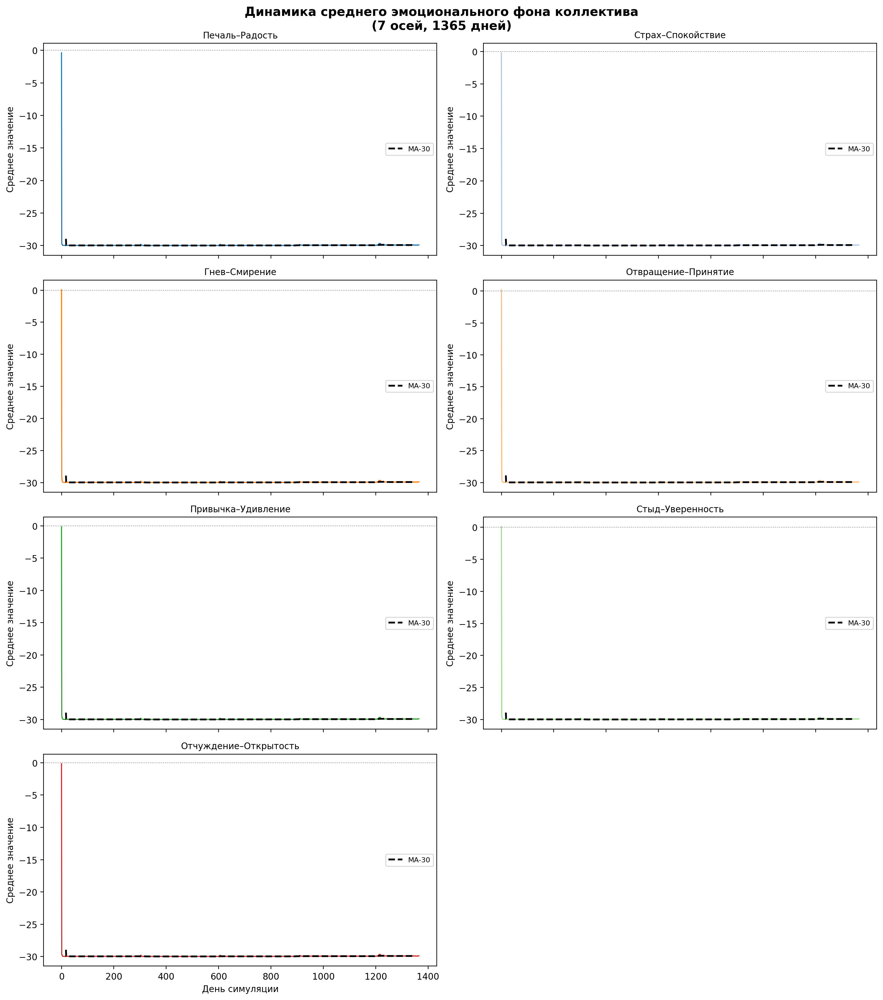
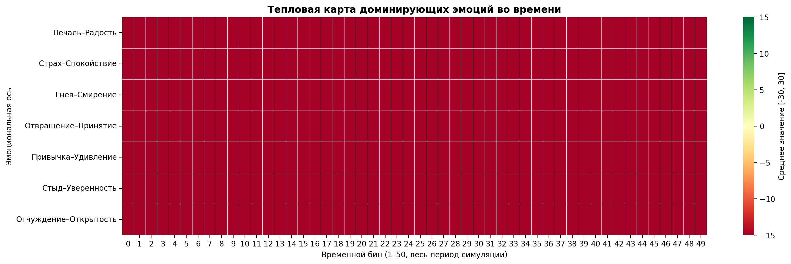
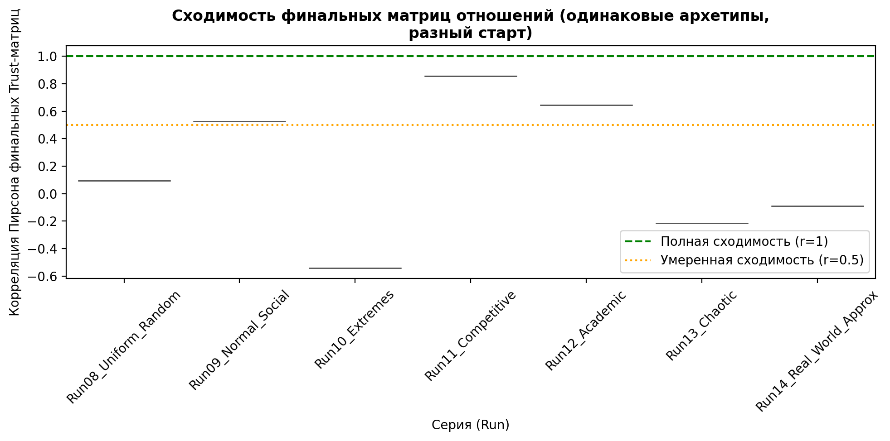

# Аналитический отчёт: Многоагентная симуляция социально-эмоциональных отношений

**Дата генерации:** 2026-05-19 01:34:40
**База данных:** ClickHouse (локальный)
**Объём данных:** 42 серии × 1365 дней, ~56 млрд строк отношений,
90 млн состояний агентов, 147 млн взаимодействий.

---


## 1. Базовые метрики взаимодействий

### 1a. Суммарные контакты по сценариям


*Суммарные контакты по сценариям*

### 1b. Мин/Среднее/Макс по группам


*Сравнение контактов по группам и типу инициализации*

| Группа        | Тип инициализации   |     Среднее |     Мин |    Макс |   N |
|:--------------|:--------------------|------------:|--------:|--------:|----:|
| heterogeneous | EMPTY               | 4.18783e+06 | 3635678 | 4738324 |   7 |
| heterogeneous | MIXED               | 3.21126e+06 | 3008302 | 3392602 |   7 |
| heterogeneous | RANDOM              | 3.083e+06   | 2848343 | 3284906 |   7 |
| homogeneous   | EMPTY               | 4.26896e+06 | 3514578 | 4988631 |   7 |
| homogeneous   | MIXED               | 3.25319e+06 | 2830748 | 3663899 |   7 |
| homogeneous   | RANDOM              | 3.12717e+06 | 2719554 | 3475253 |   7 |

### 1c. Нелинейность и активность


*Влияние нелинейности на общую активность*


## 2. Глубокий анализ отказов

**Общий процент отказов:** 28.03%

|   refusals |   successes |    failures |      total |
|-----------:|------------:|------------:|-----------:|
| 4.1464e+07 | 8.10415e+07 | 2.54143e+07 | 1.4792e+08 |

### 2a. Отказы по локациям


*Процент отказов по локациям*

| location   |   refusals |    total |   refusal_pct | location_ru       |
|:-----------|-----------:|---------:|--------------:|:------------------|
| BREAK      |   21214740 | 72606117 |         29.22 | Переменa (BREAK)  |
| CLASS      |   17986128 | 66830084 |         26.91 | Занятия (CLASS)   |
| GYM        |    2263172 |  8483615 |         26.68 | Физкультура (GYM) |

### 2b. Распределение отказов по агентам


*Кривая Лоренца: концентрация отказов*

- **ТОП-10% «мизантропов»** генерируют **13.7%** всех отказов.
- **ТОП-50%** генерируют **63.6%** всех отказов.
- Агентов, никогда не отказавших: **0** (0.0%).
- Коэффициент Джини неравенства отказов: **0.189**.

### 2c. Отказы по архетипам


*Процент отказов по архетипам агентов*

| archetype    |   refusals |    total |   refusal_pct |
|:-------------|-----------:|---------:|--------------:|
| Nihility     |    8464127 | 12245228 |         69.12 |
| Elation      |    8598272 | 18139457 |         47.4  |
| Enigmata     |    6134838 | 16240527 |         37.77 |
| Remembrance  |     630245 |  2889997 |         21.81 |
| Hunt         |    4249067 | 19790858 |         21.47 |
| Erudition    |    4287428 | 22113819 |         19.39 |
| Trailblaze   |     527517 |  3029906 |         17.41 |
| Preservation |    2903584 | 19690650 |         14.75 |
| Harmony      |    1481583 | 18757165 |          7.9  |


## 3. Анализ реляционных порогов


*Доля контактов при реляционных порогах по сценариям*

| scenario_name                  | init_type   |   soft_pct |   hard_pct |
|:-------------------------------|:------------|-----------:|-----------:|
| Run01_Erudition_EMPTY          | EMPTY       |     0      |   0        |
| Run01_Erudition_MIXED          | MIXED       |    56.6961 |   0.389659 |
| Run01_Erudition_RANDOM         | RANDOM      |    73.3404 |   0.55635  |
| Run02_Enigmata_EMPTY           | EMPTY       |     0      |   0        |
| Run02_Enigmata_MIXED           | MIXED       |    55.4482 |   0.282982 |
| Run02_Enigmata_RANDOM          | RANDOM      |    71.8735 |   0.386405 |
| Run03_Harmony_EMPTY            | EMPTY       |     0      |   0        |
| Run03_Harmony_MIXED            | MIXED       |    55.4778 |   0.490352 |
| Run03_Harmony_RANDOM           | RANDOM      |    71.0892 |   0.730768 |
| Run04_Hunt_EMPTY               | EMPTY       |     0      |   0        |
| Run04_Hunt_MIXED               | MIXED       |    55.3787 |   0.403292 |
| Run04_Hunt_RANDOM              | RANDOM      |    71.0238 |   0.588004 |
| Run05_Elation_EMPTY            | EMPTY       |     0      |   0        |
| Run05_Elation_MIXED            | MIXED       |    55.0183 |   0.311408 |
| Run05_Elation_RANDOM           | RANDOM      |    72.2308 |   0.464602 |
| Run06_Preservation_EMPTY       | EMPTY       |     0      |   0        |
| Run06_Preservation_MIXED       | MIXED       |    55.3792 |   0.469276 |
| Run06_Preservation_RANDOM      | RANDOM      |    70.8139 |   0.629049 |
| Run07_Nihility_EMPTY           | EMPTY       |     0      |   0        |
| Run07_Nihility_MIXED           | MIXED       |    52.5354 |   0.25119  |
| Run07_Nihility_RANDOM          | RANDOM      |    69.2633 |   0.302678 |
| Run08_Uniform_Random_EMPTY     | EMPTY       |     0      |   0        |
| Run08_Uniform_Random_MIXED     | MIXED       |    55.2329 |   0.357808 |
| Run08_Uniform_Random_RANDOM    | RANDOM      |    71.6919 |   0.48627  |
| Run09_Normal_Social_EMPTY      | EMPTY       |     0      |   0        |
| Run09_Normal_Social_MIXED      | MIXED       |    55.563  |   0.485404 |
| Run09_Normal_Social_RANDOM     | RANDOM      |    71.5024 |   0.627609 |
| Run10_Extremes_EMPTY           | EMPTY       |     0      |   0        |
| Run10_Extremes_MIXED           | MIXED       |    53.8862 |   0.279477 |
| Run10_Extremes_RANDOM          | RANDOM      |    71.5106 |   0.407852 |
| Run11_Competitive_EMPTY        | EMPTY       |     0      |   0        |
| Run11_Competitive_MIXED        | MIXED       |    55.4051 |   0.377968 |
| Run11_Competitive_RANDOM       | RANDOM      |    71.8713 |   0.512289 |
| Run12_Academic_EMPTY           | EMPTY       |     0      |   0        |
| Run12_Academic_MIXED           | MIXED       |    56.9374 |   0.489062 |
| Run12_Academic_RANDOM          | RANDOM      |    73.0401 |   0.595138 |
| Run13_Chaotic_EMPTY            | EMPTY       |     0      |   0        |
| Run13_Chaotic_MIXED            | MIXED       |    55.1679 |   0.285971 |
| Run13_Chaotic_RANDOM           | RANDOM      |    70.9855 |   0.393354 |
| Run14_Real_World_Approx_EMPTY  | EMPTY       |     0      |   0        |
| Run14_Real_World_Approx_MIXED  | MIXED       |    56.1264 |   0.45083  |
| Run14_Real_World_Approx_RANDOM | RANDOM      |    71.8497 |   0.612992 |

### Среднее по типам инициализации

|    | ('init_type', '')   |   ('soft_pct', 'mean') |   ('soft_pct', 'std') |   ('hard_pct', 'mean') |   ('hard_pct', 'std') |
|---:|:--------------------|-----------------------:|----------------------:|-----------------------:|----------------------:|
|  0 | EMPTY               |                 0      |              0        |               0        |             0         |
|  1 | MIXED               |                55.3038 |              1.08139  |               0.380334 |             0.0872467 |
|  2 | RANDOM              |                71.5776 |              0.991482 |               0.520954 |             0.11964   |


## 4. Стабильные пары


*Динамика стабильных пар по семестрам*

**Порог 90.0%:**
|   semester |   stable_pairs |
|-----------:|---------------:|
|          1 |              0 |
|          2 |              0 |
|          3 |              0 |
|          4 |              0 |
|          5 |              0 |
|          6 |              0 |
|          7 |              0 |
|          8 |              0 |

**Порог 95.0%:**
|   semester |   stable_pairs |
|-----------:|---------------:|
|          1 |              0 |
|          2 |              0 |
|          3 |              0 |
|          4 |              0 |
|          5 |              0 |
|          6 |              0 |
|          7 |              0 |
|          8 |              0 |

**Порог 99.5%:**
|   semester |   stable_pairs |
|-----------:|---------------:|
|          1 |              0 |
|          2 |              0 |
|          3 |              0 |
|          4 |              0 |
|          5 |              0 |
|          6 |              0 |
|          7 |              0 |
|          8 |              0 |

**Порог 100.0%:**
|   semester |   stable_pairs |
|-----------:|---------------:|
|          1 |              0 |
|          2 |              0 |
|          3 |              0 |
|          4 |              0 |
|          5 |              0 |
|          6 |              0 |
|          7 |              0 |
|          8 |              0 |


## 5. Эмоциональный фон коллектива


*Временные ряды эмоционального фона по 7 осям*


*Начало vs конец симуляции: сравнение эмоций*


*Тепловая карта эмоций во времени*

**Дрейф осей (|среднее последних 200 дней − первых 200 дней|):**
|                       |   Δ дрейф |
|:----------------------|----------:|
| Печаль–Радость        |  0.340827 |
| Страх–Спокойствие     |  0.338056 |
| Гнев–Смирение         |  0.349991 |
| Отвращение–Принятие   |  0.377161 |
| Привычка–Удивление    |  0.357553 |
| Стыд–Уверенность      |  0.378833 |
| Отчуждение–Открытость |  0.366805 |


## 6. Эффект «Выгорания лидера» (Popularity-Induced Burnout)


*Корреляция входящей популярности с эмоциональным состоянием лидеров*

- **Гнев–Смирение**: r = 0.142, p = 0.0000 (✅ значимо)

- **Страх–Спокойствие**: r = 0.141, p = 0.0000 (✅ значимо)

- **Печаль–Радость**: r = 0.141, p = 0.0000 (✅ значимо)


*Эмоциональная динамика: лидеры vs сообщество*


## 7. «Аттракторная сходимость» сетей (Topological Memory)


*Аттракторная сходимость: корреляция финальных матриц*

|       |   cosine_similarity |   pearson_r |
|:------|--------------------:|------------:|
| count |          21         |   7         |
| mean  |           0.0593185 |   0.181864  |
| std   |           0.228354  |   0.508255  |
| min   |          -0.231115  |  -0.542392  |
| 25%   |           0         |  -0.152485  |
| 50%   |           0         |   0.0943245 |
| 75%   |           0         |   0.585459  |
| max   |           0.837728  |   0.855167  |


## 8. Эмоциональные пузыри (Emotional Contagion & Clustering)


*Эмоциональная ассортативность: эго vs друзья*

|                       |         r |        p | significant   |
|:----------------------|----------:|---------:|:--------------|
| Печаль–Радость        | 0.0318539 | 0.199349 | False         |
| Страх–Спокойствие     | 0.0318539 | 0.199349 | False         |
| Гнев–Смирение         | 0.0318539 | 0.199349 | False         |
| Отвращение–Принятие   | 0.0318539 | 0.199349 | False         |
| Привычка–Удивление    | 0.0318539 | 0.199349 | False         |
| Стыд–Уверенность      | 0.0318539 | 0.199349 | False         |
| Отчуждение–Открытость | 0.0318539 | 0.199349 | False         |

**Интерпретация:** Положительный r означает, что агенты с определённым эмоциональным профилем
дружат с похожими агентами — подтверждая гипотезу об «эмоциональных пузырях».


> ⚠️ **Ошибка выполнения:** `Received ClickHouse exception, code: 241, server response: Code: 241. DB::Exception: (total) memory limit exceeded: would use 13.50 GiB (attempt to allocate chunk of 56.00 MiB), current RSS: 11.85 GiB, maximum: 13.50 GiB. OvercommitTracker decision: Query was selected to stop by OvercommitTracker: While executing FillingRightJoinSide. (MEMORY_LIMIT_EXCEEDED) (for url http://localhost:8123)`

```
Traceback (most recent call last):
  File "/home/georgiy/Documents/automata-simulation/scripts/research_analyzer.py", line 1167, in run_all
  File "/home/georgiy/Documents/automata-simulation/scripts/research_analyzer.py", line 1162, in <lambda>
  File "/home/georgiy/Documents/automata-simulation/scripts/research_analyzer.py", line 1073, in analyze_relational_halflife
            ax.set_ylabel("Среднее значение параметра при последнем контакте")
                        ^^^^^^^^^^^^^^^^^^^^^^^^^^^^^^^^^^^^^^^^^^^^^^^^^^^^^^
    ...<25 lines>...
        """).strip()
        ^
  File "/home/georgiy/Documents/automata-simulation/scripts/research_analyzer.py", line 129, in _q
    return self.client.query_df(sql)
           ~~~~~~~~~~~~~~~~~~~~^^^^^
  File "/home/georgiy/Documents/automata-simulation/venv/lib/python3.14/site-packages/clickhouse_connect/driver/client.py", line 582, in query_df
    return self._context_query(locals(), use_numpy=True, as_pandas=True).df_result
           ~~~~~~~~~~~~~~~~~~~^^^^^^^^^^^^^^^^^^^^^^^^^^^^^^^^^^^^^^^^^^
  File "/home/georgiy/Documents/automata-simulation/venv/lib/python3.14/site-packages/clickhouse_connect/driver/client.py", line 1238, in _context_query
    return self._query_with_context((self.create_query_context(**kwargs)))
           ~~~~~~~~~~~~~~~~~~~~~~~~^^^^^^^^^^^^^^^^^^^^^^^^^^^^^^^^^^^^^^^
  File "/home/georgiy/Documents/automata-simulation/venv/lib/python3.14/site-packages/clickhouse_connect/driver/httpclient.py", line 304, in _query_with_context
    response = self._raw_request(body,
                                 params,
    ...<3 lines>...
                                 fields=fields,
                                 server_wait=not context.streaming)
  File "/home/georgiy/Documents/automata-simulation/venv/lib/python3.14/site-packages/clickhouse_connect/driver/httpclient.py", line 571, in _raw_request
    self._error_handler(response)
    ~~~~~~~~~~~~~~~~~~~^^^^^^^^^^
  File "/home/georgiy/Documents/automata-simulation/venv/lib/python3.14/site-packages/clickhouse_connect/driver/httpclient.py", line 488, in _error_handler
    raise OperationalError(err_str) if retried else DatabaseError(err_str) from None
clickhouse_connect.driver.exceptions.DatabaseError: Received ClickHouse exception, code: 241, server response: Code: 241. DB::Exception: (total) memory limit exceeded: would use 13.50 GiB (attempt to allocate chunk of 56.00 MiB), current RSS: 11.85 GiB, maximum: 13.50 GiB. OvercommitTracker decision: Query was selected to stop by OvercommitTracker: While executing FillingRightJoinSide. (MEMORY_LIMIT_EXCEEDED) (for url http://localhost:8123)

```
