# Аналитический отчёт: Многоагентная симуляция социально-эмоциональных отношений

**Дата генерации:** 2026-05-20 07:56:45
**База данных:** ClickHouse (локальный)
**Объём данных:** 42 серии × 1365 дней, ~56 млрд строк отношений,
90 млн состояний агентов, 147 млн взаимодействий.

---

## 1. Базовые метрики взаимодействий

### 1a. Суммарные контакты по сценариям

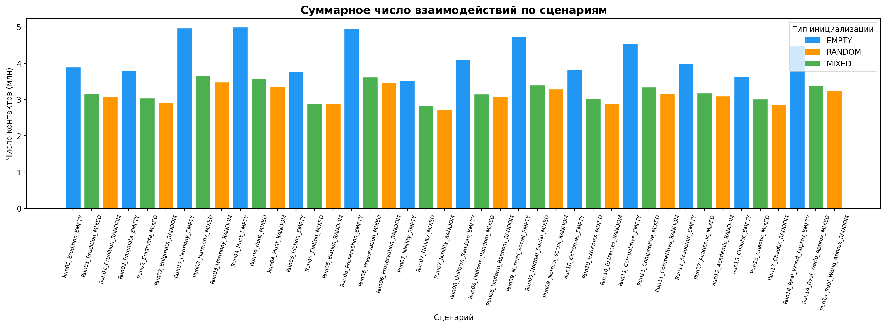
*Суммарные контакты по сценариям*

### 1b. Мин/Среднее/Макс по группам

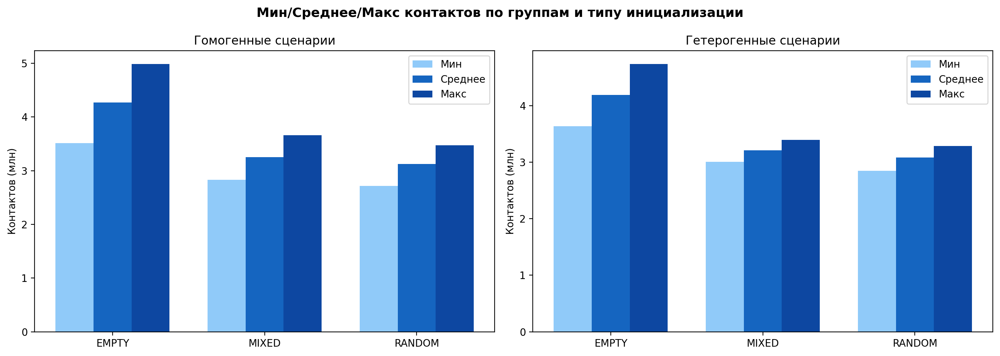
*Сравнение контактов по группам и типу инициализации*

| Группа        | Тип инициализации   |     Среднее |     Мин |    Макс |   N |
|:--------------|:--------------------|------------:|--------:|--------:|----:|
| heterogeneous | EMPTY               | 4.18783e+06 | 3635678 | 4738324 |   7 |
| heterogeneous | MIXED               | 3.21126e+06 | 3008302 | 3392602 |   7 |
| heterogeneous | RANDOM              | 3.083e+06   | 2848343 | 3284906 |   7 |
| homogeneous   | EMPTY               | 4.26896e+06 | 3514578 | 4988631 |   7 |
| homogeneous   | MIXED               | 3.25319e+06 | 2830748 | 3663899 |   7 |
| homogeneous   | RANDOM              | 3.12717e+06 | 2719554 | 3475253 |   7 |

### 1c. Нелинейность и активность

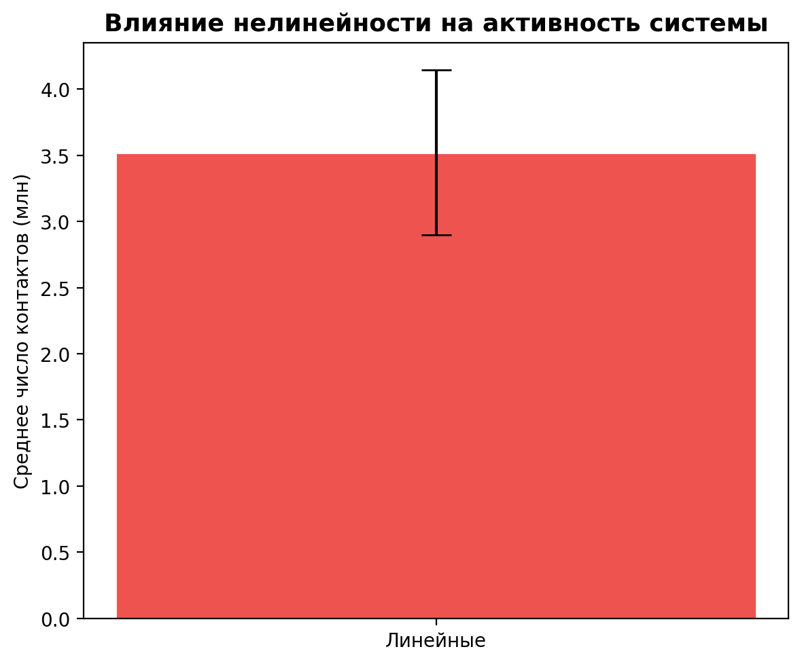
*Влияние нелинейности на общую активность*

## 2. Глубокий анализ отказов

**Общий процент отказов:** 28.03%

|   refusals |   successes |    failures |      total |
|-----------:|------------:|------------:|-----------:|
| 4.1464e+07 | 8.10415e+07 | 2.54143e+07 | 1.4792e+08 |

### 2a. Отказы по локациям

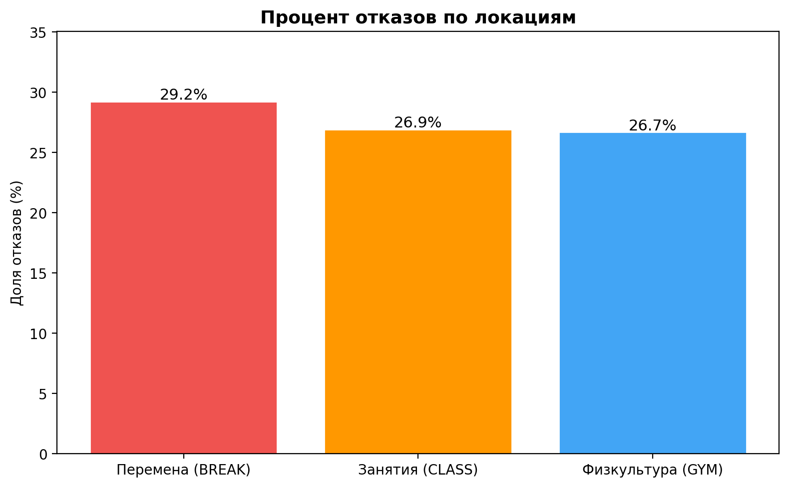
*Процент отказов по локациям*

| location   |   refusals |    total |   refusal_pct | location_ru       |
|:-----------|-----------:|---------:|--------------:|:------------------|
| BREAK      |   21214740 | 72606117 |         29.22 | Переменa (BREAK)  |
| CLASS      |   17986128 | 66830084 |         26.91 | Занятия (CLASS)   |
| GYM        |    2263172 |  8483615 |         26.68 | Физкультура (GYM) |

### 2b. Распределение отказов по агентам

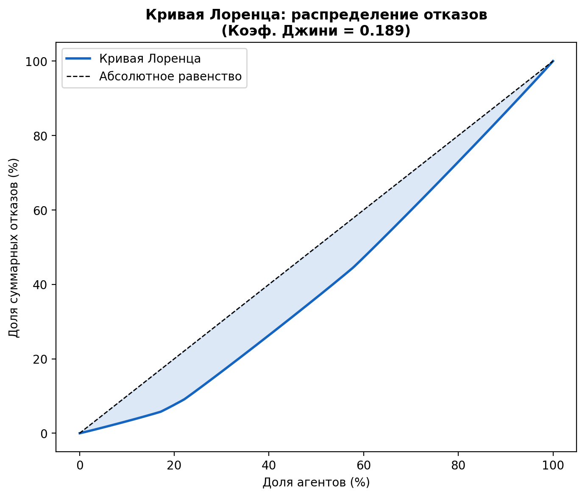
*Кривая Лоренца: концентрация отказов*

- **ТОП-10% «мизантропов»** генерируют **13.7%** всех отказов.
- **ТОП-50%** генерируют **63.6%** всех отказов.
- Агентов, никогда не отказавших: **0** (0.0%).
- Коэффициент Джини неравенства отказов: **0.189**.

### 2c. Отказы по архетипам

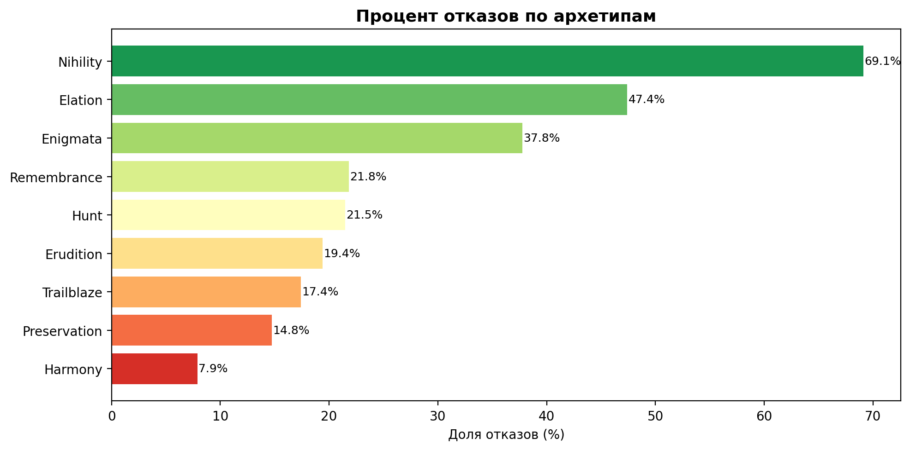
*Процент отказов по архетипам агентов*

| archetype    |   refusals |    total |   refusal_pct |
|:-------------|-----------:|---------:|--------------:|
| Nihility     |    8464127 | 12245228 |         69.12 |
| Elation      |    8598272 | 18139457 |         47.4  |
| Enigmata     |    6134838 | 16240527 |         37.77 |
| Remembrance  |     630245 |  2889997 |         21.81 |
| Hunt         |    4249067 | 19790858 |         21.47 |
| Erudition    |    4287428 | 22113819 |         19.39 |
| Trailblaze   |     527517 |  3029906 |         17.41 |
| Preservation |    2903584 | 19690650 |         14.75 |
| Harmony      |    1481583 | 18757165 |          7.9  |

## 3. Анализ реляционных порогов

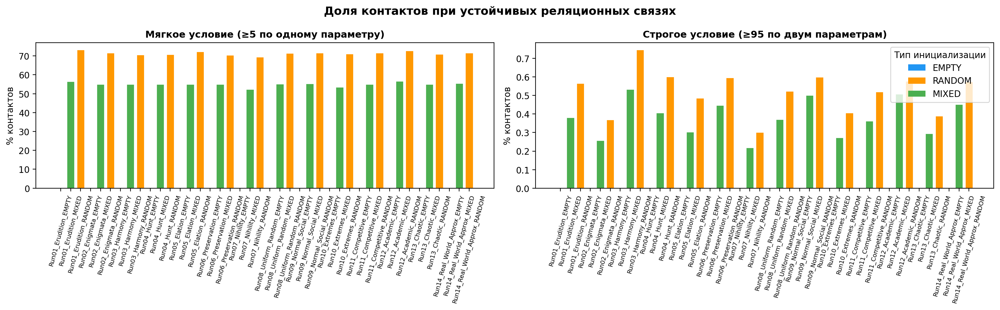
*Доля контактов при реляционных порогах по сценариям*

| scenario_name                  | init_type   |   soft_pct |   hard_pct |
|:-------------------------------|:------------|-----------:|-----------:|
| Run01_Erudition_EMPTY          | EMPTY       |    0       |   0        |
| Run01_Erudition_MIXED          | MIXED       |    9.11525 |   0.346842 |
| Run01_Erudition_RANDOM         | RANDOM      |   12.5167  |   0.569934 |
| Run02_Enigmata_EMPTY           | EMPTY       |    0       |   0        |
| Run02_Enigmata_MIXED           | MIXED       |    7.25222 |   0.255182 |
| Run02_Enigmata_RANDOM          | RANDOM      |    9.84885 |   0.383553 |
| Run03_Harmony_EMPTY            | EMPTY       |    0       |   0        |
| Run03_Harmony_MIXED            | MIXED       |    9.6422  |   0.557684 |
| Run03_Harmony_RANDOM           | RANDOM      |   13.3632  |   0.755828 |
| Run04_Hunt_EMPTY               | EMPTY       |    0       |   0        |
| Run04_Hunt_MIXED               | MIXED       |    8.665   |   0.391082 |
| Run04_Hunt_RANDOM              | RANDOM      |   11.6502  |   0.629666 |
| Run05_Elation_EMPTY            | EMPTY       |    0       |   0        |
| Run05_Elation_MIXED            | MIXED       |    8.11875 |   0.295227 |
| Run05_Elation_RANDOM           | RANDOM      |   10.4499  |   0.476508 |
| Run06_Preservation_EMPTY       | EMPTY       |    0       |   0        |
| Run06_Preservation_MIXED       | MIXED       |    8.94085 |   0.472387 |
| Run06_Preservation_RANDOM      | RANDOM      |   12.0177  |   0.58239  |
| Run07_Nihility_EMPTY           | EMPTY       |    0       |   0        |
| Run07_Nihility_MIXED           | MIXED       |    6.14439 |   0.258676 |
| Run07_Nihility_RANDOM          | RANDOM      |    7.80815 |   0.288923 |
| Run08_Uniform_Random_EMPTY     | EMPTY       |    0       |   0        |
| Run08_Uniform_Random_MIXED     | MIXED       |    8.45633 |   0.408636 |
| Run08_Uniform_Random_RANDOM    | RANDOM      |   11.4765  |   0.533575 |
| Run09_Normal_Social_EMPTY      | EMPTY       |    0       |   0        |
| Run09_Normal_Social_MIXED      | MIXED       |    9.3565  |   0.550052 |
| Run09_Normal_Social_RANDOM     | RANDOM      |   12.4398  |   0.617996 |
| Run10_Extremes_EMPTY           | EMPTY       |    0       |   0        |
| Run10_Extremes_MIXED           | MIXED       |    7.10685 |   0.274068 |
| Run10_Extremes_RANDOM          | RANDOM      |    9.63318 |   0.41242  |
| Run11_Competitive_EMPTY        | EMPTY       |    0       |   0        |
| Run11_Competitive_MIXED        | MIXED       |    7.93129 |   0.345833 |
| Run11_Competitive_RANDOM       | RANDOM      |   10.7577  |   0.57554  |
| Run12_Academic_EMPTY           | EMPTY       |    0       |   0        |
| Run12_Academic_MIXED           | MIXED       |    9.45481 |   0.485015 |
| Run12_Academic_RANDOM          | RANDOM      |   11.932   |   0.594596 |
| Run13_Chaotic_EMPTY            | EMPTY       |    0       |   0        |
| Run13_Chaotic_MIXED            | MIXED       |    7.37778 |   0.307937 |
| Run13_Chaotic_RANDOM           | RANDOM      |   10.2345  |   0.356779 |
| Run14_Real_World_Approx_EMPTY  | EMPTY       |    0       |   0        |
| Run14_Real_World_Approx_MIXED  | MIXED       |    8.85734 |   0.507099 |
| Run14_Real_World_Approx_RANDOM | RANDOM      |   11.7323  |   0.581155 |

### Среднее по типам инициализации

|    | ('init_type', '')   |   ('soft_pct', 'mean') |   ('soft_pct', 'std') |   ('hard_pct', 'mean') |   ('hard_pct', 'std') |
|---:|:--------------------|-----------------------:|----------------------:|-----------------------:|----------------------:|
|  0 | EMPTY               |                0       |               0       |               0        |              0        |
|  1 | MIXED               |                8.31568 |               1.03696 |               0.389694 |              0.108131 |
|  2 | RANDOM              |               11.1329  |               1.44461 |               0.525633 |              0.126455 |

## 4. Стабильные пары

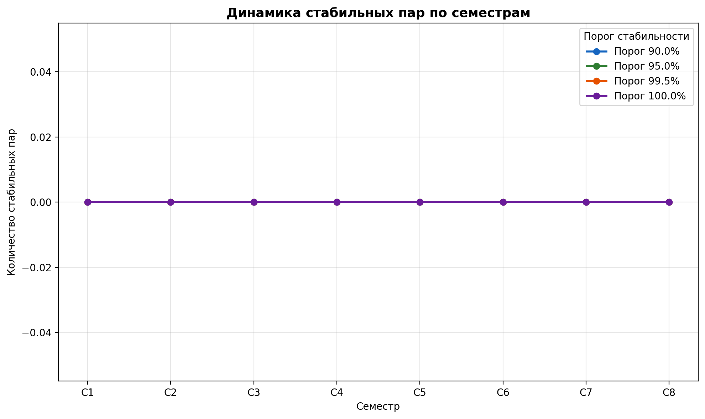
*Динамика стабильных пар по семестрам*

**Порог 90.0%:**
|   semester |   stable_pairs |
|-----------:|---------------:|
|          1 |              0 |
|          2 |              1 |
|          3 |              0 |
|          4 |             14 |
|          5 |              0 |
|          6 |             77 |
|          7 |              0 |
|          8 |              0 |

**Порог 95.0%:**
|   semester |   stable_pairs |
|-----------:|---------------:|
|          1 |              0 |
|          2 |              1 |
|          3 |              0 |
|          4 |             14 |
|          5 |              0 |
|          6 |             77 |
|          7 |              0 |
|          8 |              0 |

**Порог 99.5%:**
|   semester |   stable_pairs |
|-----------:|---------------:|
|          1 |              0 |
|          2 |              1 |
|          3 |              0 |
|          4 |             14 |
|          5 |              0 |
|          6 |             77 |
|          7 |              0 |
|          8 |              0 |

**Порог 100.0%:**
|   semester |   stable_pairs |
|-----------:|---------------:|
|          1 |              0 |
|          2 |              1 |
|          3 |              0 |
|          4 |             14 |
|          5 |              0 |
|          6 |             77 |
|          7 |              0 |
|          8 |              0 |

## 5. Эмоциональный фон коллектива

*Временные ряды эмоционального фона по 7 осям*

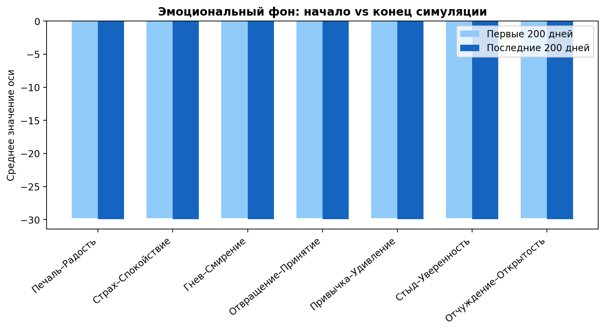
*Начало vs конец симуляции: сравнение эмоций*

*Тепловая карта эмоций во времени*

**Дрейф осей (|среднее последних 200 дней − первых 200 дней|):**
|                       |   Δ дрейф |
|:----------------------|----------:|
| Печаль–Радость        |  1.04973  |
| Страх–Спокойствие     |  0.825353 |
| Гнев–Смирение         |  0.872971 |
| Отвращение–Принятие   |  0.823142 |
| Привычка–Удивление    |  0.873227 |
| Стыд–Уверенность      |  0.877278 |
| Отчуждение–Открытость |  0.825016 |

## 6. Эффект «Выгорания лидера» (Popularity-Induced Burnout)

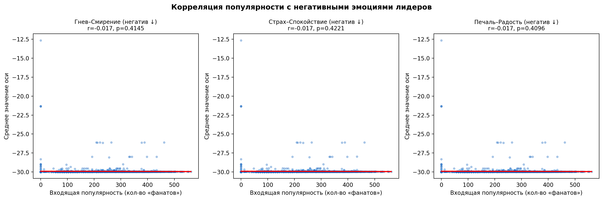
*Корреляция входящей популярности с эмоциональным состоянием лидеров*

- **Гнев–Смирение**: r = 0.025, p = 0.2306 (❌ незначимо)

- **Страх–Спокойствие**: r = 0.025, p = 0.2263 (❌ незначимо)

- **Печаль–Радость**: r = 0.024, p = 0.2457 (❌ незначимо)

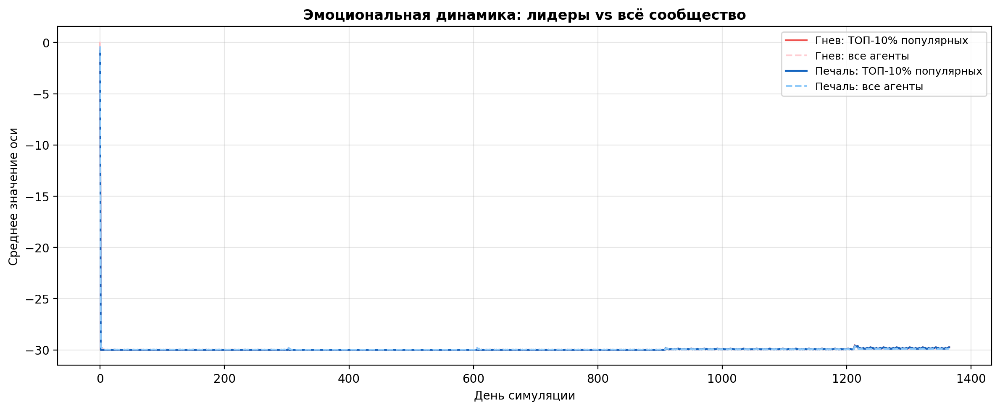
*Эмоциональная динамика: лидеры vs сообщество*

## 7. «Аттракторная сходимость» сетей (Topological Memory)

*Аттракторная сходимость: корреляция финальных матриц*

|       |   cosine_similarity |   pearson_r |
|:------|--------------------:|------------:|
| count |          21         |   7         |
| mean  |           0.0593185 |   0.181864  |
| std   |           0.228354  |   0.508255  |
| min   |          -0.231115  |  -0.542392  |
| 25%   |           0         |  -0.152485  |
| 50%   |           0         |   0.0943245 |
| 75%   |           0         |   0.585459  |
| max   |           0.837728  |   0.855167  |

## 8. Эмоциональные пузыри (Emotional Contagion & Clustering)

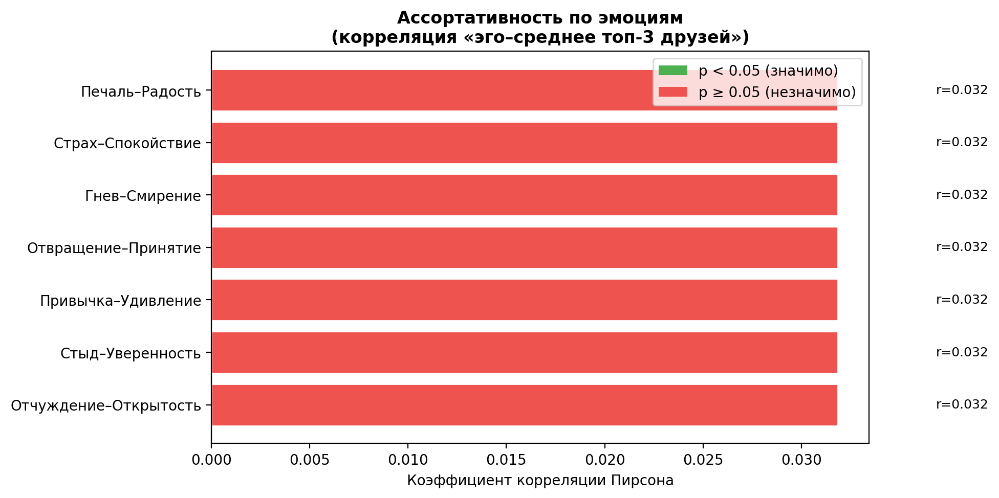
*Эмоциональная ассортативность: эго vs друзья*

|                       |          r |         p | significant   |
|:----------------------|-----------:|----------:|:--------------|
| Печаль–Радость        | -0.0485644 | 0.0539101 | False         |
| Страх–Спокойствие     | -0.0485644 | 0.0539101 | False         |
| Гнев–Смирение         | -0.0485644 | 0.0539101 | False         |
| Отвращение–Принятие   | -0.0485644 | 0.0539101 | False         |
| Привычка–Удивление    | -0.0485644 | 0.0539101 | False         |
| Стыд–Уверенность      | -0.0485644 | 0.0539101 | False         |
| Отчуждение–Открытость | -0.0485644 | 0.0539101 | False         |

**Интерпретация:** Положительный r означает, что агенты с определённым эмоциональным профилем
дружат с похожими агентами — подтверждая гипотезу об «эмоциональных пузырях».

## 9. Скорость полураспада отношений (Relational Half-Life by Archetype)

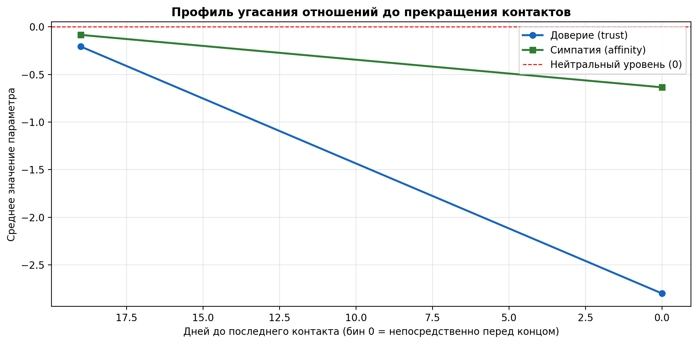
*Профиль угасания отношений перед прекращением контактов*

*Уровень отношений при распаде пары по архетипам*

| archetype    |   avg_trust_at_end |   avg_affinity_at_end |   pairs_count |
|:-------------|-------------------:|----------------------:|--------------:|
| Hunt         |            6.64774 |               5.70645 |          1550 |
| Remembrance  |            6.72561 |               5.60052 |          1527 |
| Enigmata     |            7.06151 |               4.30886 |          1512 |
| Preservation |            7.71744 |               4.91041 |          1451 |
| Erudition    |            7.71809 |               5.04388 |          1504 |
| Harmony      |            8.04052 |               2.58362 |          1160 |
| Nihility     |            8.23487 |               4.3202  |          1371 |
| Trailblaze   |            9.5167  |               4.41507 |          1407 |
| Elation      |            9.55193 |               3.52077 |          1348 |
